# cadsim

工場のライン設備を 3D で組み立てて、部品どうしがぶつからないかを確かめるためのツールです。
STEP などの CAD データを読み込み、部品を動かしながら干渉や距離をその場で確認できます。

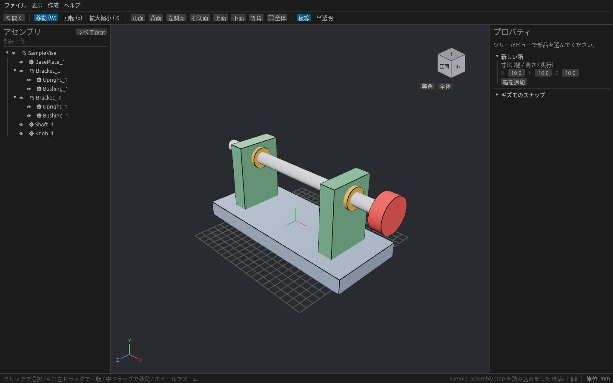

画面ごとの詳しい使い方は [操作マニュアル](docs/src/introduction.md)(画像付き)にまとめています。

## はじめかた

### ダウンロードして使う(Windows / Mac)

[Releases](https://github.com/T-T0821/cadsim/releases) の最新版から、自分の OS 用のファイルを取ってください。

インストールは要りません。ダウンロードしたものを開くだけで起動し、フォントやサンプルも中に入っています。

| OS | ファイル | 起動のしかた |
| --- | --- | --- |
| Windows 10 / 11 (64bit) | `cadsim-<版>-windows-x86_64.exe` | ダウンロードした exe をそのままダブルクリック(好きな場所に置いて使えます) |
| 〃(zip 版) | `cadsim-<版>-windows-x86_64.zip` | 展開して `cad_proto.exe` をダブルクリック。中身は上の exe と README |
| macOS 11 以降(Apple Silicon / Intel) | `cadsim-<版>-macos-universal.zip` | ダブルクリックで展開して `CAD Prototype.app` を開く(「アプリケーション」に移すとほかのアプリと同じように使えます) |

やめるときは、ダウンロードしたファイル(Mac は `.app`)を削除するだけです(見た目などの設定は小さなファイルとして残ります。場所は「開発する人へ」の資料を見てください)。

署名をしていないため、初回は警告が出ます。

- **Windows**: 「WindowsによってPCが保護されました」と出たら「詳細情報」→「実行」。
- **Mac**: 「開発元を検証できない」「開けません」と出たら、アプリを右クリック →「開く」→「開く」。macOS 15 以降でこの方法が出ないときは、一度開こうとしたあと「システム設定」→「プライバシーとセキュリティ」の下のほうにある「このまま開く」を押します。それでも開けないときは、ターミナルで `xattr -dr com.apple.quarantine "/Applications/CAD Prototype.app"`(置いた場所に合わせて変えてください)を実行してから開いてください。

### ソースから動かす

[Rust](https://www.rust-lang.org/ja/tools/install) を入れてから、このフォルダで次を実行します。

```sh
cargo run                         # サンプルのアセンブリを開いて起動
cargo run -- path/to/part.step    # STEP ファイルを開いて起動
cargo run -- path/to/line.cadsim  # 保存したプロジェクトを開いて起動
cargo run --release -- --stress 5000  # 部品 5000 個ほどの負荷テスト用シーンを開いて起動
cargo run --release -- --physics      # 物理演算のサンプルライン(ワーク 100 個)を開いて流し始める
```

初回はビルドに数分かかります。Linux では先に `libasound2-dev libudev-dev libwayland-dev libxkbcommon-dev` を入れてください。

## 基本の流れ

1. **データを開く。** 「ファイル → 開く」(Ctrl+O)か、ファイルをウィンドウにドラッグ&ドロップします。
2. **部品を選ぶ。** 3D ビューで部品をクリックするか、左のアセンブリツリーで行をクリックします。
3. **動かす。** W(移動)/ E(回転)/ R(拡大縮小)でギズモを出し、矢印や輪をドラッグします。右のプロパティに数値を打ち込んでも動かせます。
4. **ぶつかりを確かめる。** 動かすたびに干渉が自動で調べられ、ぶつかった部品は赤くなります。
5. **保存する。** 「ファイル → 保存」(Ctrl+S)で `.cadsim` ファイルに保存します。次回は「開く」でそのまま続きから作業できます。

まちがえたら Ctrl+Z で元に戻せます(やり直しは Ctrl+Y)。

## 画面の見かた

| 場所 | 内容 |
| --- | --- |
| 上 | メニューとツールバー(開く・保存・標準ビュー・透視 / 平行・箱の追加など) |
| 左 | アセンブリツリー。クリックで選択、ダブルクリックで拡大表示、👁 で表示 / 非表示、右クリックで「これだけ表示」「削除」 |
| 右 | プロパティ。名前・色・位置・回転・寸法の確認と編集、体積や面積など |
| 中央 | 3D ビュー。右上のビューキューブの面をクリックするとその向きから見られます |
| 3D ビュー左上 | シミュレーションパネル。干渉・接触・近接の一覧と計測結果 |
| 3D ビュー下 | 平面図・点群パネル(平面図か点群を読み込んだときだけ)。縮尺合わせ・位置合わせ・点群との干渉 |
| 3D ビュー左下 | 安全パネル。安全機器の配置、停止とリセット、柵の距離の確認 |
| 3D ビュー右上 | 作業者・AGV パネル。作業者の手順、AGV の経路と台数の比較 |
| 3D ビュー左下(安全パネルの右) | 物理演算パネル。開始・停止、ケーブル・ホースの一覧 |
| 浮いたウィンドウ | 「ライン」メニューから開く工程シミュレーションとライン連携 |
| 下 | ステータスバー(読み込みの進み具合やお知らせ) |

| アセンブリを選択 | 部品をクリック |
| --- | --- |
| 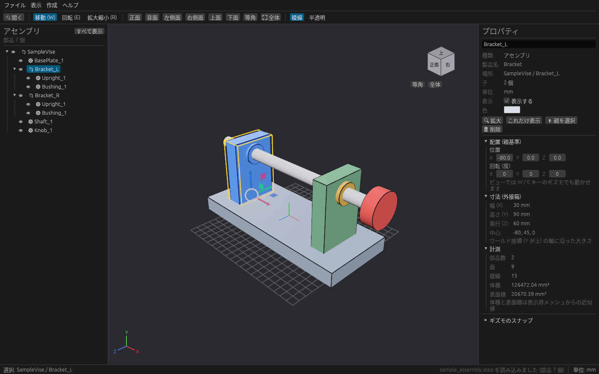 | 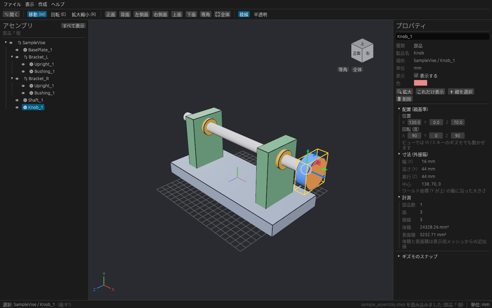 |

アセンブリを選ぶと中の部品がすべて青くなり、クリックした面はオレンジになります。

## マウスとキーの操作

マウスは Unity / Unreal Engine のシーンビューと同じ割り当てです。操作の一覧は「ヘルプ」メニューでも見られます。

### 見る

| 操作 | 内容 |
| --- | --- |
| Alt + 左ドラッグ | 回転(注視点のまわりを回る) |
| 中ドラッグ | 平行移動 |
| ホイール / Alt + 右ドラッグ | ズーム |
| 右ドラッグ | その場で見回す |
| 右ボタンを押しながら W / A / S / D / Q / E | 前後左右・上下に移動(Shift で速く) |
| F / Home | 選択を拡大 / 全体を表示 |
| 1 / 3 / 7 / 0 | 正面 / 右側面 / 上面 / 等角(Ctrl を押すと反対側) |
| 5 | 透視投影と平行投影を切り替え |
| H / Alt + H | 選択を隠す / すべて表示 |

### 選ぶ・動かす

| 操作 | 内容 |
| --- | --- |
| 左クリック | 部品を選ぶ。何もない所で選択を解除 |
| W / E / R | 移動 / 回転 / 拡大縮小のギズモ。軸や輪を左ドラッグ |
| Ctrl + ギズモをドラッグ | 一定量ずつ動かす(移動 0.1・回転 15°・寸法 0.1。プロパティの「ギズモのスナップ」で変更) |
| M | 距離を測る。部品の表面を2回クリック(頂点の近くは頂点に吸い付く) |
| Delete | 選択を削除 |
| Esc | 選択を解除(計測中・寸法を置いている間・平面図の縮尺合わせ中は、1点目の取り消し → もう一度押すと道具をやめる) |

拡大縮小のギズモは箱だけに使えます。読み込んだ部品は移動と回転だけです。

### ファイルと編集

| 操作 | 内容 |
| --- | --- |
| Ctrl + N | 新規プロジェクト |
| Ctrl + O | 開く |
| Ctrl + S / Ctrl + Shift + S | 保存 / 名前を付けて保存 |
| Ctrl + Z | 元に戻す |
| Ctrl + Y / Ctrl + Shift + Z | やり直し |

## できること

### ファイルを開く・書き出す

「ファイル → 開く」で、`.cadsim` はプロジェクトとして開き直し、それ以外の形式は今のプロジェクトに追加で取り込みます。
「ファイル → 書き出し」では、全体か選んだアセンブリを別の形式で保存できます(保存ダイアログで選んだ拡張子の形式になります)。

| 形式 | 読み込み | 書き出し | 引き継がれるもの |
| --- | --- | --- | --- |
| STEP(.step / .stp) | ○ | | 部品の構成・配置・色・単位 |
| glTF / GLB | ○ | ○ | 階層・名前・色・アニメーション |
| OpenUSD(.usda / .usdc / .usdz / .usd) | ○ | ○ | 階層・名前・色・アニメーション(タイミングチャートの動きも)。Omniverse でそのまま再生できます |
| OBJ | ○ | ○ | 部品ごとの形状と色 |
| STL | ○ | ○ | 形状だけ |
| 図面(.pdf / .dxf) | | ○ | 上面図・正面図と寸法([下記](#図面と部品表を書き出す)) |
| 部品表(.xlsx / .csv) | | ○ | 部品の一覧と数量([下記](#図面と部品表を書き出す)) |
| Web ビューア(.html) | | ○ | 階層・名前・色・アニメーション。cadsim が無い人がブラウザ・スマホ・VR で見られます([下記](#ブラウザやスマホで見てもらうvr-で実寸で見る)) |

SOLIDWORKS・Inventor・CATIA・NX・Creo などの CAD 独自のファイルは直接開けません。CAD で STEP(AP214 / AP242)に書き出してから開いてください。CAD ごとの書き出しかたは [操作マニュアル](docs/src/step-export.md) にあります。
平面図(DXF / PDF / 画像)と点群(PLY / LAS / E57)も「開く」で読み込めます([下記](#平面図を床に敷く))。

OBJ と STL には単位がないので、「ファイル → OBJ / STL の単位」で mm / cm / m / inch と上向きの軸を選んでから読み書きしてください(既定は mm・Y 軸が上)。
アニメーション付きのファイルを開くと、ビューの下に「アニメーション」パネルが出て、再生・停止と、好きな時刻への移動ができます。
タイミングチャートに動きがあるときは、その1サイクルも glTF / GLB・OpenUSD・Web ビューアにアニメーションとして書き出されます(秒間 30 キー)。

| glTF のアニメーションを再生 | 書き出しメニュー |
| --- | --- |
|  | 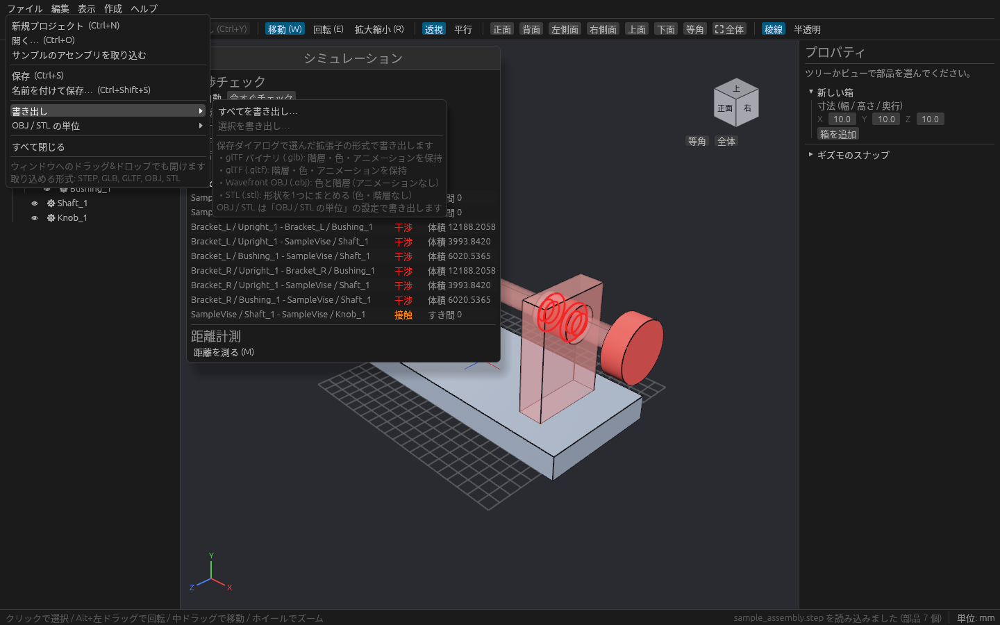 |

### ブラウザやスマホで見てもらう・VR で実寸で見る

「ファイル → 書き出し → すべてを書き出し…」で保存先の拡張子を `.html` にすると、モデルとアニメーションを1つの HTML ファイルにまとめて書き出します。
メールやチャットで送れば、cadsim を入れていない人もブラウザで開くだけで見られます。インターネットにつながっていなくても表示できます。

| PC のブラウザ | スマホ |
| --- | --- |
|  | 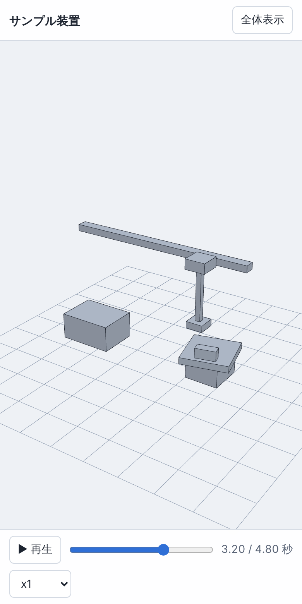 |

| 操作(PC) | 操作(スマホ) | 内容 |
| --- | --- | --- |
| 左ドラッグ | 1本指でドラッグ | 回転 |
| 右ドラッグ / Shift + ドラッグ | 2本指でドラッグ | 平行移動 |
| ホイール | ピンチ | 拡大・縮小 |
| クリック | タップ | 部品を選んで名前を表示 |
| ダブルクリック / 「全体表示」 | 「全体表示」 | 全体が見える向きに戻す |

アニメーションがあれば下に再生バーが出て、再生・停止、好きな時刻への移動、速度の切り替えができます。

**VR で実寸で見る。** VR に対応したブラウザ(Meta Quest のブラウザ、PC VR を Chrome / Edge で使う場合など)で開くと「VR で見る」ボタンが出ます。押すとモデルが実寸(1 m = 1 m)で床の上に置かれ、手前の端が 1 m 先に来ます。
左スティックで見ている方向へ歩き、右スティックを左右に倒すと 30° ずつ向きが変わります。設備の間を歩いて、作業のしやすさやメンテナンスの空間を確かめられます。
AR に対応した端末では「AR で置く」ボタンも出て、カメラの映像の上に実寸で置けます。

cadsim から直接見るときは「ファイル → 書き出し → ブラウザ / VR で見る」を押すと、いまのモデル全体を書き出して既定のブラウザで開きます。PC につないだ VR ヘッドセットで見るときはここから「VR で見る」を押してください。

### 設計変更後の形状に差し替える

取り込んだアセンブリの設計が変わったら、動きの設定を付け直さずに形状だけを新しい版に入れ替えられます。

1. ツリーかビューで、差し替えたいアセンブリ(または部品)を選ぶ
2. 「編集 → 形状を差し替え…」で、新しい版の STEP などのファイルを選ぶ

部品は名前とツリーの構成で対応づけます。名前が変わっていても、ほかに同じ製品名の部品がなければ対応がつきます。
対応がついた部品は形状と配置だけが新しくなり、タイミングチャートのアクチュエータなどの設定はそのまま残ります。アセンブリ全体の置き場所も変わりません。
終わると結果のウィンドウが出て、新しい版に見つからなかった部品(古い形状のまま残します)と、新しく加わった部品を一覧で確かめられます。名前をクリックするとその部品を選びます。
差し替えは Ctrl + Z で元に戻せます。

### 箱を作る

「作成 → 箱を追加」で箱を置けます。右のプロパティで寸法・位置・回転を数値で変えられ、R キーのギズモで寸法を引き伸ばすこともできます。
ちょっとした治具や仮の設備を置いて、ぶつからないかを確かめるのに使えます。

### 円柱・押し出し・穴・ブーリアン

「作成」メニューの「円柱を追加…」「押し出しで追加…」「穴をあける…」「ブーリアン (和・差・積)…」で **モデリング** の画面が開きます。

| タブ | すること |
| --- | --- |
| 円柱 | 半径と高さを入れて「円柱を追加」 |
| 押し出し | 上から見た形の頂点を `0,0; 400,0; 400,200` のように並べ、高さを入れて「押し出して追加」 |
| 穴あけ | 部品を選び、中心(入口)・向き(X / Y / Z)・直径・深さ(0 で貫通)を入れて「穴をあける」 |
| ブーリアン | 1つ目の部品を選び、2つ目の部品と 和 / 差 / 積 を選んで「演算する」。結果は1つ目に入り、2つ目は消えます |

穴あけとブーリアンは、箱とこの画面で作った部品に使えます。どれも Ctrl+Z で戻せます。詳しくは [操作マニュアル](docs/src/modeling.md) を見てください。

### 表示を切り替える

ツールバーとメニューの「表示」で、稜線・グリッド・選択の外接箱・選択以外を半透明、を切り替えられます。
部品の色はプロパティの「色」で変えられます。

「表示 → 画面上で小さい部品を簡略表示」がオン(既定)のときは、遠くて小さく見える部品を粗い形で描き、ごく小さい部品は省きます。選んだ部品はいつも細かく描きます。どのくらい小さければ簡略にするかも同じメニューで変えられます。

| 上面ビュー + 選択以外を半透明 | 大きなアセンブリ(公開サンプル as1) |
| --- | --- |
| 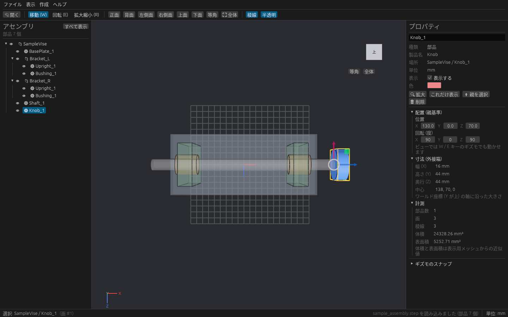 | 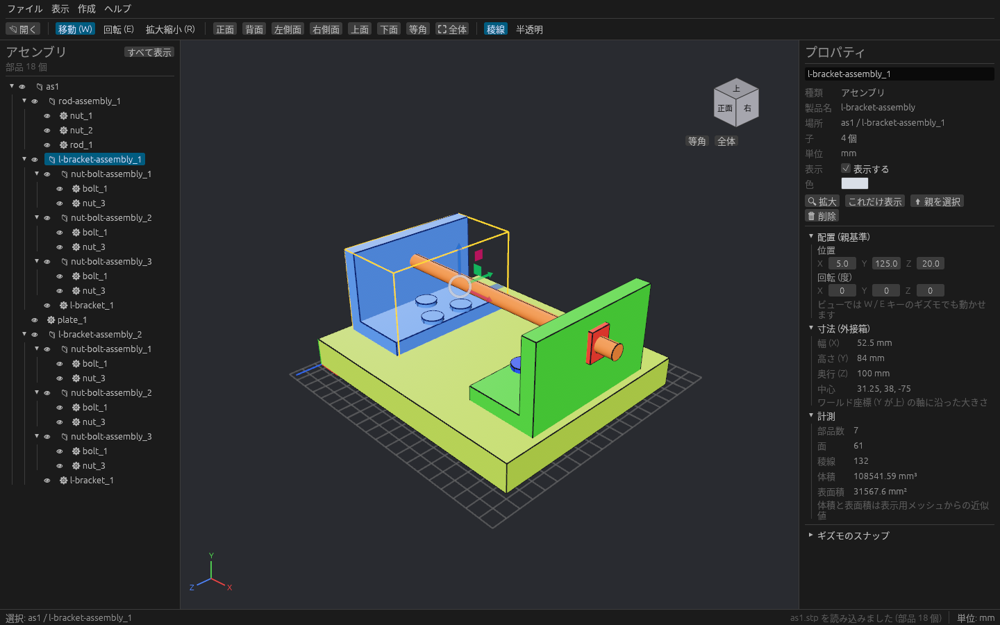 |

### 大きなアセンブリを扱う

数千〜1万部品のアセンブリでも、回転・ズーム・クリック選択・ツリーの操作が重くならないようにしています。

- ステータスバーの右に FPS(1秒あたりの描画回数)と、いま描いている三角形の数が出ます。三角形の数にカーソルを乗せると、細かく描いている部品・簡略に描いている部品・小さくて省いた部品・画面の外の部品の数が出ます。
- 重いと感じたら「表示」メニューで簡略表示のしきい値を上げるか、稜線を消してください。
- 試すときは「ファイル → 負荷テスト用シーンを開く」で、1000 / 5000 / 10000 部品の設備の並びを開けます。

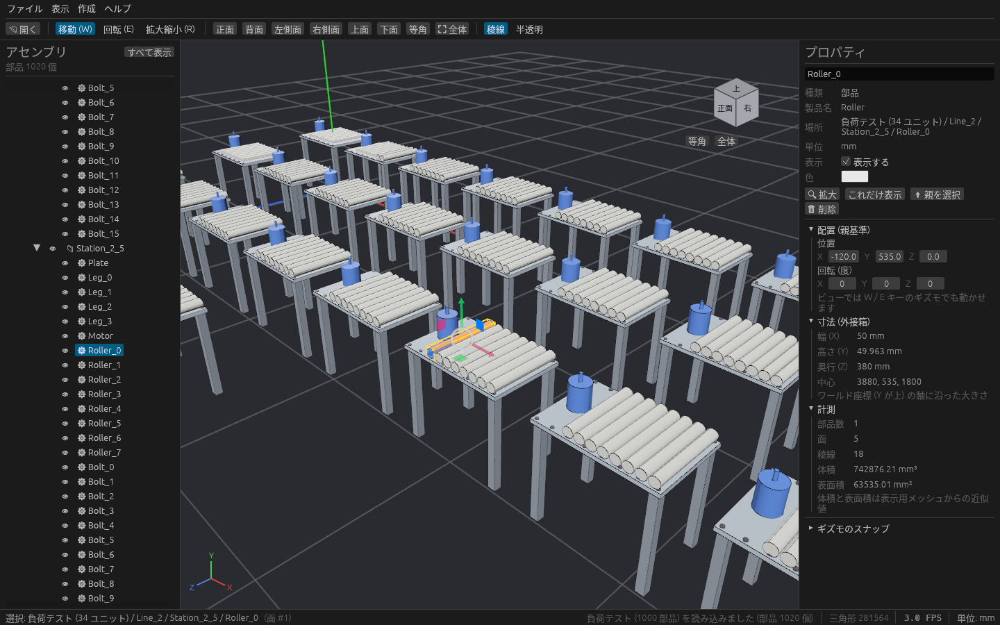

#### 小さな穴とフィレットを省略する

「表示 → 小さな穴とフィレットを省略」をオンにすると、STEP で読み込んだ部品の小さな穴を埋め、角の丸み(フィレット)を尖った角にして描きます。ボルト穴や丸みの多い部品が並ぶアセンブリで、描く三角形が大きく減ります。

- 消す大きさは、その下の「穴の直径」「フィレットの半径」のスライダーで決めます(モデルの単位)。
- 計算は部品の形ごとに裏で行い、できたものから表示が変わります。メニューに計算の進み具合と、省略した穴・フィレットの数が出ます。
- 干渉チェックは元の形のまま行います。クリックでの選択や距離計測は、表示している形に当たります。
- glTF / OBJ / STL などメッシュで読み込んだ部品と、ここで作った箱は変わりません。

| オフ | オン(穴 4 個とフィレット 4 個を省略、三角形 3654 → 1558) |
| --- | --- |
|  |  |

### 干渉チェックと距離計測

部品を動かすたびに、表示中のすべての部品の組み合わせを自動で調べます。

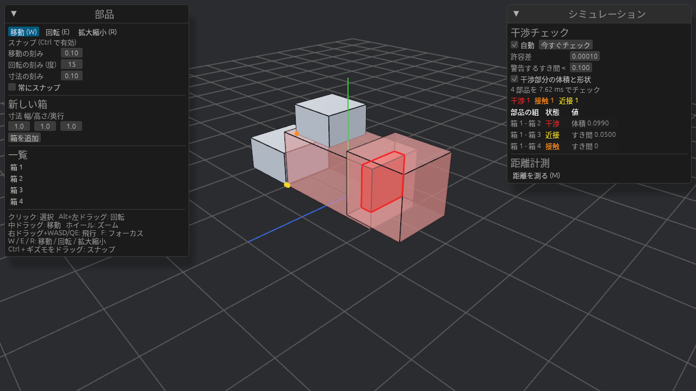

| 見え方 | 意味 |
| --- | --- |
| 半透明の赤い部品と濃い赤の立体 | 干渉(食い込み)。濃い赤が重なっている部分で、体積をパネルに表示 |
| 赤い太線 | 干渉している面どうしの交わる線 |
| 橙の線 | 接触(触れているだけ) |
| 黄の線 | 近接(すき間が警告値より小さい)。すき間の値をパネルに表示 |
| 水色の線とラベル | 距離計測の結果(距離と X / Y / Z の差) |

どこまでを「接触」「近接」とみなすかは、シミュレーションパネルの許容差と警告値で変えられます。

### 図面と部品表を書き出す

「ファイル → 書き出し → 図面 (PDF / DXF)…」で、表示中の設備を A3 横の図面にします。上面図・正面図、かくれ線、全体寸法、設備どうしの間隔寸法、設備名の有無を選んで、PDF か DXF で保存します。尺度は用紙に収まるよう自動で選ばれます。


「ファイル → 書き出し → 部品表 (Excel / CSV)…」で、同じ部品をまとめて数えた部品表(品名・取り込み元・寸法・数量・体積・使用箇所)を書き出します。Excel にはアセンブリの構成のシートも付きます。

### 平面図を床に敷く

工場のレイアウト図(DXF / PDF / PNG / JPEG)を「開く」で読み込むと、3D ビューの床に敷かれ、ビューの下に **平面図・点群** パネルが出ます。その上に設備を並べて置き場所を決められます。

- DXF は図面に書かれた単位で実寸に敷きます。PDF や画像は縮尺が分からないので、パネルの **📏 縮尺合わせ** で合わせます。
- 縮尺合わせは、寸法の分かっている2点(柱の芯どうしなど)をクリックして **実際の距離** を入れ、**適用** を押すだけです。向きを X 軸にそろえたり、1点目を原点にしたりもできます。
- パネルで位置・回転・高さ・不透明度を変えられます。敷いた図面はクリックしても選ばれません。

### 点群を読み込んで干渉を調べる

3D スキャナーの点群(PLY / LAS / E57)を「開く」で読み込むと、既存の建屋や設備と新しい設備を重ねて見られます。

- 数億点あっても、読み込むときに 300 万点ほどに間引き、遠くの点は減らして描くので軽く動きます。**表示の細かさ** で調整できます。
- **平面図・点群** パネルで位置と回転を合わせます。
- **点群との干渉** で、点群とぶつかっている部品(赤い × 印)と、警告距離より近い部品(黄色い線)を一覧にします。**自動** にすると部品を動かすたびに調べます。

詳しくは操作マニュアルの [平面図を床に敷く](docs/src/floor-plan.md)・[点群を読み込む](docs/src/point-cloud.md) を見てください。

### 寸法と注記を置く

3D ビュー右下の「寸法・注記」パネルで道具を選び、ビューをクリックして置きます。置いた寸法と注記はプロジェクトに保存され、部品を動かしても付いて行きます。

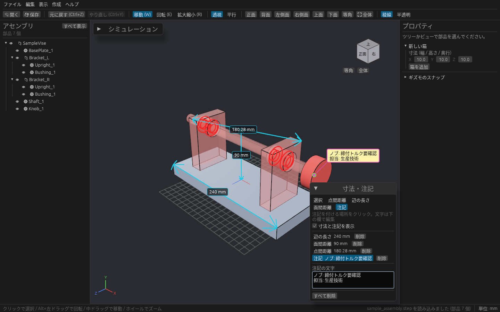

| 道具 | 置き方 |
| --- | --- |
| 点間距離 | 2点をクリック。頂点・辺の中点・面の中心の近くでは吸い付き、緑の四角が出ます |
| 辺の長さ | 辺をクリック(近くの辺が緑になります) |
| 面間距離 | 面を2つクリック。平行な平面なら距離、平行でなければ角度が出ます |
| 注記 | 部品の上をクリックし、パネルの「注記の文字」欄にメモを書きます(複数行・日本語可) |

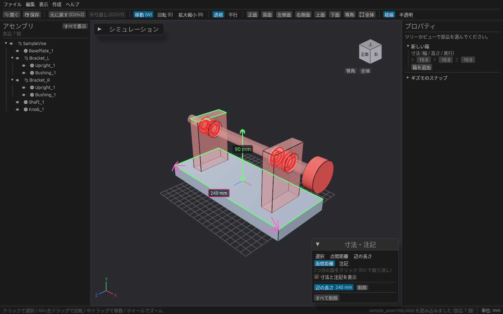

- 一覧かビュー上のラベルをクリックすると選択(ピンク)になり、「削除」で消せます。「寸法と注記を表示」のチェックでまとめて隠せます。
- 置いている間はクリックしても部品は選ばれません。パネルの「選択」に戻すか Esc で抜けます。
- M キーの距離計測はその場で測るだけ、寸法は保存して残すための道具です。

### タイミングチャートで動きを確かめる

画面下の「タイミングチャート」パネルで装置の動きを組み、3D ビューで再生できます。再生中も干渉チェックは各時刻の位置で動きます。
試すときは **サンプル装置** を押すと、供給コンベア → ガントリーのピック & プレース → 排出コンベアの装置が読み込まれます(いま開いているモデルは置き換わります)。

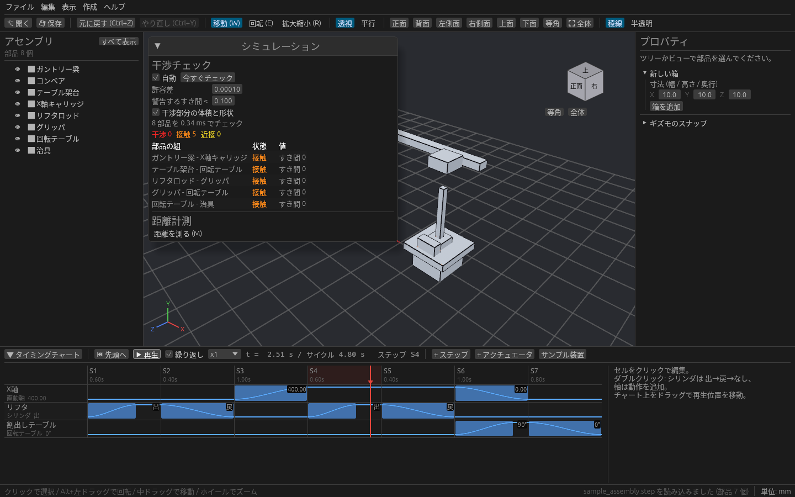

1. **アクチュエータを割り当てる。** ツリーかビューで部品やアセンブリを選び、「選択中の〜を追加」でシリンダ(出 / 戻)・直動軸(移動量)・回転テーブル(角度)にします。アセンブリなら中の部品がまとめて動きます。**載せ先** で別のアクチュエータに載せると親と一緒に動きます(例: X 軸に載った上下シリンダ)。
2. **ステップを並べる。** S1, S2, … の列に動作を置きます。同じステップの動作は同時に始まり、すべて終わってタイマーが過ぎると次のステップへ進みます。サイクルタイムは自動で計算されます。
3. **再生する。** ▶ で再生、チャート上をドラッグで好きな時刻へ。最後に原点へ戻っていないとチャート上部に警告が出ます。

| 操作 | 内容 |
| --- | --- |
| ▼ タイミングチャート | パネルを畳む / 開く。パネルの上端をドラッグで高さを変える |
| ▶ 再生 / ⏸ 一時停止 / ⏮ 先頭へ | 「繰り返し」でループ、x0.1〜x2 で速度を変える |
| 速度 | 各行に速度のグラフ(オレンジ)を重ね、行の右下に最高速度を出す |
| ステップ見出しをクリック | そのステップを選び、開始時刻へ移動 |
| セルをクリック | ステップ × アクチュエータを選び、右側で目標値・動作時間を編集 |
| セルをダブルクリック | シリンダは 出 → 戻 → なし を切り替え、軸は動作を追加 |
| + ステップ / + アクチュエータ | ステップ(選択中の次)・アクチュエータを追加 |
| 右側の設定欄 | ステップのコメント・タイマー・並べ替え・複製・削除、アクチュエータの方向・ストローク・回転中心・加減速・載せ先 |


**加減速** は、アクチュエータの行の名前をクリックして右側の設定欄で選びます。S字加減速・台形加減速(加速にかける時間の割合を指定)・サイクロイド・等速のほか、**+ 電子カム表を作る** で「時間 % と位置 %」の点を並べた自分のカム曲線も使えます。設定欄の下に、選んだパターンの位置と速度のグラフが出ます。

再生位置が先頭以外のときはギズモでの編集が止まります。編集するときは ⏮ 先頭へ で戻してください。

### センサーとインターロック

タイミングチャートの **+ センサー** で光電センサー・近接センサーを置き、ステップに「このセンサーが ON(OFF)になるまで始めない」という開始条件を付けられます。サンプル装置にも 2 つ入っています。

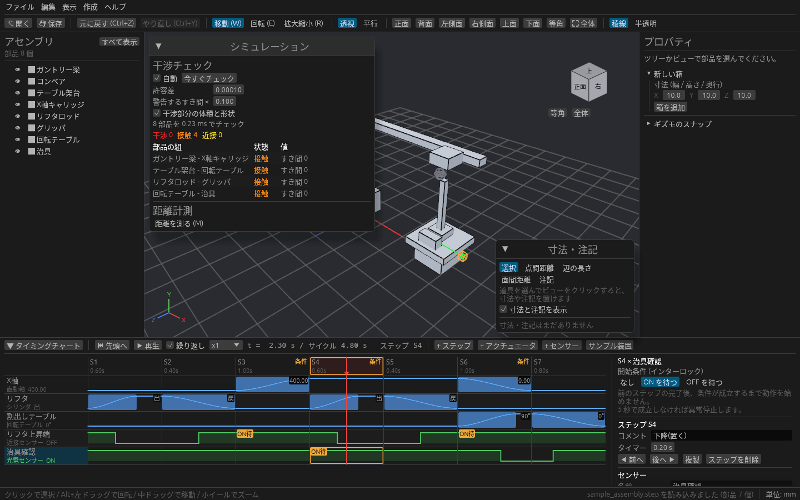

- センサーの位置・向き・範囲・取り付け先は、センサーの行をクリックして右側で設定します。取り付け先のアクチュエータと一緒に動きます。
- センサーの行のセルをダブルクリックすると、そのステップの開始条件が **ON待 → OFF待 → なし** と切り替わります。
- 条件が成り立つまでステップは待ち、5 秒たっても成り立たないと異常停止して赤い警告が出ます。設定欄の **強制** で ON / OFF を固定すると、センサーが反応しないときに止まるかを確かめられます。

詳しくは [マニュアル](docs/src/sensors.md) を見てください。

### シミュレーション結果を CSV に書き出す

「ファイル → シミュレーション結果 (CSV)」から、装置検討の資料に使える表を書き出せます。Excel でそのまま開けます。

| メニュー | 書き出すもの |
| --- | --- |
| サイクルタイム… | ステップごとの開始・終了・所要時間と、そのステップで一番時間のかかる動作。最後の行がサイクルタイム |
| 干渉結果 (1サイクル分)… | チャートを最初から最後まで動かしながら調べた、干渉・接触・近接の時間帯。どの部品の組が、何秒から何秒まで、どのステップで、どれだけ食い込んだか(またはすき間) |

- 干渉結果は「干渉チェックの間隔」(初期値 0.02 秒)ごとに調べます。細かくすると時刻が正確になり、そのぶん時間がかかります。
- 許容差・警告値はシミュレーションパネルの設定を使います。チャートが空のときは、いまの配置を1回だけ調べます。
- 書き出しが終わるとステータスバーに保存先が出ます。

### コンベアでワークを流し、チャックで掴んで運ぶ

3D ビュー右上の「ワーク搬送」ウィンドウで投入口・コンベア・グリッパ・排出口を設定すると、タイミングチャートの再生に合わせてワークが流れ、投入数と排出数が数えられます。サンプル装置には一式が入っています。

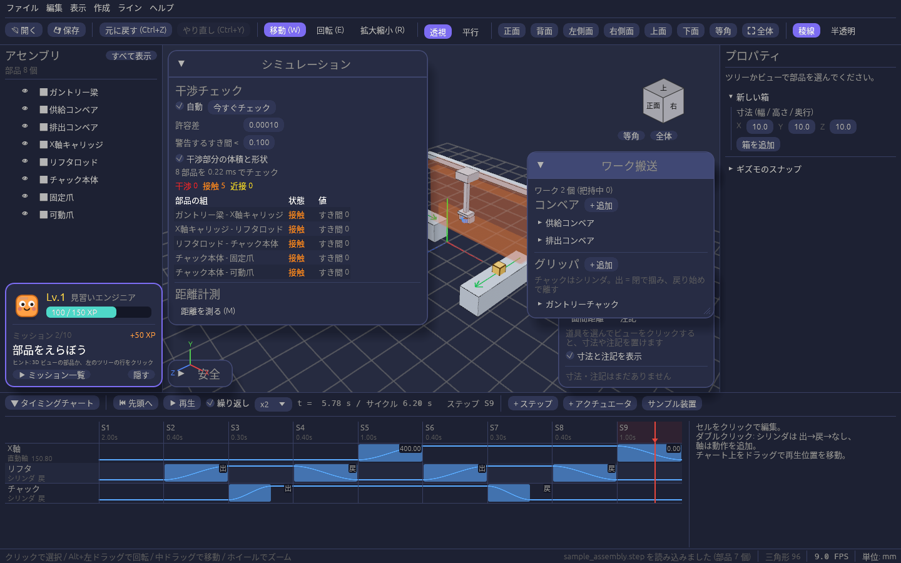

1. **ワーク種類を作る。** 「ワーク種類 + 追加」で名前・色・寸法(幅 / 高さ / 奥行)を決めます。
2. **投入口を置く。** 「投入口 + 追加」で作り、**部品** に投入口にする部品を選びます(ツリーで選んで「選択中」でも可)。**出す先** はコンベアの始端か、部品の上です。**間隔** ごとにワークが出ます。**種類** を複数選ぶと順番に出し、**上限あり** で個数を決められます。
3. **コンベアを置く。** 「+ 追加」で作り、**ベルト部品** を選びます。部品の上面を、選んだ向き(X / Z)へワークが流れます。終端が **ストッパ** ならワークは終端から詰まって並び、**排出** なら流れ出て消え、排出として数えます。
4. **グリッパを作る。** 「+ 追加」で作り、**チャック** にタイミングチャートのシリンダを選びます。シリンダが **出** になり切った瞬間に **掴む位置** の近く(**掴める距離** 以内)のワークを掴み、**戻** を始めた瞬間に離します。
5. **運ぶ・載せ替える。** 掴んだワークは、チャックの「載せ先」のアクチュエータと一緒に動きます。離した場所がコンベアならそのコンベアで流れ、動くテーブルなどアクチュエータに割り当てた部品の上ならその部品と一緒に動きます。別のグリッパが掴むと、そのまま持ち替えます。
6. **排出口を置く。** 「排出口 + 追加」で部品を選ぶと、その部品に触れたワークが消えて数えられます(掴んでいる間は数えません)。

- ウィンドウ上部に **投入 / 排出 / 仕掛** の数が出ます。「内訳」を開くと、種類ごと・投入口ごと・排出口ごとの数が見られます。
- 投入口の部品は緑、排出口の部品は赤、掴む位置は青い球(掴んでいる間は赤)、コンベアの向きは緑の矢印で表示されます。
- 繰り返し再生ではサイクルをまたいでもワークが残ります。⏮ 先頭へ でワークも数も空に戻ります。
- いまはワークの到着を待つ条件がないので、最初のステップにタイマーを入れて待たせてください。

### 動きを動画にする

タイミングチャートの動きを動画ファイルにして、打ち合わせの資料に貼れます。ffmpeg などを別に入れる必要はありません。

1. メニューの **ファイル → 書き出し → シミュレーションを動画で書き出し…** を開きます。
2. 形式・フレームレート・サイクル数・再生速度・映す範囲・大きさを選びます。
3. **書き出し開始…** を押して保存先を選ぶと、1 コマずつ撮っていきます。進み具合はウィンドウのタイトルに出ます。書き出し中は操作しないでください。**Esc** で中止できます。

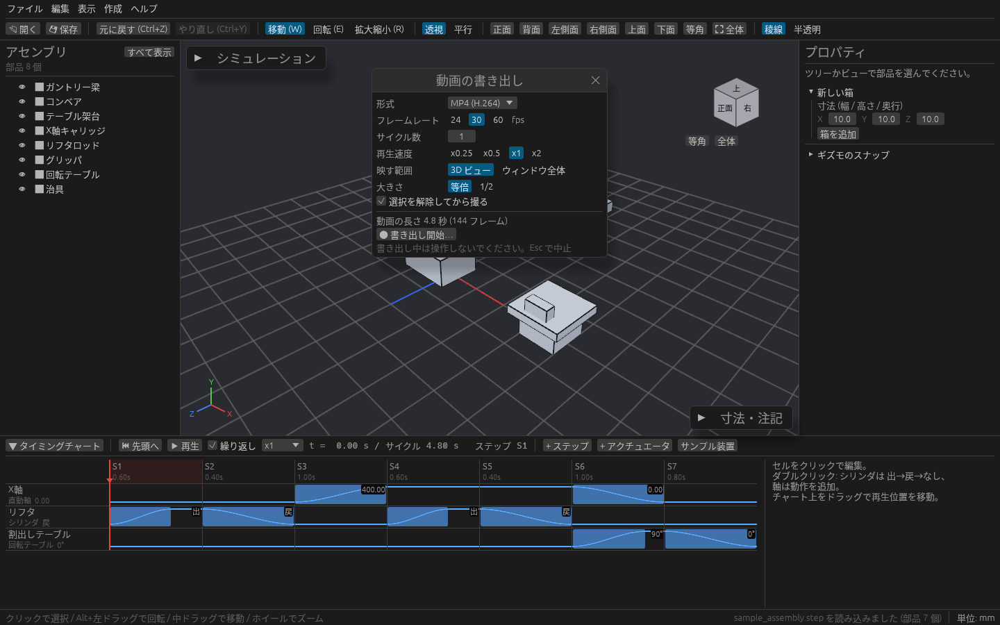

| 設定 | 内容 |
| --- | --- |
| 形式 | **MP4**(PowerPoint や Teams でそのまま再生できる)、**GIF**(256 色、どこにでも貼れる)、**PNG 連番**(フォルダに 1 コマ 1 枚) |
| サイクル数 / 再生速度 | 何サイクル分を撮るか。x0.25・x0.5 でスローモーションになる |
| 映す範囲 | **3D ビュー**(パネルを除く)か **ウィンドウ全体**(タイミングチャートも入る) |
| 大きさ | 等倍か 1/2。GIF は 1/2 にするとファイルが小さくなる |
| 選択を解除してから撮る | 選んだ部品の色を元に戻してから撮る |

PC が遅くてもコマ落ちせず、同じ設定なら毎回同じ動画になります。

### ロボットを動かす

回転テーブルと直動軸を **載せ先** でつなぐと、ロボットアームの関節になります。教示点(TCP を持っていきたい位置と工具の向き)を登録してステップに置くと、各関節の動きを自動で計算して再生します。
試すときはチャートの **ロボットのサンプル** を押すと、4 軸アームのピック & プレースが読み込まれます。


1. **関節を作る。** 部品を回転テーブル・直動軸にして、根元から順に **載せ先** でつなぎます。右側の設定欄の **可動範囲** で動ける範囲を決めます。
2. **ロボットにする。** 右のプロパティ欄の「ロボット」で **+ ロボット** を押し、先端(手首)の関節を選びます。「設定」で TCP(工具先端)の位置と工具の向きを合わせます。
3. **教示点を登録する。** スライダか X± / Y± / Z± ボタンで TCP を動かし、**+ 今の TCP を登録** を押します。または **+ 3D ビューで置く** を押して部品の面をクリックすると、その面に向かう工具の向きで教示点を置けます(**面から離す** で浮かせる距離を決めます)。座標と向き(下向きなど)はあとから直接直せます。
4. **ステップに置く。** チャートでステップを選び、教示点の **S○へ** を押します(ロボットの行のセルをダブルクリックしても置けます)。届かない教示点は赤い ⚠ で知らせます。
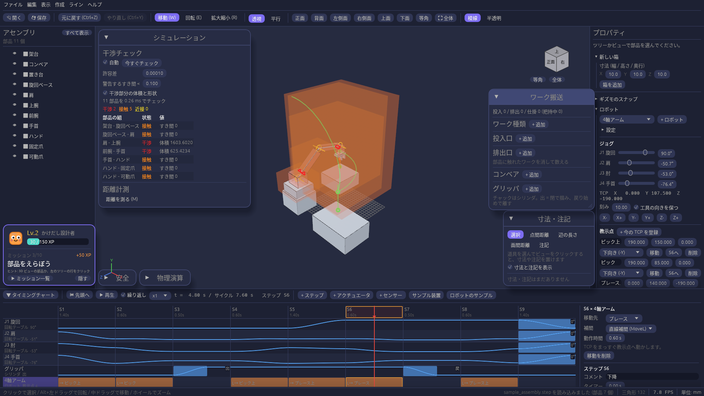

5. **動かし方を選ぶ。** ロボットの行のセルをクリックし、**補間** を「関節補間 (MoveJ)」か「直線補間 (MoveL)」にします。直線補間は TCP が教示点までまっすぐ動きます(チャートでは L→)。
6. **サイクルタイムを詰める。** 「設定」で関節と直線の最高速度・加速時間を入れると、プロパティ欄の **サイクルタイム** に「ロボットを最短で動かすと何秒か」が出ます。**すべて最短にする** で移動の動作時間を最短にそろえられます。
7. **ロボットのプログラムにする。** **MELFA-BASIC VI で書き出す…** で、三菱電機のロボット言語のプログラム(.prg)に書き出せます。教示点の位置、移動(Mov / Mvs)、ハンドの開閉、待ち時間が入ります。
8. **経路を確かめる。** プロパティ欄の「ロボット」の **経路の確認** に、届かない移動と特異点(腕が伸び切る姿勢など)の近くを通る移動が出ます。**移動中の干渉を調べる** で、腕やグリッパがほかの部品に当たる移動も一覧にできます。

| 操作 | 内容 |
| --- | --- |
| 関節のスライダ | その関節だけを動かす |
| X- / X+ / Y- / Y+ / Z- / Z+ | TCP を「刻み」の分だけ動かす。「工具の向きを保つ」で向きを変えずに動かす |
| + 3D ビューで置く → 部品の面をクリック | クリックした面に教示点を置く(Esc でやめる) |
| 教示点の「移動」 | その教示点へ動かして、届くか確かめる |
| ロボットの行のセルをクリック | 移動先の教示点・補間(MoveJ / MoveL)・動作時間を変える |
| 経路の確認の行をクリック | その移動のステップを選ぶ |
| チャートの位置に戻す | スライダやボタンで動かした姿勢をやめる(再生・スクラブでも戻る) |

スライダやボタンで動かしてもチャートは変わりません。3D ビューには関節の軸(黄)、腕の骨格(水色)、TCP と工具の向き(オレンジ)、教示点(緑、届かない点は赤)、TCP の通り道(緑の線、特異点の近くは黄、届かないところは赤)が出ます。

### 工程シミュレーションでスループットを見る

「ライン → 工程シミュレーション…」で開くウィンドウで、「加工 30 秒」「検査 10 秒」のような工程とバッファを並べ、ラインを数時間分早回しできます。
設備ごとの稼働・待ち・詰まり・故障の割合、サイクルタイム、仕掛数、電力量とエア消費量を集計し、ボトルネックを 3D ビューで赤く示します。
試すときは「ライン → サンプル工程を読み込む」を押して ⏩ 最後まで を押してください。

| 結果(サンプル工程を 8 時間) | 稼働率で色分け(赤がボトルネック) |
| --- | --- |
|  | 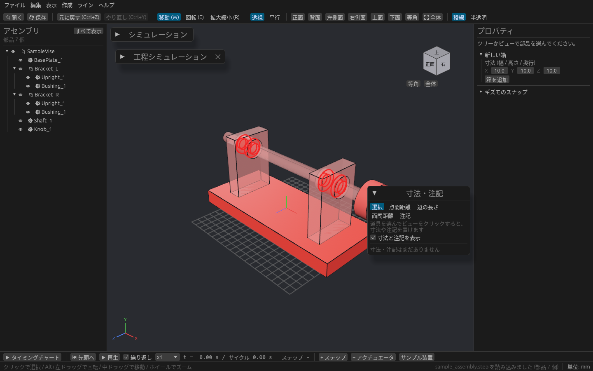 |

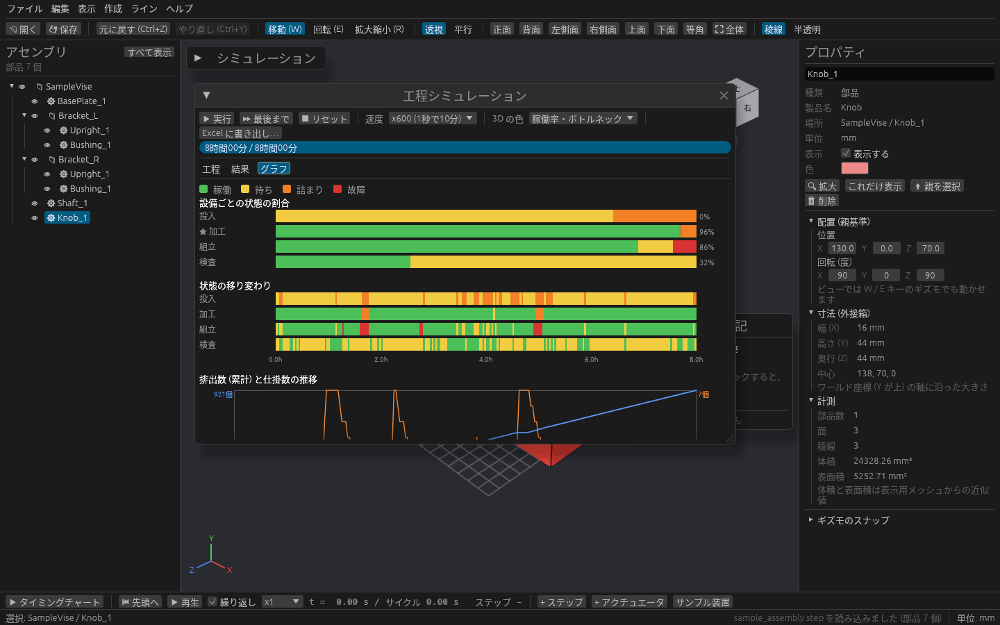

1. **工程を並べる。** 「工程」タブの「+ 生成」「+ 工程」「+ バッファ」「+ 排出」を順に押すと、押した順につながったラインができます。3D で部品を選んでから「+ 選択中の部品を工程に」を押すと、その部品が工程になり、実行中に色が付きます。
2. **値を入れる。** 一覧で要素を選び、右側でサイクルタイム・生成の間隔・バッファの容量・ばらつき(± %)を入れます。工程は「乱数で故障させる」で MTBF(平均故障間隔)と MTTR(平均修理時間)を入れられます。定格電力・待機電力・エア消費量を入れると電力量も集計されます。
3. **回す。** 下の欄で回す時間(既定 8 時間)と、集計から外す立ち上がり時間を決めます。▶ 実行 で早送りしながら回し(3D の部品が状態の色になります)、⏩ 最後まで で一気に回します。
4. **結果を見る。** 「結果」タブに排出数・スループット・サイクルタイム・リードタイム・仕掛数・電力量と設備ごとの表、「グラフ」タブに状態の割合・状態の移り変わり・排出数と仕掛数の推移が出ます。「Excel に書き出し…」で表とグラフを xlsx に保存できます。

| 操作 | 内容 |
| --- | --- |
| ▶ 実行 / ⏸ 一時停止 / ⏹ リセット | 早送りで回す・止める・結果を消す。速度は x1〜x36000(x3600 なら 1 秒で 1 時間) |
| ⏩ 最後まで | 回す時間の最後まで一気に回して集計する |
| 3D の色 | なし / 状態(稼働 緑・待ち 黄・詰まり 橙・故障 赤・人待ち 紫)/ 稼働率・ボトルネック(低い 青 → 高い 橙、ボトルネックは赤) |
| 送り先 | 要素の設定で、ワークを送る先にチェックを入れる。複数あれば上から順に空いている先へ送る(並列の設備に使えます) |
| 乱数の種 | 同じ種なら同じ結果になります。種を変えて回すと、故障やばらつきによる差を見られます |

工程はプロジェクトに保存されます。工程の編集は Ctrl+Z で戻せます。

### 作業者を割り当てて、何人で回るかを見る

工程シミュレーションの「人員」タブで作業者の名簿・できる工程・シフトを入れると、人が足りない工程は作業者が来るまで **人待ち**(紫)で止まります。「このラインは何人で回るか」「誰が休むとどうなるか」を確かめられます。
試すときは「人員」タブの **サンプルの人員を入れる** を押して ⏩ 最後まで を押してください(日勤 3 人で、加工は投入だけ人、組立と検査は手作業のライン)。

| 人員タブ(シフト・スキル表・人数の比較) | 結果タブの作業者の表 |
| --- | --- |
| 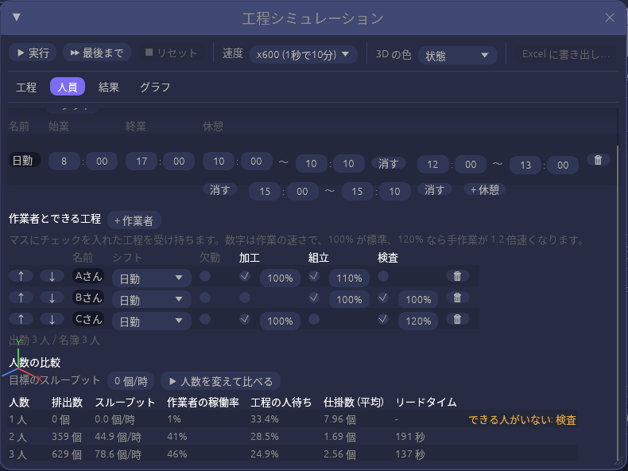 | 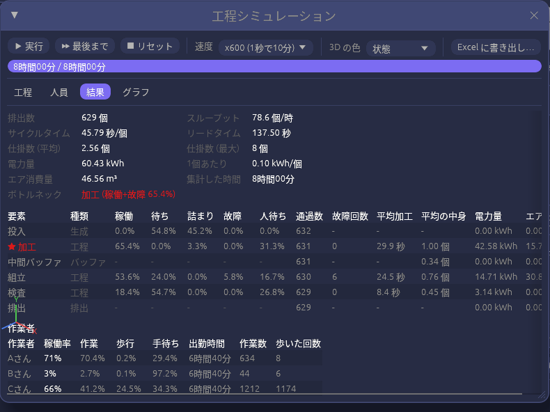 |

1. **工程に人が要るかを決める。** 「工程」タブで工程を選び、**作業者** を「加工中ずっと必要」(手作業・組立など)か「投入・段取りだけ必要」(最初の何秒かだけ人が付き、あとは機械が自動で加工)にします。
2. **シフトを作る。** 「人員」タブの「+ シフト」で始業・終業と休憩(「+ 休憩」)を入れます。終業を始業より早くすると夜勤(日をまたぐ)になります。**始める時刻** はシミュレーションを何時から始めるかです。
3. **作業者を足して、できる工程にチェックを入れる。** 「+ 作業者」で名簿に足し、シフトを選び、表のマスにチェックを入れた工程を受け持ちます。マスの数字は作業の速さ(100% が標準、120% なら手作業が 1.2 倍速い)。**欠勤** にチェックを入れると、その人がいない場合を試せます。
4. **回す。** ▶ 実行 / ⏩ 最後まで で回すと、「結果」タブの下に作業者ごとの稼働率(出勤時間のうち作業と歩行の割合)・作業・歩行・手待ちの割合・作業数が出ます。設備の表には「人待ち」の割合が出ます。
5. **人数を比べる。** 「人員」タブの下で目標のスループットを入れて **▶ 人数を変えて比べる** を押すと、名簿の上から 1 人、2 人、… と出勤させて同じ条件で回し、結果を並べます。目標を満たすいちばん少ない人数が緑になり、出勤している人の誰もできない工程があれば黄色で知らせます。誰から出勤させるかは名簿の ↑ ↓ で並べ替えます。

| 人員タブの項目 | 内容 |
| --- | --- |
| 別の工程への歩行 | 作業者が別の工程へ移るときにかかる秒数。同じ工程を続けるときはかかりません |
| シフト | 始業・終業・休憩。シフトを選ばない作業者は休みなしで回す時間ずっと働きます |
| 作業者の割り当て | 人待ちの工程には、手の空いている人のうち速い人が行きます。手が空いた人は、いちばん長く人待ちしている工程へ行きます。休憩や終業の時刻には、今の作業を終えてから抜けます |

名簿とシフトも工程と一緒にプロジェクトに保存され、「Excel に書き出し…」には「作業者別」のシートが加わります。

### 安全機器を置いて止まり方を確かめる

3D ビュー左下の「安全」パネルで、ライトカーテン・エリアセンサ・安全柵・非常停止ボタンを置けます。
タイミングチャートで動く部品、作業者、AGV が検知範囲に入ると **安全停止** になり、チャートの再生と AGV が止まります。


1. 「追加:」のボタンで機器を置き、一覧で選んで位置(X / Z / 高さ)・向き・大きさを数値で合わせます。
2. ライトカーテンとエリアセンサは「停止までの時間」(センサの応答 + 機械が止まるまで)を入れると、必要な安全距離 S が出ます。
3. 再生して何かが検知範囲に入ると「● 安全停止中」になり、原因が出ます。検知がなくなってから「リセット」で解除します。非常停止ボタンは一覧の「押す / 戻す」、ライトカーテンなどは「遮光」で、その場で止まり方を試せます。
4. チャートで動く部品の動作範囲が半透明の橙の箱で出ます。安全柵とライトカーテンは、いちばん近い動作範囲までの距離が足りているかを表で確かめられます(足りないと「近すぎ」と赤い線)。

機械の可動部そのものが検知範囲を通る設計なら「機械の可動部も検知の対象にする」を外してください。

### 作業者を歩かせて作業時間を見る

3D ビュー右上の「作業者・AGV」パネルの「作業者」で、作業者の手順を組みます。▶ 再生で歩き出し、青い線で歩行経路が出ます。

1. 「作業者を追加」して、開始位置と歩く速さを決めます。
2. 「歩く先を床でクリック」を選んで 3D ビューの床をクリックすると、そこへ歩く手順が増えます。「+ ピック」「+ ボタン」「+ 待つ」で、その場の作業と時間を足します。↑ ↓ で並べ替え、削除で消せます。
3. 下の表に、1 サイクルの時間と、歩行・作業・待ちの内訳(秒と割合)、歩行距離が出ます。最後の手順のあとは開始位置まで歩いて戻ります。

作業者は安全機器の検知の対象になるので、ライトカーテンの位置が作業者の動線にかかっていないかも確かめられます。

### AGV の経路を引いて台数を比べる

同じパネルの「AGV」で、床に AGV の経路を引き、搬送の要求を出して走らせます。試すときは「サンプルを置く」で、作業者 1 人と十字の通路を走る AGV が置かれます。

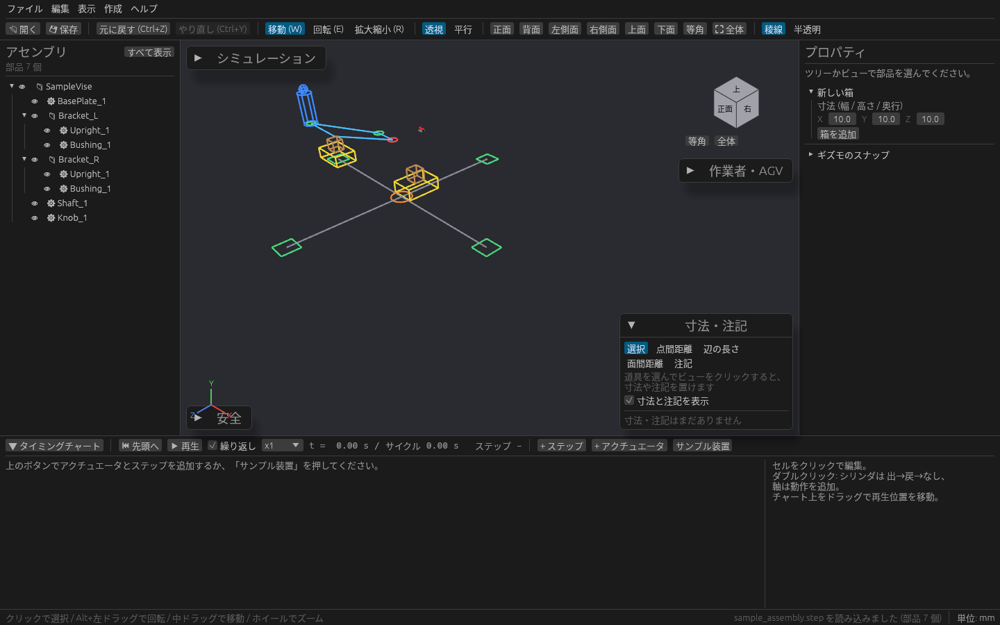

1. **経路を引く。** 「点」か「ステーション」(積み降ろしの場所)を選んで床をクリックすると点が置かれ、直前の点と通路でつながります。「通路を結ぶ・外す」で 2 つの点を順にクリックすると、通路を足したり外したりできます。
2. **搬送の要求を出す。** 「+ 要求を追加」で「どのステーションからどこへ、何秒ごとに」を決めます。
3. **走らせる。** ▶ 再生で、空いている AGV のうち近いものが積み込みに向かいます。荷を積んだ AGV は上に箱が乗り、交差点を予約している間は交差点が橙になります。交差点や前の車を待っている AGV は赤くなります。
4. **台数を比べる。** 「台数の比較」で 1 〜 N 台を同じ条件で走らせ、1 時間あたりの搬送数・平均リードタイム・稼働率・渋滞の割合・さばききれずに残った要求の数を並べます。要求をさばききれる台数が緑になります。

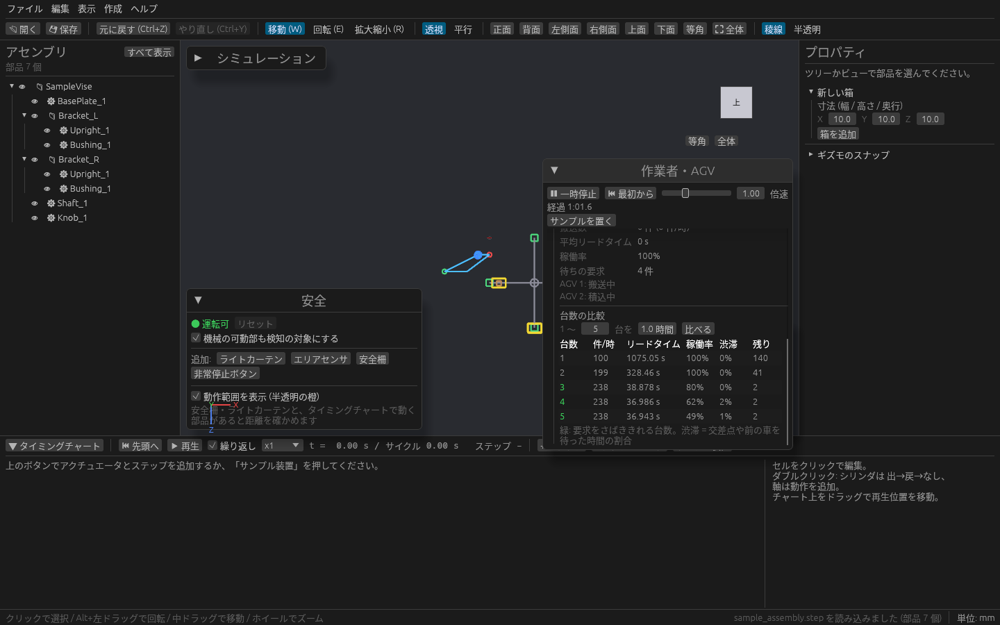

3 本以上の通路が集まる点は交差点で、同時に 1 台しか入れません。ステーションは通路の端か、通路が 2 本の点に置いてください。
安全機器・作業者・AGV の配置はプロジェクトに保存され、編集は Ctrl+Z で戻せます。

### ミッションで操作を覚える(ゲーム風の画面)

はじめて使う人でも迷わないよう、画面左下の **ミッションカード** が「次にやってみること」と、画面のどこで何をすればよいかを教えてくれます。
「部品をえらぼう」「ぐるっと見まわそう」「部品を動かそう」「距離をはかろう」「ぶつかりを見つけよう」「セーブしよう」など 10 個のミッションがあり、クリアすると紙吹雪が舞って経験値(XP)がもらえます。経験値がたまるとレベルと称号が上がります。


- カードの「▶ ミッション一覧」で全ミッションと達成状況を見られます。未達成の行にカーソルを乗せるとヒントが出ます。
- カードの背景をドラッグすると好きな場所へ動かせます。「隠す」で消し、「表示 → ミッションを表示」でまた出せます。
- 進み具合とテーマはアプリを閉じても覚えています。「ヘルプ → ミッションを最初からやり直す」で最初に戻せます。

#### 見た目を切り替える

「表示 → テーマ」で **ゲーム風**(明るい色・丸いボタン・紙吹雪とマスコットつき、はじめはこちら)と **シンプル**(落ち着いた標準の見た目、演出なし)を選べます。


### 物理演算でワークを流す

重力・接触・摩擦でワークを動かし、コンベアで流れる・ストッパで止まる・シュートを滑り落ちる様子を確かめられます。
試すときは、3D ビュー左下(「安全」パネルの右)の「物理演算」パネルで **サンプルラインを読み込む** を押してから ▶ 開始 を押してください。ワーク 100 個がコンベアを流れ、ストッパで溜まっては通され、シュートを落ちて回収箱に入ります(いま開いているモデルは置き換わります)。

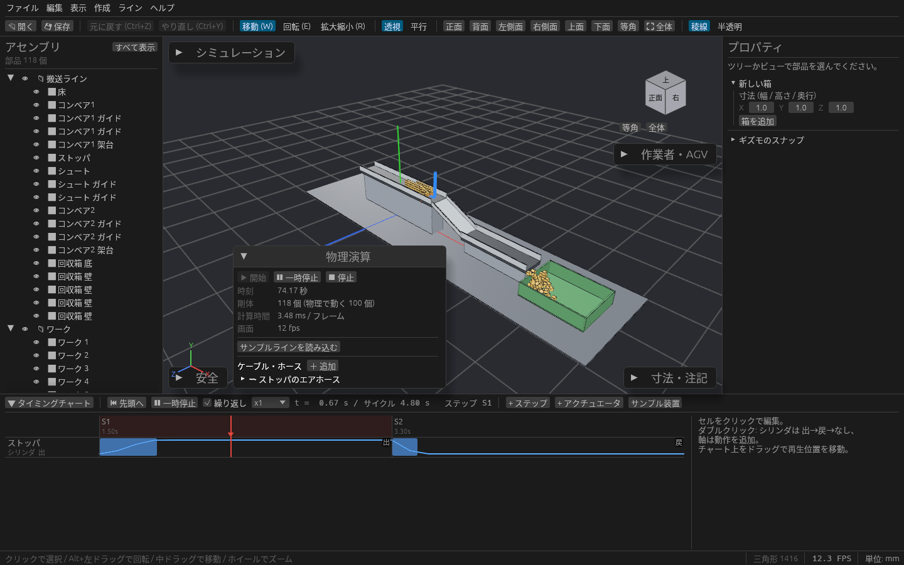

1. **部品ごとに振る舞いを選ぶ。** 部品を選び、右のプロパティの「物理」で選びます。

   | 振る舞い | 使いどころ |
   | --- | --- |
   | 機構で動く(既定) | タイミングチャートのとおりに動き、ワークを押す・支える(ストッパ、プッシャ、ロボットなど) |
   | 動かない | 架台、ガイド、シュート、床 |
   | 物理で動く | ワーク。重力で落ち、ぶつかり、滑る |
   | 当たらない | カバーなど、ワークに関係しない部品 |

2. **当たり判定の形を選ぶ。** 「自動」のままで、箱は箱、読み込んだ部品は形に合わせて決まります。くぼみのある部品(溝のあるシュートやトレイ)は「凸分解」にすると、くぼみの中にワークが入ります。摩擦係数・反発係数・密度(物理で動く部品だけ)も変えられます。
3. **コンベアにする。** 動かない(または機構で動く)部品で「ベルトコンベア」にチェックを入れ、向き(部品の X / Y / Z)と速度を決めると、上に載ったものが運ばれます。
4. **開始する。** 物理演算パネルの ▶ 開始 で動き出します。タイミングチャートがあれば一緒に再生されます。⏸ で一時停止、⏹ 停止(またはチャートの ⏮ 先頭へ)で部品が設計位置に戻ります。

パネルには、物理で動く部品の数、1 フレームの計算時間、画面のフレームレートが出ます。物理演算を動かしている間はギズモでの編集が止まります。
ワークはベルトなどに載っているだけでもわずかに食い込むため、干渉チェックでは「干渉」と数えられます。サンプルラインを読み込むと干渉チェックの「自動」は切れます。

#### ケーブル・ホース

可動部につないだケーブルやエアホースが、動いたときにどう垂れるか・曲がりすぎないか・ほかの部品に当たらないかを確かめられます。

1. 端を付けたい部品を選び、物理演算パネルの「ケーブル・ホース」で **＋ 追加** を押します。もう一方の端はワールドの点に付きます。
2. 一覧の行を開き、長さ・直径・許容曲げ半径を入れます。端は「選択中の部品に付ける」で付け替え、位置は数値で調整します。
3. タイミングチャートを再生するか物理演算を始めると、紐が引かれて動きます(止まっていても重力で垂れます)。

| 見え方 | 意味 |
| --- | --- |
| 黒い線(ケーブル)/ 青い線(ホース) | 問題なし |
| 一部が赤い | そこで許容曲げ半径より小さく曲がっている |
| 全体が赤い | 長さが足りず、両端に引っ張られている |

一覧には最小曲げ半径と、当たっている部品の名前も出ます。当たり判定は部品の外接箱なので、くぼみの中を通す配線は目安として見てください。
### 工程・AGV・安全機器をつないでラインとして動かす

「ライン → ライン連携…」で開くウィンドウで、工程シミュレーション・AGV・作業者・タイミングチャートを同じ時計でまとめて動かします。試すときは「サンプルのラインを置く」で、サンプル工程と十字の AGV 通路が置かれ、バッファから組立へ AGV で運ぶようにつながります。

| つなぎ方と集計 | AGV がワークを運ぶ様子 | PLC の信号 |
| --- | --- | --- |
|  | 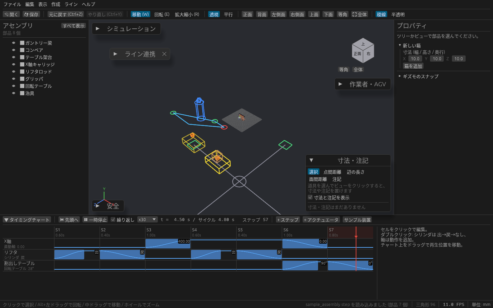 |  |

1. **つなぐ。** 「つなぎ方」の表で、工程やバッファごとに送り出し方を決めます。「AGV」にチェックを入れて積み込みと荷降ろしのステーションを選ぶと、その要素で終わったワークは AGV が運ぶまで下流へ進みません。AGV が足りないと、その工程は「詰まり」になります。「チャート起動」にチェックを入れた工程は、加工を始めるたびにタイミングチャートを頭から再生します。
2. **再生する。** ▶ 再生で、全部が同じ速さ(1 〜 120 倍)で動きます。3D ビューには、設備の上にたまっているワーク、設備から設備へ渡るワーク、AGV に積まれたワークがオレンジの箱で出ます(3D の部品を対応付けていない要素は、AGV のステーションの上に出ます)。
3. **止まり方を見る。** 安全機器が作業者や AGV を検知して安全停止になると、ライン全体が止まります。「安全」パネルでリセットすると、続きから動きます。
4. **PLC の信号を見る。** 「PLC の信号」の表に、工程の稼働・詰まり・故障・在荷、バッファの数、排出数、安全停止、AGV の状態が番号付きで並びます。「ワーク搬送」で投入口を置いていれば、コンベアの投入数・排出数・仕掛数も並び、集計にも出ます。PLC → 設備の「ライン.運転」と「<生成>.投入許可」は、クリックで ON / OFF を切り替えられます(OFF にすると、ライン全体またはその生成からの投入が止まります)。
   この表は「PLC 連携」の I/O 一覧の後ろにも並び、外部 PLC(Modbus TCP / OPC UA)とつなぐと、状態は PLC の入力に書かれ、「ライン.運転」「投入許可」は PLC の出力に従います(PLC が ON にするまでラインは止まったままです)。ログ再生でも、ログの値に従います。番号は I/O 表の CSV で PLC 側に合わせられます。

   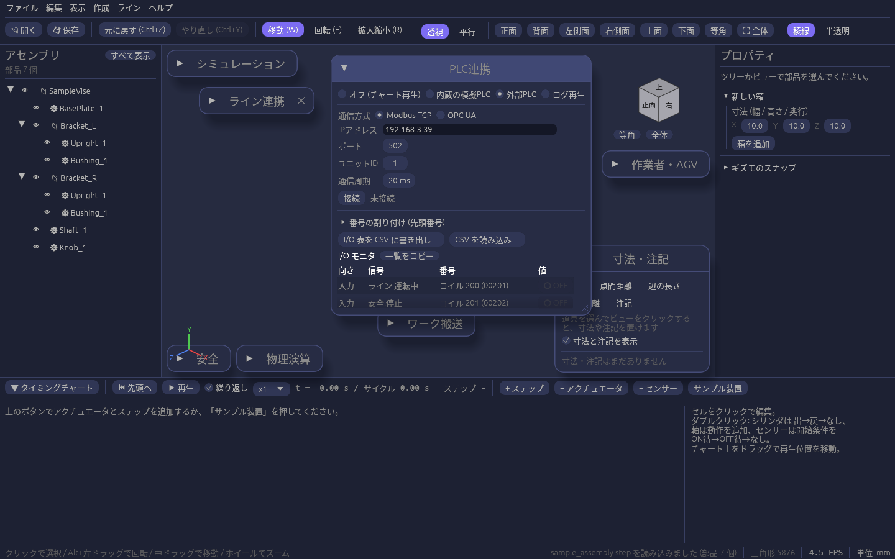

ライン連携で再生している間は、工程シミュレーションと「作業者・AGV」パネルのそれぞれの再生は使いません。工程モデルや AGV の経路を変えると止まり、次の再生で最初から回します。つなぎ方は工程モデルと一緒にプロジェクトに保存されます。

### PLC で設備を動かす(仮想立ち上げ)

タイミングチャートの代わりに **PLC の出力でシリンダや軸を動かし**、出端・戻端・現在位置を PLC の入力に返します。
ラダーを実機の据え付け前に 3D モデル相手に確かめられます。3D ビュー右上の「PLC連携」を開いて使います。


1. **アクチュエータを用意する。** タイミングチャートでアクチュエータを作ると、I/O モニタに信号が並びます
   (シリンダ: `出` / `出端` / `戻端`、直動軸・回転テーブル: `指令位置` / `現在位置` / `位置決め完了`)。
2. **モードを選ぶ。**
   - **内蔵の模擬PLC**: ▶ 運転 で、チャートのステップを出端・戻端を見ながら順に実行します。実機がなくても試せます。停止中は I/O モニタの出力をクリックして手動で ON / OFF できます。
   - **外部PLC → Modbus TCP**: PLC の IP アドレス・ポート(502)・ユニット ID を入れて **接続**。PLC 側で Modbus TCP サーバーを有効にしておきます。
   - **外部PLC → OPC UA**: エンドポイント(`opc.tcp://…:4840` など)を入れて **接続**。やりとりするのは、I/O 表の「OPC UAノード」列にノード ID(`ns=2;s=Line1.Lifter.Out` など)を書いた信号だけです(下の 4. で設定)。暗号化なし・匿名ログインでつなぎます。
   - **ログ再生**: 「ログ CSV を読み込み…」で、GX LogViewer などで記録した PLC のログ(CSV)を開くと、記録どおりに設備が動きます。
     ▶ / ⏸ で再生・一時停止、⏮ で先頭へ、スライダーで好きな時刻へ移動、速度と「繰り返し」も選べます。
     ログの列は I/O 表の「ログ列名」(空欄なら信号名)と同じ見出しの列が使われます。時刻の列(日付・時刻・秒など)は自動で見つけます。Shift_JIS のファイルもそのまま開けます。
3. **番号を合わせる。** 「番号の割り付け」で先頭番号を決めると、出力はそこからコイル・保持レジスタに順に割り付けられます(初期値: 出力 0、入力 100)。ワードは 1 = 0.1 mm / 0.1° です。
   「一覧をコピー」で信号名と番号を Excel やデバイスコメントに貼れます。
4. **PLC 側の割り付けに合わせる。** 「I/O 表を CSV に書き出し…」で対応表を保存し、Excel で信号ごとの番号・スケール・OPC UA ノード・ログ列名を書き換えて「CSV を読み込み…」で戻します。
   空欄にした欄は自動の値に戻ります。行は「信号」列の名前で突き合わせるので、行の順番は変えてかまいません。

PLC 連携中はチャートの再生とギズモでの編集が止まります。「オフ」に戻すとチャート再生に戻ります。
番号の割り付け(CSV で読み込んだ個別の設定も)と外部 PLC の通信方式・接続先(Modbus TCP / OPC UA)はプロジェクトに保存され、割り付けの変更は Ctrl+Z で戻せます。

### 部品にスクリプトを書いて動かす

チャートのステップでは書きにくい動き(条件で分ける、繰り返す、部品どうしで合図を送る)は、部品ごとのスクリプトで書けます。

1. 部品(またはアセンブリ)を選び、右のプロパティの「スクリプト」で **スクリプトを付ける** を押す。ひな形が入るので書き換える
2. 3D ビュー右上の「PLC連携」を開き、モードを **部品スクリプト** にして **▶ 実行**

```rhai
// ワークが来たらシリンダを出して戻す
loop {
    wait_signal("ワーク有", true);   // センサーが ON になるまで待つ
    move_joint("押し出し", 1);       // シリンダを出端まで出す (着くまで待つ)
    wait(0.5);
    move_joint("押し出し", 0);       // 戻す
    set("押し出し完了", true);       // ほかの部品のスクリプトへの合図
}
```

| 関数 | 内容 |
| --- | --- |
| `get("信号")` / `set("信号", true)` | 信号を読む / 書く。名前は「PLC連携」の I/O 一覧の名前(`シリンダ1.出端` など)かセンサー名。それ以外の名前は、スクリプトどうしで共有する内部信号になります |
| `joint("関節")` / `move_joint("関節", 値)` | タイミングチャートのアクチュエータ(ロボットの関節も)の今の値 / 目標値へ動かして着くまで待つ。シリンダは 0 = 戻端、1 = 出端 |
| `wait(秒)` / `wait_signal("信号", true, 最大秒)` | 待つ / 信号がその値になるまで待つ(最大秒を付けると、時間切れで false を返します) |
| `time()` / `log("文字")` | シミュレーションの時刻 / ウィンドウのログに出す |

書き方を間違えるとプロパティ欄にすぐ表示されます。実行中のエラー(知らない信号名、可動範囲外など)は「PLC連携」ウィンドウのログに部品名付きで出て、そのスクリプトだけが止まります。
スクリプトはプロジェクトに保存され、編集は Ctrl+Z で戻せます。形状を差し替えても残ります。

### 元に戻す・やり直し

部品の追加・削除・移動・回転・寸法や色や物理の設定の変更、寸法・注記の追加や削除、タイミングチャート(センサー・インターロックを含む)・コンベアとグリッパ・工程モデル・安全機器・作業者・AGV・平面図・点群・ケーブル / ホース・PLC の番号の割り付けの編集は Ctrl+Z で戻せます。メニューの「編集」やツールバーのボタンにカーソルを乗せると、何が戻るかが表示されます。
表示 / 非表示、選択、カメラの向きは履歴に残りません。

### プロジェクトの保存

`.cadsim` には、ツリーの構成・配置・表示 / 非表示・色・箱の寸法・寸法と注記・部品の物理の設定・ケーブル / ホース・タイミングチャート・工程モデル・安全機器・作業者・AGV の配置・センサーとインターロック・コンベアとグリッパ・取り込んだ glTF のアニメーション・PLC 連携の番号の割り付けと接続先・部品スクリプトと、取り込んだファイル・平面図・点群の場所と配置が入ります。
形状そのものは入れず、開くときに元のファイルから読み直します。**取り込んだ STEP・平面図・点群のファイルは、移動や削除をしないでください。**
モデリングの画面で作った形だけは、`.cadsim` の中に形状ごと入ります。
プロジェクトと同じフォルダ以下に置いておけば、フォルダごと別の PC に移しても開けます。

未保存の変更があるとウィンドウのタイトルに `*` が付き、新規作成や別のプロジェクトを開く前に、破棄してよいか確認が出ます。

## 開発中・予定

- コンベアで流れるワークを工程の送り出しに使う(いまは数を PLC の信号と集計に出すだけ)、作業者のボタン操作を PLC の入力にする

## 開発する人へ

変更を送る前に、手元で次を実行してすべて通ることを確認してください。

```sh
cargo fmt --all --check
cargo clippy --all-targets --locked -- -D warnings
cargo test --locked
```

| 資料 | 内容 |
| --- | --- |
| [docs/architecture.md](docs/architecture.md) | コードのレイヤー分けと依存の向き |
| [docs/internals.md](docs/internals.md) | 使っているライブラリ、各機能のしくみ、サンプルとフォントの作り方 |
| [docs/simulation.md](docs/simulation.md) | 干渉チェック・距離計測・結果の CSV 出力の設計 |
| [docs/conveyor.md](docs/conveyor.md) | コンベアのワーク搬送とグリッパの把持・解放のしくみ |
| [docs/flow.md](docs/flow.md) | 工程シミュレーション(離散事象シミュレーション・集計・Excel 書き出し)の設計 |
| [docs/staffing.md](docs/staffing.md) | 人員配置(作業者の割り当て・シフト・人数の比較)の設計 |
| [docs/performance.md](docs/performance.md) | 大規模アセンブリを軽くするしくみと、負荷テスト・FPS の測り方 |
| [docs/web-viewer.md](docs/web-viewer.md) | Web ビューア(.html)と VR / AR 表示のしくみ |
| [docs/site.md](docs/site.md) | 平面図の下敷き(DXF / PDF / 画像の読み込み、縮尺合わせ)と点群(間引き・LOD・干渉)のしくみ |
| [docs/drawing.md](docs/drawing.md) | 2D 図面(投影・かくれ線・寸法・PDF / DXF)と部品表(Excel / CSV)のしくみ |
| [docs/modeling.md](docs/modeling.md) | 円柱・押し出し・穴あけ・ブーリアンのしくみと保存のしかた |
| [docs/safety-and-floor.md](docs/safety-and-floor.md) | 安全機器・作業者・AGV のしくみ(検知と停止、安全距離、配車、交差点の排他) |
| [docs/playful-ui.md](docs/playful-ui.md) | ゲーム風の画面(テーマ・ミッション・経験値・設定ファイル)のしくみ |
| [docs/physics.md](docs/physics.md) | 物理演算・ベルトコンベア・ケーブルの紐モデルの設計 |
| [docs/defeature.md](docs/defeature.md) | 小さな穴とフィレットを省略する形状の簡略化のしくみ |
| [docs/plc.md](docs/plc.md) | PLC 連携(I/O の割り付け、模擬 PLC、Modbus TCP、OPC UA、ログ再生)の設計 |
| [docs/scripting.md](docs/scripting.md) | 部品スクリプト(Rhai)の実行と待ちのしくみ |
| [docs/line.md](docs/line.md) | ライン連携のしくみ(1つの時計、工程と AGV の受け渡し、信号表の割り付け) |
| [docs/robot.md](docs/robot.md) | 関節・ロボットの順運動学と逆運動学、教示点への移動の展開 |
| [docs/project-file.md](docs/project-file.md) | プロジェクトファイル(.cadsim)の形式 |
| [docs/video-export.md](docs/video-export.md) | 動画書き出しのしくみ |
| [docs/release.md](docs/release.md) | Windows / Mac 向けの配布パッケージと Release の作り方 |

## ライセンス

[MIT License](LICENSE-MIT) と [Apache License 2.0](LICENSE-APACHE) のどちらかを選んで使えます(デュアルライセンス)。

ただし、同梱の日本語フォント `assets/fonts/NotoSansJP-Subset.otf` は [SIL Open Font License 1.1](assets/fonts/OFL.txt) です。
