# plantwright


工場のライン設備を 3D で組み立てて、**動かしながら確かめる** ためのツールです。
STEP などの CAD データを読み込んで設備を並べ、ぶつかり・サイクルタイム・スループット・安全停止・PLC のラダーまで、実機を据え付ける前に画面の中で試せます。

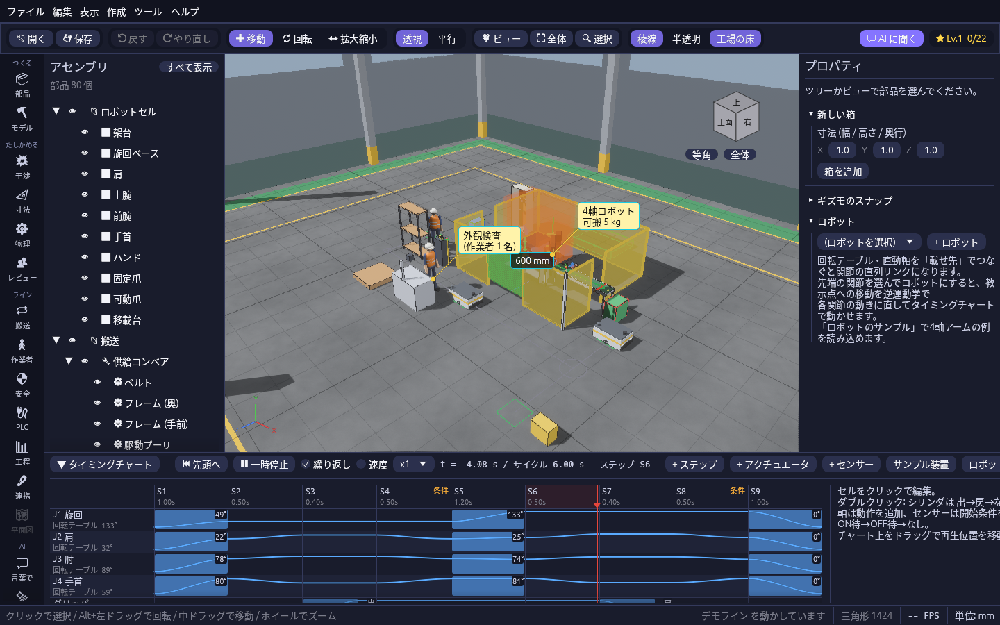

**[▶ デモ動画を見る(約 2 分半)](docs/media/plantwright_demo.mp4)** ・ **[📘 操作マニュアル(画像付き)](docs/src/introduction.md)** ・ **[⬇ ダウンロード](https://github.com/T-T0821/cadsim/releases)**

## 画面の様子

| 動きを付けて再生する | ラインを早回ししてボトルネックを探す |
| --- | --- |
| 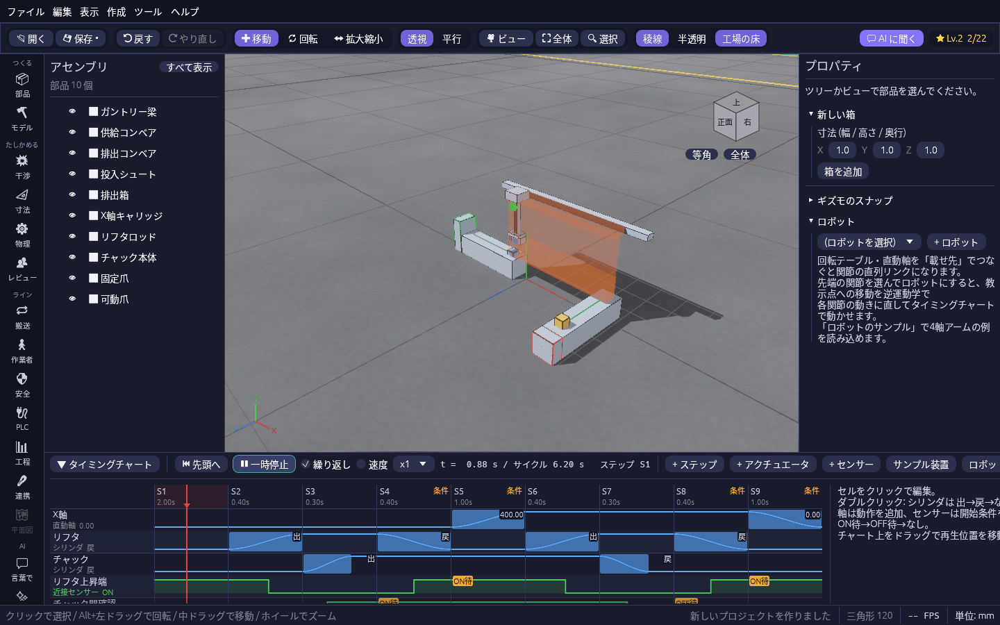 | 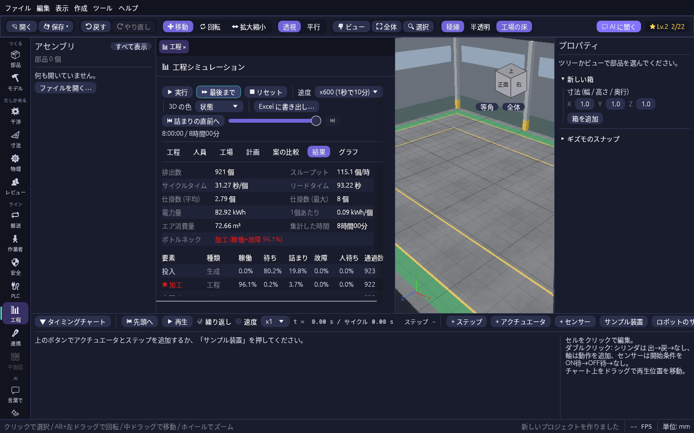 |
| **PLC の出力で設備を動かす** | **本物のロボットの CAD で動かす** |
| 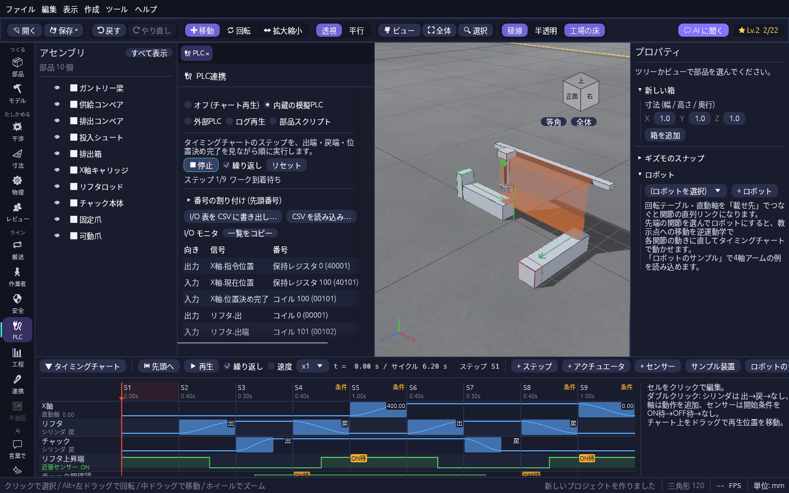 | 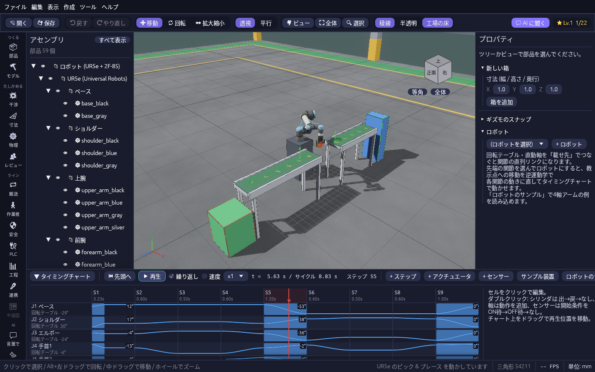 |
| **人と AGV の動線をヒートマップで見る** | **作業者の目の高さで歩いて通路幅を測る** |
| 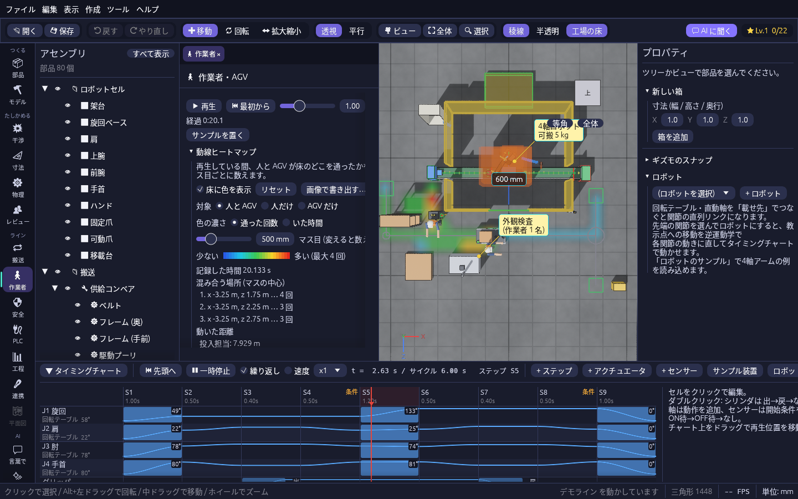 | 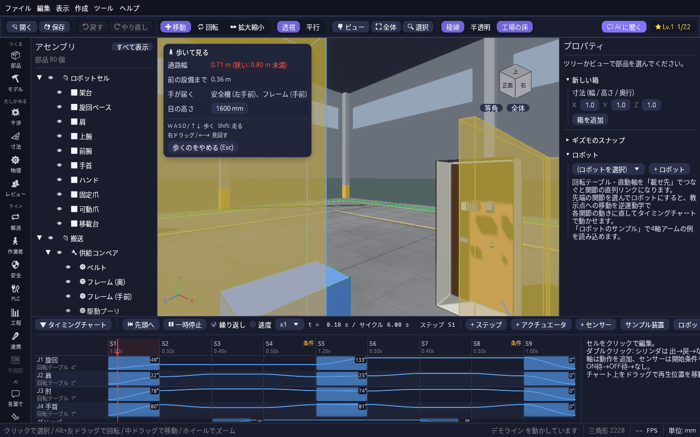 |
| **止まった設備を光と煙で知らせる** | **文章からラインの下書きを作る** |
| 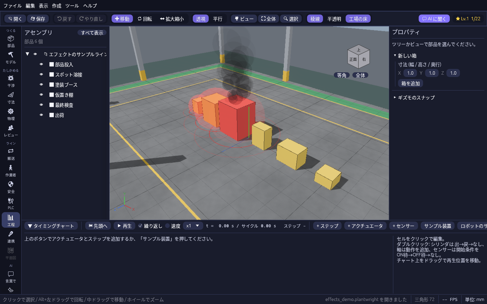 | 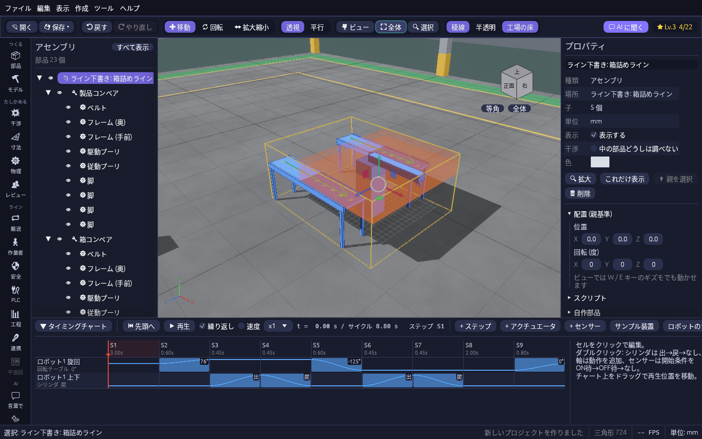 |

## はじめかた

### ダウンロードして使う(Windows / Mac)

[Releases](https://github.com/T-T0821/cadsim/releases) の最新版から自分の OS 用のファイルを取り、開くだけで起動します。インストールは要りません。

| OS | ファイル | 起動のしかた |
| --- | --- | --- |
| Windows 10 / 11 (64bit) | `plantwright-<版>-windows-x86_64.exe` | ダブルクリック(zip 版は展開して `plantwright.exe`) |
| macOS 11 以降 | `plantwright-<版>-macos-universal.zip` | 展開して `plantwright.app` を開く |

<details>
<summary>初回に警告が出たとき・やめるとき・以前の名前 (cadsim) から移るとき</summary>

署名をしていないため、初回は警告が出ます。

- **Windows**: 「WindowsによってPCが保護されました」と出たら「詳細情報」→「実行」。
- **Mac**: 「開発元を検証できない」「開けません」と出たら、アプリを右クリック →「開く」→「開く」。macOS 15 以降でこの方法が出ないときは、一度開こうとしたあと「システム設定」→「プライバシーとセキュリティ」の下のほうにある「このまま開く」を押します。それでも開けないときは、ターミナルで `xattr -dr com.apple.quarantine "/Applications/plantwright.app"`(置いた場所に合わせて変えてください)を実行してから開いてください。

やめるときは、ダウンロードしたファイル(Mac は `.app`)を削除するだけです。

以前の名前 (cadsim) の版を使っていた場合も、`.cadsim` のプロジェクトファイルはそのまま開けます。ミッションの進み具合・AI のキー・自作部品などの設定も、初めて起動したときに自動で引き継ぎます。

</details>

### ソースから動かす

[Rust](https://www.rust-lang.org/ja/tools/install) と C++ のコンパイラを入れてから、このフォルダで実行します(Linux では先に `g++ libasound2-dev libudev-dev libwayland-dev libxkbcommon-dev` を入れてください)。

```sh
cargo run                              # デモラインを開き、動かした状態で起動
cargo run -- path/to/part.step         # STEP ファイルを開いて起動
cargo run -- path/to/line.plantwright  # 保存したプロジェクトを開いて起動
```

初回はビルドに数分かかります。Docker だけでビルドする方法や、負荷テスト用の起動オプションは [インストールと起動](docs/src/install.md) にあります。

### 最初の5分

起動すると、ロボットセル・コンベア・安全柵・AGV・作業者を並べた **デモライン** が動いた状態で開き、**ようこそ画面** が出ます。
「▶ チュートリアルを始める」を押すと、左下のミッションカードが手順を1つずつ案内し、次に押すボタンが **黄色く光ります**。
基本編(見る → さわる → ラインを組む → 保存する)で主な使い方をひと回りしたら、応用編(動きを付ける → PLC・ライン連携 → AI・一人称・動画)に進めます。

| ようこそ画面 | 次に押すボタンが光る |
| --- | --- |
| 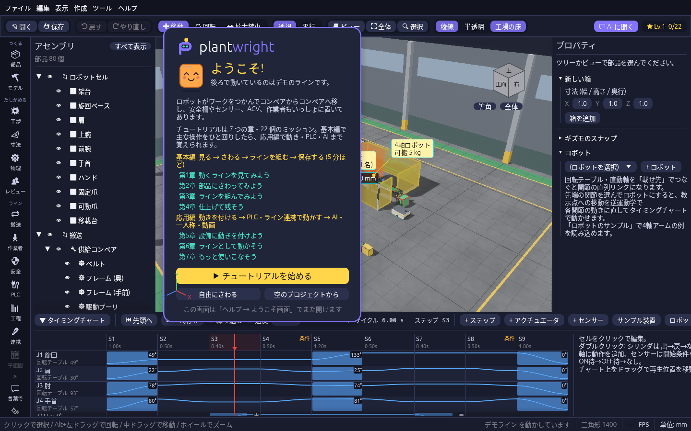 | 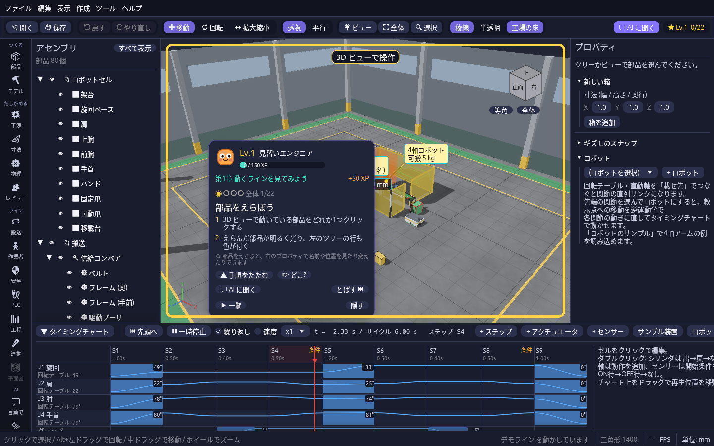 |

迷ったら、ツールバー右上の **💬 AI に聞く**(F1)で「シリンダを置いて動かすには?」のように聞くと、押す場所を手順で答え、使う道具を開くボタンを出します。

## 基本の流れ

1. **データを開く。** 「ファイル → 開く」(Ctrl+O)か、ファイルをウィンドウにドラッグ&ドロップします。
2. **部品を選ぶ。** 3D ビューで部品をクリックするか、左のアセンブリツリーで行をクリックします。
3. **動かす。** W(移動)/ E(回転)/ R(拡大縮小)でギズモを出し、矢印や輪をドラッグします。右のプロパティに数値を打ち込んでも動かせます。
4. **ぶつかりを確かめる。** 動かすたびに干渉が自動で調べられ、ぶつかった部品は赤くなります。
5. **保存する。** 「ファイル → 保存」(Ctrl+S)で `.plantwright` ファイルに保存します。

まちがえたら Ctrl+Z で元に戻せます(やり直しは Ctrl+Y)。

### 画面の見かた

| 場所 | 内容 |
| --- | --- |
| 上 | メニューとツールバー。右端に **💬 AI に聞く** とレベル表示 |
| 左端 | **ツールレール**。干渉・安全・PLC などの道具のアイコン。押すと 3D ビューの左隣の欄にパネルが開き、開いた道具はタブで切り替えます |
| 左 | アセンブリツリー |
| 中央 | 3D ビュー。右上のビューキューブで向きを変え、左下にミッションカード。計測や穴あけなどの道具を使っている間は、次にすることの案内がビューの下に出ます |
| 右 | プロパティ(名前・色・位置・寸法、標準部品の寸法、ロボットなど) |
| 下 | タイミングチャートとステータスバー |

| 分類 | ツールレールの道具 |
| --- | --- |
| つくる | 📦 部品(部品ライブラリ)、🔨 モデル(円柱・押し出し・穴・ブーリアン) |
| たしかめる | 💥 干渉、📐 寸法、⚙ 物理、👥 レビュー |
| ライン | 🔁 搬送、🚶 作業者・AGV、🛡 安全、🔌 PLC、📊 工程、🔗 連携、🗺 平面図 |
| AI | 💬 言葉で、✨ ラダー |

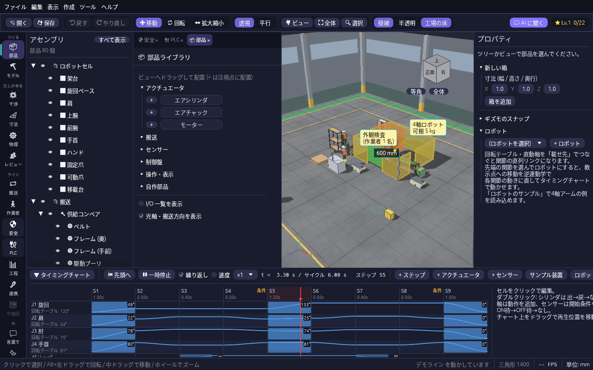

詳しくは [画面の見かた](docs/src/screen.md) を見てください。

## できること

それぞれの詳しい使い方は、リンク先の操作マニュアルにあります。

### 読み込む・つくる

| できること | 画面のどこで | 詳しく |
| --- | --- | --- |
| STEP・glTF / GLB・OpenUSD・OBJ・STL を開く。CAD で上書き保存すると開いたまま形状が新しくなる | ファイル → 開く / ドラッグ&ドロップ | [STEP を開く](docs/src/step-import.md)・[glTF・USD など](docs/src/interchange.md) |
| SOLIDWORKS・Inventor・CATIA などのデータを使う(STEP に書き出してから開く) | 各 CAD の書き出し | [各 CAD から STEP を書き出す](docs/src/step-export.md) |
| 標準部品(シリンダ・コンベア・センサー・シーケンサー・制御盤など)を置き、I/O 点の一覧を見る | 📦 部品 → ビューへドラッグ | [部品ライブラリと自作部品](docs/src/parts-library.md) |
| 動きを付けた部品を自作部品として保存し、何個でも置く | プロパティの「自作部品」 | [部品ライブラリと自作部品](docs/src/parts-library.md) |
| 箱・円柱を作る、床に形を描いて押し出す、面をクリックして穴をあける、ブーリアンをかける | 作成メニュー / プロパティの「形を編集」/ 🔨 モデル | [箱](docs/src/boxes.md)・[モデリング](docs/src/modeling.md) |
| あけた穴やフィレットを、あとから直す・消す | プロパティの「形の編集履歴」 | [モデリング](docs/src/modeling.md) |
| 設計変更後の形状に差し替える(動きの設定はそのまま) | 編集 → 形状を差し替え… | [形状の差し替え](docs/src/replace-geometry.md) |
| 工場の平面図(DXF / PDF / 画像)を床に敷く、点群を読み込んで干渉を調べる | ファイル → 開く / 🗺 平面図 | [平面図](docs/src/floor-plan.md)・[点群](docs/src/point-cloud.md) |
| 1 万部品のアセンブリを軽く扱う、小さな穴とフィレットを省略する | 表示メニュー | [大きなアセンブリ](docs/src/large-assembly.md) |

### たしかめる

| できること | 画面のどこで | 詳しく |
| --- | --- | --- |
| 干渉(食い込み)・接触・近接を自動で調べ、距離を測る | 💥 干渉 / M キー | [干渉チェックと距離計測](docs/src/simulation.md) |
| 寸法と注記を 3D に置いて残す | 📐 寸法 | [寸法と注記](docs/src/annotations.md) |
| 安全柵・ライトカーテン・非常停止を置き、止まり方と安全距離を確かめる | 🛡 安全 | [安全機器](docs/src/safety.md) |
| 作業者の目の高さで歩き、通路幅と手の届く範囲を測る | ツールバーの 🎥 ビュー → 🚶 一人称で歩く | [カメラとビュー](docs/src/camera.md#一人称で歩く) |
| 重力・摩擦でワークを流し、ケーブル・ホースの垂れと曲げを見る | ⚙ 物理 | [物理演算](docs/src/physics.md) |
| 画質を選ぶ、工場の床と壁を背景に出す | 表示 → 画質 / 工場の床と壁 | [画質と工場の背景](docs/src/display.md) |

### 動きを付ける

| できること | 画面のどこで | 詳しく |
| --- | --- | --- |
| シリンダ・直動軸・回転テーブルの動きをステップで組んで再生する(加減速・電子カムも) | 画面下のタイミングチャート | [タイミングチャート](docs/src/timing-chart.md) |
| センサーでステップを待たせる(インターロック) | チャートの + センサー | [センサーとインターロック](docs/src/sensors.md) |
| コンベアでワークを流し、チャックで掴んで運ぶ | 🔁 搬送 | [ワーク搬送](docs/src/conveyor.md) |
| ロボットに教示点を置いて動かす(MoveJ / MoveL、サイクルタイム、MELFA 書き出し、実機 UR とつなぐ) | プロパティの「ロボット」 | [関節とロボット](docs/src/robot.md) |
| URDF のロボット機種や、本物の装置(UR5e + 2F-85)の CAD で動かす | ファイル → ロボット機種 (URDF) を読み込む… | [ロボット機種と本物の装置](docs/src/robot-models.md) |
| 部品にスクリプトを書いて、条件分けや繰り返しの動きを作る | プロパティの「スクリプト」 | [部品スクリプト](docs/src/scripting.md) |

### ラインを検討する

| できること | 画面のどこで | 詳しく |
| --- | --- | --- |
| 工程とバッファを並べて数時間分を早回しし、スループット・ボトルネック・電力を見る。巻き戻して詰まりの原因を探す | 📊 工程 | [工程シミュレーション](docs/src/flow.md) |
| 作業者の名簿とシフトを入れて、何人で回るかを比べる | 📊 工程 →「人員」タブ | [工程シミュレーション](docs/src/flow.md#作業者を割り当てて何人で回るかを見る) |
| 複数ラインの工場、品種と納期、設定を変えた案どうしを比べる | 📊 工程 →「工場」「計画」「案の比較」タブ | [工場・生産計画・案の比較](docs/src/factory-plan.md) |
| 作業者を歩かせて作業時間を見る、AGV の経路を引いて台数を比べる、動線をヒートマップで見る | 🚶 作業者 | [作業者と AGV](docs/src/operator-agv.md) |
| 工程・AGV・コンベア・安全停止を 1 つの時計で動かす | 🔗 連携 | [ライン連携](docs/src/line.md) |
| 止まった所・溶接中の所を光・煙・火花で、警報を音で知らせる | 表示 → 状態のエフェクト / 音の設定 | [音とエフェクト](docs/src/sound-effects.md) |

### PLC とつなぐ

| できること | 画面のどこで | 詳しく |
| --- | --- | --- |
| PLC の出力でシリンダや軸を動かす(内蔵の模擬PLC・Modbus TCP・OPC UA・三菱 SLMP・ログ再生) | 🔌 PLC | [PLC で設備を動かす](docs/src/plc.md) |
| チャートから三菱 PLC 向けのラダーと I/O 表を作る、説明文からチャートを作る | ✨ ラダー | [生成 AI を使う](docs/src/ai.md#チャートラダーの自動生成) |

### 見せる・残す・共有する

| できること | 画面のどこで | 詳しく |
| --- | --- | --- |
| プロジェクトを保存する(形状は元のファイルから読み直す) | ファイル → 保存 | [保存と読み込み](docs/src/project.md) |
| 図面(PDF / DXF)と部品表(Excel / CSV)を書き出す | ファイル → 書き出し | [図面と部品表](docs/src/drawing.md) |
| サイクルタイムと干渉結果を CSV にする | ファイル → シミュレーション結果 (CSV) | [CSV 出力](docs/src/csv-export.md) |
| 動きを MP4 / GIF にする。カメラワークを付けた紹介動画も撮れる | ファイル → 書き出し → 動画で書き出し… | [動きを動画にする](docs/src/video-export.md) |
| HTML 1 つに書き出して、ブラウザ・スマホ・VR(実寸)で見てもらう | ファイル → 書き出し → ブラウザ / VR で見る | [ブラウザ・スマホ・VR で見る](docs/src/web-viewer.md) |
| 離れた人と同じ 3D に入って、視点と指した場所を見ながらレビューする | 👥 レビュー | [レビュー](docs/src/review.md) |

### AI を使う

| できること | 画面のどこで | 詳しく |
| --- | --- | --- |
| 使い方を文で聞く | 💬 AI に聞く(F1) | [生成 AI を使う](docs/src/ai.md) |
| 「コンベア2本とロボット1台で箱詰め」のような文から、設備とチャートの下書きを作る | 💬 言葉で | [生成 AI を使う](docs/src/ai.md#言葉でラインを組む) |
| Claude Code や Claude デスクトップアプリから、Claude に画面を操作してもらう | `--mcp` を付けて起動 | [Claude に画面を操作させる](docs/src/mcp.md) |

生成 AI には Anthropic の Claude を使います。API キーは「ツール → AI の設定…」で入れます(キーがなくても、キーワードから作る簡易版で動きます)。

### サンプルで試す

「ファイル → サンプルを開く」から、機能を試せるサンプルを開けます。

| サンプル | 試せること |
| --- | --- |
| デモライン | ロボットの移載・コンベア・AGV・安全機器・作業者・工程シミュレーションをまとめて |
| 本物の装置 (UR5e + Robotiq 2F-85) / 本物の装置のライン | メーカーが公開している本物の形状で、ピック & プレースとライン全体 |
| ロボット機種 UR5e (URDF) | URDF から読み込んだロボットのジョグと教示点 |
| 工程シミュレーションのサンプル | 早回し・ボトルネック・巻き戻し |
| 負荷テスト用シーン | 1000 / 5000 / 10000 部品の重さ |

## マウスとキーの操作

マウスは Unity / Unreal Engine のシーンビューと同じ割り当てです。すべての操作は「ヘルプ → キー操作の一覧」か [ショートカット一覧](docs/src/shortcuts.md) で見られます。

| 見る | | 選ぶ・動かす | |
| --- | --- | --- | --- |
| Alt + 左ドラッグ | 回転 | 左クリック | 部品を選ぶ |
| 中ドラッグ | 平行移動 | W / E / R | 移動 / 回転 / 拡大縮小のギズモ |
| ホイール | ズーム | Ctrl + ギズモ | 一定量ずつ動かす |
| 右ドラッグ + W A S D | 見回して移動 | M | 距離を測る |
| F / Home | 選択を拡大 / 全体 | Delete | 削除 |
| 1 / 3 / 7 / 0 | 正面 / 右 / 上 / 等角 | Esc | 選択を解除・道具をやめる |
| 5 | 透視 / 平行の切り替え | Ctrl + Z / Ctrl + Y | 元に戻す / やり直し |
| H / Alt + H | 隠す / すべて表示 | Ctrl + S / Ctrl + O | 保存 / 開く |

3D ビューでは、部品を **ダブルクリック** で画面いっぱいに拡大、**右クリック** で部品のメニュー(拡大・これだけ表示・隠す・親を選択・穴をあける・削除)が出ます。カーソルを部品の上で止めると名前が出ます。

## 開発中・予定

- 作業者のボタン操作を PLC の入力にする

## 開発する人へ

変更を送る前に、手元で次を実行してすべて通ることを確認してください(`make check` でもまとめて流せます。Rust がなければ `make docker-check`)。

```sh
cargo fmt --all --check
cargo clippy --all-targets --locked -- -D warnings
cargo test --locked
```

画面に関わる変更をしたら、画面での動作確認も流してください。主な操作を自動で操作して画面を撮り、前に撮った基準画像と見比べます。結果は `target/ui-check/index.html` で見られます。

```sh
cargo ui-check        # Windows / Mac / 画面のある Linux
tools/ui_check.sh     # 画面のない Linux (仮想画面で動かす)
```

README とマニュアルの画面写真は `docs/screenshots/scenarios/` の手順書で撮っています。画面が変わったら `tools/ui_check.sh docs/screenshots/scenarios --update --baseline docs/screenshots` で撮り直し、マニュアルで使う分は `tools/copy_manual_images.sh` で `docs/src/images/` に写します。

<details>
<summary>設計資料の一覧(docs/)</summary>

| 資料 | 内容 |
| --- | --- |
| [docs/architecture.md](docs/architecture.md) | コードの構成 (機能ごとのフォルダ、ファイル名の決まり) |
| [docs/dev-environment.md](docs/dev-environment.md) | 開発コンテナ(Dev Containers)と Makefile の目標、Windows 向けのクロスビルド |
| [docs/internals.md](docs/internals.md) | 使っているライブラリ、各機能のしくみ、サンプルとフォントとアイコンの作り方 |
| [docs/project-file.md](docs/project-file.md) | プロジェクトファイル(.plantwright)の形式 |
| [docs/simulation.md](docs/simulation.md) | 干渉チェック・距離計測・結果の CSV 出力の設計 |
| [docs/performance.md](docs/performance.md) | 大規模アセンブリを軽くするしくみと、負荷テスト・FPS の測り方 |
| [docs/defeature.md](docs/defeature.md) | 小さな穴とフィレットを省略する形状の簡略化のしくみ |
| [docs/modeling.md](docs/modeling.md) | 円柱・押し出し・穴あけ・ブーリアンのしくみと保存のしかた |
| [docs/library.md](docs/library.md) | 標準部品ライブラリの設計と、ほかの機能からの使い方 |
| [docs/custom-parts.md](docs/custom-parts.md) | 自作部品ライブラリ(保存するもの、`part.cadpart` の形式、置くときの名前と id の付け替え) |
| [docs/site.md](docs/site.md) | 平面図の下敷きと点群(間引き・LOD・干渉)のしくみ |
| [docs/drawing.md](docs/drawing.md) | 2D 図面(投影・かくれ線・寸法・PDF / DXF)と部品表(Excel / CSV)のしくみ |
| [docs/web-viewer.md](docs/web-viewer.md) | Web ビューア(.html)と VR / AR 表示のしくみ |
| [docs/video-export.md](docs/video-export.md) | 動画書き出しのしくみ(カメラワークのつなぎ方も) |
| [docs/conveyor.md](docs/conveyor.md) | コンベアのワーク搬送とグリッパの把持・解放のしくみ |
| [docs/physics.md](docs/physics.md) | 物理演算・ベルトコンベア・ケーブルの紐モデルの設計 |
| [docs/robot.md](docs/robot.md) | 関節・ロボットの順運動学と逆運動学、教示点への移動の展開 |
| [docs/urdf.md](docs/urdf.md) | URDF の読み込み、関節への直し方、同梱の UR5e と公開されている機種のライセンス |
| [docs/real-robot.md](docs/real-robot.md) | 本物の装置のサンプル(UR5e + 2F-85)の出典・ライセンス、作り直すスクリプト |
| [docs/scripting.md](docs/scripting.md) | 部品スクリプト(Rhai)の実行と待ちのしくみ |
| [docs/flow.md](docs/flow.md) | 工程シミュレーション(離散事象シミュレーション・集計・案の比較・Excel 書き出し)の設計 |
| [docs/staffing.md](docs/staffing.md) | 人員配置(作業者の割り当て・シフト・人数の比較)の設計 |
| [docs/safety-and-floor.md](docs/safety-and-floor.md) | 安全機器・作業者・AGV のしくみ(検知と停止、安全距離、配車、交差点の排他) |
| [docs/walk.md](docs/walk.md) | 一人称で歩く(体の寸法、ぶつかりの調べ方、通路幅と手の届く範囲の測り方) |
| [docs/line.md](docs/line.md) | ライン連携のしくみ(1つの時計、工程と AGV の受け渡し、信号表の割り付け) |
| [docs/rewind.md](docs/rewind.md) | 巻き戻しと時間スライダーのしくみ |
| [docs/effects.md](docs/effects.md) | 状態のエフェクト(光・煙・火花の出し方と、重くしないための工夫) |
| [docs/sound.md](docs/sound.md) | 設備の音と警報(波形の作り方、鳴らす条件、聞こえ方、設定ファイル) |
| [docs/plc.md](docs/plc.md) | PLC 連携(I/O の割り付け、模擬 PLC、Modbus TCP、OPC UA、三菱 PLC の SLMP、ログ再生)の設計 |
| [docs/ai.md](docs/ai.md) | 生成 AI(Claude API)の呼び出し口、チャートの下書き・ラダーの生成・動作の説明のしくみ |
| [docs/line-compose.md](docs/line-compose.md) | 言葉でラインを組むしくみ(下書きの型、整え方、並べ方、チャートへの展開) |
| [docs/mcp.md](docs/mcp.md) | Claude に画面を操作させる MCP の操作口(ツールの一覧、写真の座標、試し方) |
| [docs/review.md](docs/review.md) | 複数人でのレビュー(ホストと参加、通信の取り決め、配置の共有) |
| [docs/playful-ui.md](docs/playful-ui.md) | ゲーム風の画面(配色・ツールレール・AI に聞く・ミッション・経験値・設定ファイル)のしくみ |
| [docs/demo-line.md](docs/demo-line.md) | デモライン(`samples/demo_line.plantwright`)の中身と、作り直すスクリプトの使い方 |
| [docs/ui-check.md](docs/ui-check.md) | 画面での動作確認の自動化(手順書の書き方、基準画像の更新、結果の見かた) |
| [docs/release.md](docs/release.md) | Windows / Mac 向けの配布パッケージと Release の作り方 |
| [docs/licenses.md](docs/licenses.md) | 依存ライブラリのライセンスの方針と確かめ方、特許・商標で気をつける点 |

</details>

## ライセンス

[MIT License](LICENSE-MIT) と [Apache License 2.0](LICENSE-APACHE) のどちらかを選んで使えます(デュアルライセンス)。

ただし、同梱の日本語フォント `assets/fonts/NotoSansJP-Subset.otf` は [SIL Open Font License 1.1](assets/fonts/OFL.txt) です。
本物の装置のサンプルの形状(`samples/real_robot/ur5e.glb` と `robotiq_2f85.glb`、アプリにも埋め込み)は BSD 3-Clause です。出典とライセンス文は [samples/real_robot](samples/real_robot/README.md) にあります。

使っているライブラリ・フォント・サンプル形状のライセンスの全文は、アプリの **ヘルプ → ライセンス** で見られます。配布の zip と Mac の `.app` には `THIRD_PARTY_LICENSES.txt` として入っています。
