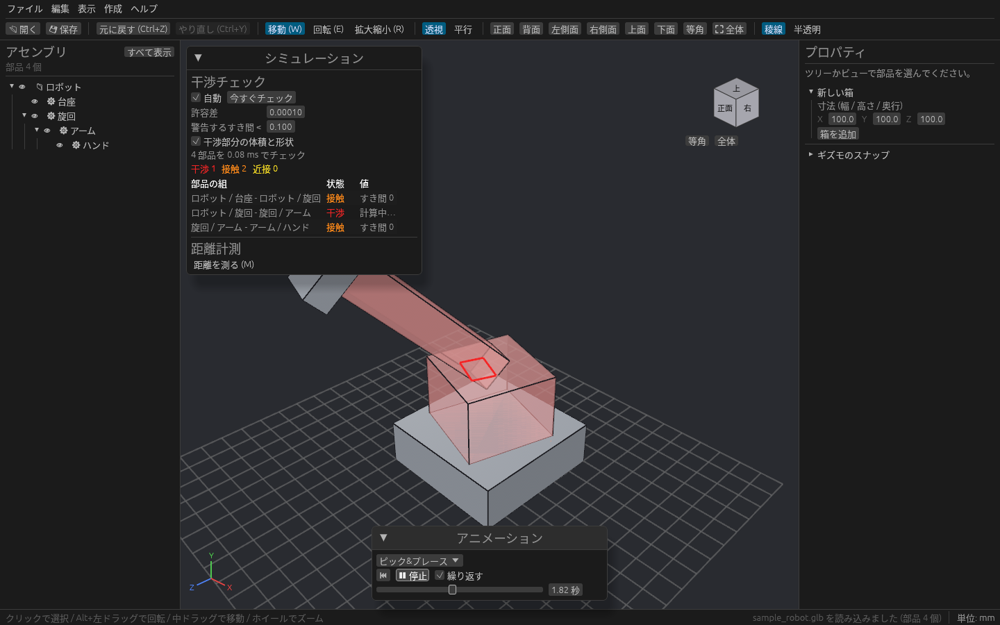
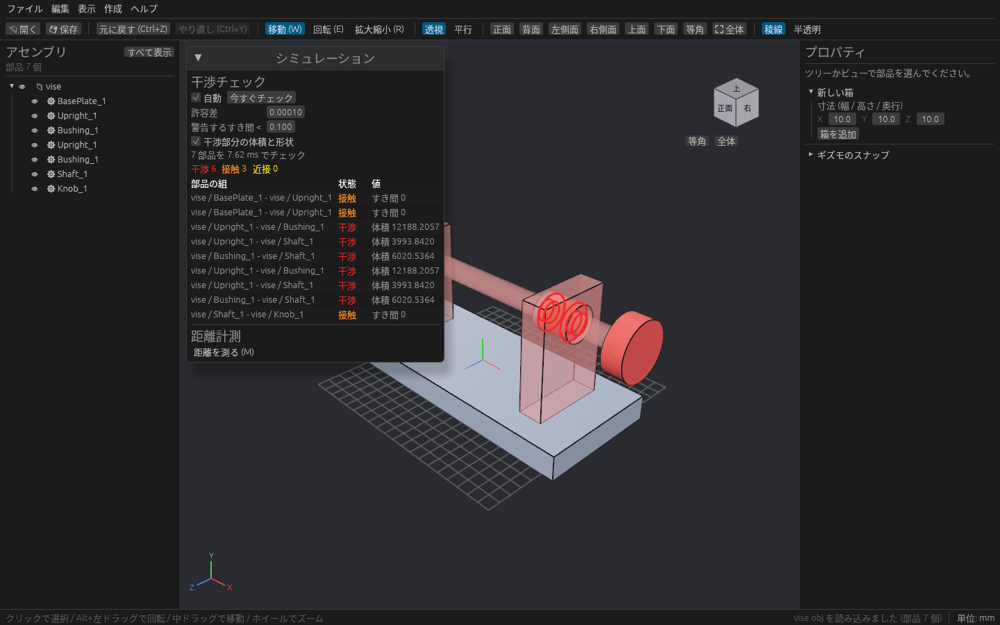
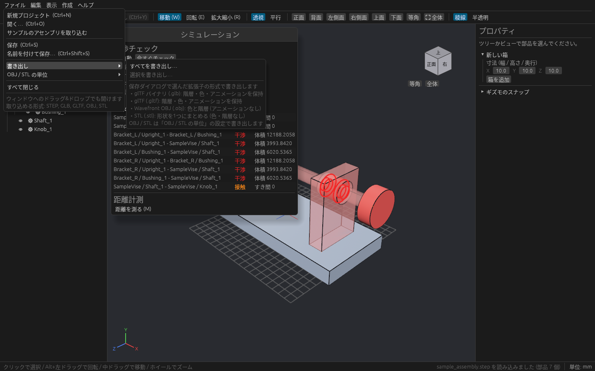
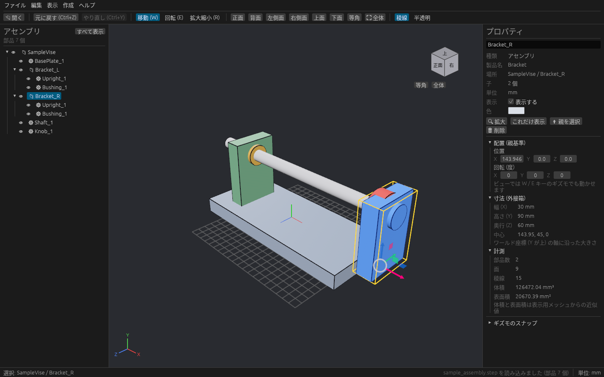
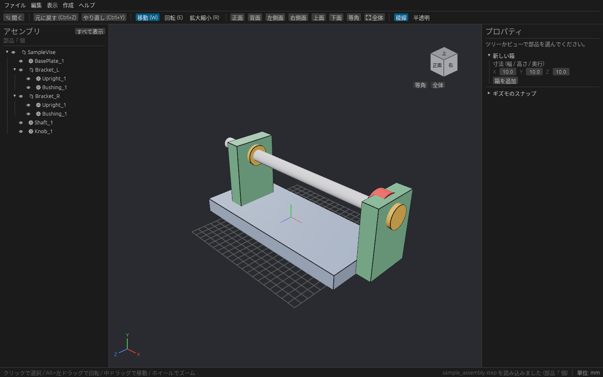
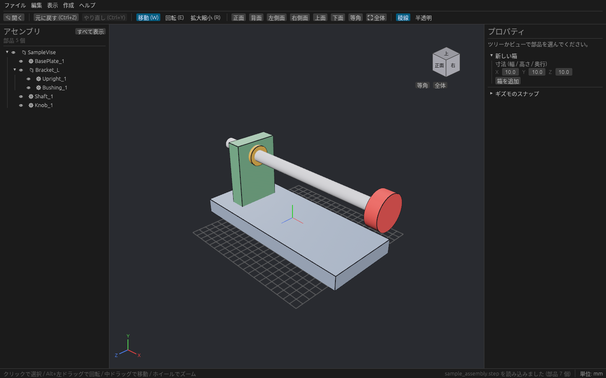
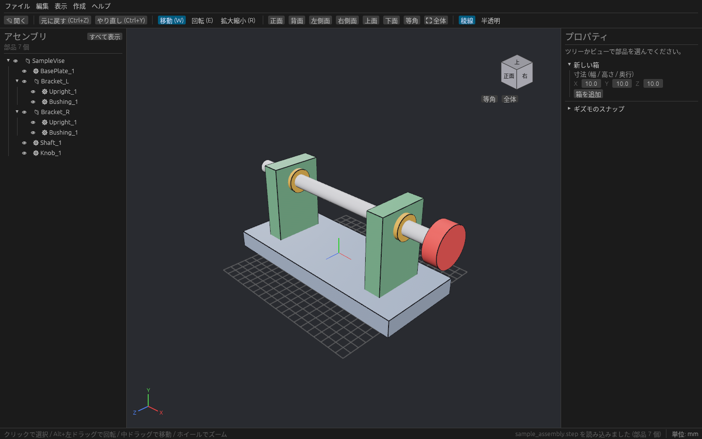

# cadsim の内部のしくみ

開発者向けの資料です。使い方は [README](../README.md) を見てください。
レイヤーの分け方は [architecture.md](architecture.md) にまとめています。

## 動作確認したバージョン

| crate | バージョン |
| --- | --- |
| Rust | 1.97.1 以上(依存crateの要件) |
| bevy | 0.20 |
| bevy_egui | 0.43 |
| truck-modeling | 0.6 |
| truck-meshalgo | 0.4 |
| truck-stepio | 0.3 |
| transform-gizmo | 0.11 |
| rfd(ファイル選択ダイアログ) | 0.17 |
| serde / serde_json(プロジェクトファイル、glTF の書き出し) | 1 |
| gltf(glTF / GLB の読み込み) | 1.4 |
| tobj(OBJ の読み込み) | 4 |
| stl_io(STL の読み書き) | 0.11 |
| openusd(OpenUSD の読み書き。純 Rust) | 0.8 |
| rust_xlsxwriter(工程シミュレーションの Excel 書き出し) | 0.102 |

## コードの構成

層の分け方は [architecture.md](architecture.md) を見てください。

```text
crates/cadsim_core/   Bevy に依存しないドメイン (cargo test -p cadsim_core で単体テスト)
├── math.rs          回転・行列・外接箱の計算 (f64)
├── simulation/      干渉チェックの幾何計算 (geometry / mesh / interference / overlap)
└── flow/            工程モデル (model)、離散事象シミュレーションと集計 (sim)、状態・稼働率の色 (palette)
src/                  アプリ本体 (Bevy + egui)
├── main.rs          アプリの組み立て (プラグインを並べるだけ)
├── model.rs         設計データ: アセンブリの木 (f64) と選択状態
├── step_import.rs   STEP → アセンブリの木と B-rep (Bevy に依存しない)
├── file_io.rs       ダイアログ・ドラッグ&ドロップ・別スレッドでの読み込み・書き出し
├── interchange/     glTF / OBJ / STL などの読み書き (形式に依存しない中間表現 Scene を経由)
│   ├── mod.rs        Scene・Format・対応形式の一覧 FORMATS
│   ├── model_io.rs   Scene ⇔ Model の変換 (単位の換算、メッシュの稜線)
│   ├── gltf.rs / obj.rs / stl.rs
│   ├── usd.rs        OpenUSD (.usda / .usdc / .usdz)
│   ├── web_viewer.rs Web ビューア (.html、GLB を埋め込んだ1ファイル。docs/web-viewer.md)
│   └── samples.rs    サンプルファイルを作るテスト (手で実行)
├── animation.rs     取り込んだアニメーションの再生
├── project.rs       プロジェクトファイル (.cadsim) の保存と読み込み
├── viewport.rs      3D 表示: メッシュ作成、選択の強調、簡略表示 (LOD)、グリッド、クリック選択
├── part_mesh.rs     部品1つ分の表示用メッシュ (面をまとめたもの・面番号の表・簡略形状。Bevy に依存しない)
├── bvh.rs           外接箱の木 (BVH) とレイの当たり判定 (Bevy に依存しない)
├── stress.rs        負荷テスト用の数千部品のシーン
├── bench.rs         `--bench` で FPS を測って終了する
├── camera.rs        オービットカメラ、標準ビュー、全体表示、透視 / 平行投影
├── gizmo.rs         移動・回転・拡大縮小のギズモとスナップ
├── motion/          タイミングチャートと動作シミュレーション
│   ├── mod.rs        プラグイン、再生状態、SimulationPose (干渉チェックとのつなぎ口)
│   ├── chart.rs      アクチュエータ・ステップのデータと時刻表への変換 (Bevy に依存しない)
│   ├── pose.rs       時刻 t のアクチュエータ・部品の動き (f64 の剛体変換)
│   ├── ui.rs         タイミングチャートのパネル
│   ├── export.rs     1サイクルの動きを書き出し用のアニメーションにする
│   └── demo.rs       サンプル装置 (ピック & プレース)
├── shortcuts.rs     キーボードショートカット
├── history.rs       元に戻す・やり直し
├── math.rs          f64 の配置を Bevy の Transform にする (計算は cadsim_core::math)
├── japanese_font.rs egui に日本語フォントを登録
├── simulation/      干渉チェックの配線・表示・パネルと距離計測 (詳しくは docs/simulation.md)
├── annotation.rs    3D 上の寸法と注記 (置く操作・描画・パネル・保存形式)
├── flow/            工程シミュレーションの配線と画面 (計算は cadsim_core::flow。詳しくは docs/flow.md)
│   ├── record.rs     .cadsim に書く形
│   ├── xlsx.rs       Excel 書き出し
│   ├── mod.rs        プラグイン、早送りの再生、3D の色分け (FlowColors)
│   └── ui.rs         工程シミュレーションのウィンドウ
└── ui/
    ├── mod.rs        画面の割り付け (上 → 下 → 左 → 右 → 残りが 3D ビュー)
    ├── menu.rs       メニューバーとツールバー
    ├── tree.rs       アセンブリツリー
    ├── properties.rs プロパティパネル
    ├── status.rs     ステータスバーと読み込み中の表示
    ├── animation.rs  アニメーションの再生パネル
    ├── view_cube.rs  ビューキューブと座標軸
    └── widgets.rs    数値入力などの小さな部品
```

データは一方向に流れます: **UI・ギズモ・読み込み → `Model`(f64)→ `viewport` が Bevy のエンティティに写す**。
動作シミュレーションは `Model` を書き換えず、`viewport` が配置を写すときに `SimulationPose` の動きを重ねます。
`Model` は Bevy のエンティティを知らないので、表示を変えても設計データには影響しません。

## 各機能のしくみ

### STEP の読み込み(`step_import.rs`)

1. `ruststep` で STEP をパースし、`#id` からレコードを引ける表を作る。
2. `PRODUCT_DEFINITION` を製品、`NEXT_ASSEMBLY_USAGE_OCCURRENCE` を親子関係として木を組む。配置は `CONTEXT_DEPENDENT_SHAPE_REPRESENTATION` → `ITEM_DEFINED_TRANSFORMATION` の2つの `AXIS2_PLACEMENT_3D` から「子 → 親」の行列を求める。
3. 部品の形状(`MANIFOLD_SOLID_BREP` などのシェル)は `truck-stepio` で truck の B-rep に変換し、`robust_triangulation` で面ごとのメッシュと稜線にする。許容誤差は部品の大きさ(と一番薄い方向の寸法)に合わせる。
4. 同じ製品の形状は `Arc` で共有し、Bevy 側のメッシュも形状ごとに1回だけ作る。
5. STEP は Z 軸が上なので、ルートの配置に「Z 上 → Y 上」の回転を入れて Bevy の座標に合わせる。

構成が書かれていない STEP(シェルだけのもの)は、シェルを1つずつ部品として並べます。読めなかった形状はスキップしてステータスバーに件数を出します。

### 3D ファイルの読み書き(`interchange/`)

各形式はアプリの `Model` を直接触らず、形式に依存しない中間表現 `Scene` とだけやり取りします。

```text
読み込み: ファイル ─(gltf.rs など)→ Scene ─(model_io.rs)→ Model
書き出し: Model ─(model_io.rs)→ Scene ─(gltf.rs など)→ ファイル
```

1. `Scene` はノードの並び(名前・親・親から見た移動 / 回転 / 拡大・三角形メッシュ・色)とアニメーション(ノードごとの「時刻 → 姿勢」のキー)。親は必ず子より前に並ぶ。
2. `Scene` は常にメートル・Y 軸が上で持つ。glTF はそのまま、OBJ / STL は「OBJ / STL の単位」の設定で換算する。`Model` はファイルの単位(STEP なら多くは mm)で持つので、`model_io.rs` が位置とメッシュを換算する。
3. 取り込んだメッシュは STEP の部品と同じ `ImportedShape`(B-rep なし)になる。稜線は B-rep がないので、隣の面と 30° 以上折れている辺と穴の縁を描く。
4. 書き出しでは、箱は truck でテッセレーションし、STEP の部品は表示用のメッシュをそのまま使う。glTF には形状ごとのメッシュ・色ごとのマテリアル・ノードの階層・アニメーション(線形補間の移動 / 回転 / 拡大)を書く。OBJ は部品ごとにワールド座標へ焼き込んだ `o`、STL は全体を1つの形状にまとめる。
5. glTF のアニメーションは、移動・回転・拡大の別々のチャンネルをノードごとの姿勢のキーにまとめて取り込む(Step はそのまま、CubicSpline は値だけを使って線形で近似)。再生中は `animation.rs` が毎フレームそのノードの配置を書き換える。
6. プロジェクト(`.cadsim`)には取り込んだファイルの場所を保存し、開くときにこの経路で読み直す。

書き出した glb は Khronos の glTF Validator でエラー・警告なしを確認しています。

**新しい形式の足し方**: `src/interchange/xxx.rs` に `import(&Path, &UnitOptions) -> Result<Scene, String>` と `export(&Scene, &Path, &UnitOptions) -> Result<(), String>` を書き、`interchange/mod.rs` の `FORMATS` に1行足します。開くダイアログ・ドラッグ&ドロップ・書き出しメニューに自動で出ます。

| glTF のアニメーションを再生(干渉チェックも追従) | OBJ に書き出したサンプルを取り込み直したところ |
| --- | --- |
|  |  |



動作確認用のサンプル `assets/sample_robot.glb`(階層とアニメーション付きのロボット)は `cargo test write_samples -- --ignored` で作り直せます。同時に STEP のサンプルを glb / gltf / obj / stl / usda / usdz に、ロボットを usda / usdz に書き出したものが `target/samples/` にできます。

いまの制限: テクスチャ・スキン・モーフターゲットは読み飛ばします。プロジェクトに保存する配置は移動と回転だけなので、glTF ノードの拡大縮小は保存すると失われます。プロジェクトを開き直すとき OBJ / STL は既定の単位(mm・Y 軸が上)で読み直します。

### OpenUSD の読み書き(`interchange/usd.rs`)

純 Rust の [`openusd`](https://crates.io/crates/openusd) crate を使い、C++ の USD ライブラリには依存しません。

**書き出し**は USDA のテキストを組み立て、`.usdc` / `.usd` はそれを `openusd` でバイナリ(Crate)形式に、`.usdz` はさらにパッケージにします。

```text
/World (Xform, kind = assembly)          defaultPrim。metersPerUnit = 1、upAxis = "Y"
├── Node_0 (Xform, displayName = "ライン 1")
│   ├── xformOp:translate / orient / scale    動く部品は同じ属性の timeSamples (60 タイムコード / 秒)
│   ├── Geom (Mesh)                           三角形、faceVarying 法線 (30° で角を立てる)、extent
│   └── …子のノード
└── Looks (Scope)                         色ごとの Material + UsdPreviewSurface
```

- プリム名は ASCII の識別子にし(日本語名は `Node_番号`)、元の名前は `displayName` に入れるので Omniverse の画面には日本語名が出ます。
- アニメーションは1本のタイムラインになるので、複数のクリップがあるときはノードごとに最初に見つかったものを書きます。タイミングチャートの動きは先頭に入れるので、取り込んだアニメーションより優先されます。

**読み込み**は `openusd` の Stage で合成(サブレイヤー・リファレンス・ペイロード・バリアント・インスタンス)した結果をたどります。

- `xformOpOrder` の translate / scale / orient / rotateX・Y・Z / rotateXYZ など6通り / transform(行列)/ `!invert!` を評価し、時刻サンプルのある時刻ごとの姿勢をアニメーションのキーにします(時刻は `startTimeCode` からの秒)。
- 形状は Mesh(多角形は扇形に三角形分割、leftHanded は向きを反転)と Cube / Sphere / Cylinder / Cone / Capsule(テッセレーションして取り込み)。
- 色はバインドされたマテリアルの `inputs:diffuseColor`(祖先へのバインドもたどる)、なければ `primvars:displayColor`。
- 変換も子もない形状が Xform の唯一の中身なら(cadsim の `Geom` も)、その Xform の部品として1つにまとめます。形状のない枝(マテリアルの Scope など)は取り込みません。
- 非アクティブなプリム、`purpose` が guide / proxy のもの、カメラ・ライト・マテリアルは読み飛ばします。

確認: 書き出した .usda / .usdz を Pixar の USD(usd-core 26)で開き、全バリデーターでエラーがないこと、マテリアルのバインドと時刻ごとの姿勢が正しいことを確かめています。逆に Pixar の USD で作った .usdc(Z 上・mm・アニメーション・Cylinder・マテリアル付き)も読み込めることを確認しています。

いまの制限(読み込み時に無視するもの): NURBS 曲面・曲線・点群・PointInstancer、スキニング・ブレンドシェイプ・頂点アニメーション(points の timeSamples)、テクスチャと UsdPreviewSurface 以外のシェーダー、GeomSubset ごとのマテリアル。シアーを含む変換は移動・回転・拡大に近似します。

### 表示と選択(`viewport.rs`)

1. 部品1つにつき Bevy のエンティティを2つだけ作る。面をすべてまとめた1つのメッシュ(`PartView`)と、子の稜線のメッシュ(`EdgeLines`)。どの三角形がどの面かは `PartMesh::triangle_face` が持つ。
2. 配置・表示/非表示・色・強調は、`Model`・選択・表示設定・干渉の結果・動作シミュレーションのどれかが変わったフレームだけ、木を1回たどって(`Model::visit_parts`)写す。形状が変わったとき(`dirty`)だけメッシュを作り直す。
3. クリックした部品と面は `PartPicker` で求める。部品の外接箱の BVH → 部品内の三角形の BVH の順に調べる(`bvh.rs`)。計測ツールと寸法ツールも同じものを使う。
4. マテリアルは「選択(アセンブリなら子孫すべて)→ 青」「ツリーでホバー → 水色」「それ以外 → 部品の色」で決める。クリックした面は、その面だけのメッシュを重ねてオレンジにする。
5. 稜線は線のメッシュで GPU に描かせる。グリッドと選択の外接箱は Gizmos で描く。グリッドの間隔はモデルの大きさに合わせて 1, 10, 100… と変わる。
6. 部品のエンティティには干渉チェック用の `SimBody`(部品座標の f64 三角形メッシュ + 姿勢 + モデル上で表示中か)も付ける。姿勢と表示/非表示は 2. と一緒に写し、`src/simulation/` がこれを拾って判定する。干渉中の部品は半透明の赤にする。
7. 画面上で小さい部品は粗いメッシュに替え、ごく小さい部品は描かない(`update_level_of_detail`)。大規模アセンブリ向けの工夫は [performance.md](performance.md) にまとめている。

### 画面の割り付け(`ui/mod.rs`)

egui のパネルを上・下・左・右の順に置き、残った領域を 3D ビューにします。3D カメラはその領域だけに描き(`Camera::viewport`)、egui はウィンドウ全体を覆う別のカメラに描きます。カーソルがパネルやビューキューブの上にあるときは、3D ビューのクリックやカメラ操作を止めます。

### カメラと投影(`camera.rs`)

1. カメラの状態は `OrbitCamera`(注視点・向き・距離・平行投影かどうか)だけ。毎フレーム Bevy の `Transform` と `Projection` に写す。
2. 平行投影の画面の高さは `2 × 距離 × tan(画角/2)`、つまり透視投影で注視点の位置に見える高さと同じにしている。切り替えても注視点付近の大きさが変わらず、距離を変えるズーム(ホイール・Alt + 右ドラッグ)や全体表示がそのまま平行投影でも効く。
3. 平行投影ではカメラの後ろ(注視点までの距離の 20 倍まで)も描く。ズームやフライ移動でカメラが物体を通り越しても物体が消えないようにするため。
4. ギズモには、透視投影なら画角から、平行投影なら Bevy が計算した表示範囲から作った投影行列を渡す。

### 箱とギズモ

1. 箱(`BoxPart`)は寸法・位置・回転を f64 で持ち、編集されると truck で B-rep ソリッドを作り直す(`tsweep` を3回 → `rotated` → `translated`)。
2. ギズモ(`src/gizmo.rs`)は transform-gizmo で計算し、egui の背景レイヤーに描く。箱ならパラメータに、取り込んだ部品やアセンブリなら親から見た配置(f64 の行列)に書き戻す。スナップは移動・回転を transform-gizmo の機能に任せ、拡大縮小の寸法だけ `snap_size` で丸める。

### タイミングチャートと干渉チェックのつながり(`motion/`)

- チャートは「ステップ × アクチュエータ」の表。ステップの動作は同時に始まり、すべて完了 + タイマーで次へ進む。サイクル開始時はすべてのアクチュエータが原点(設計位置)にある。
- 再生中の動きは `motion::SimulationPose` に入る(アクチュエータに割り当てたノード id → 設計位置からのワールド座標での剛体変換, f64)。
- `SimulationPose::pose_of(&model, node)` は、部品自身か、いちばん近い祖先のアセンブリの動きを返す。
- `viewport.rs` の `sync_views` が `.after(MotionSet::Pose)` で動きを部品の配置に重ね、表示用の `Transform` と干渉チェック用の `SimBody.pose` の両方に写すので、再生・スクラブ中も各時刻の位置で干渉チェックが走る。設計データ(`Model`)は書き換えない。
- 書き出し(`motion/export.rs`)では、1サイクルを 1/30 秒ごとに標本化し、親と違う動きをするノードだけに「親から見た配置」のキーを作る(`(動き × 設計のワールド配置)` を親の同じ時刻のワールド配置で割る)。アセンブリに割り当てた動きは、シーンの親子関係で子孫に伝わる。

### 寸法と注記(`annotation.rs`)

- 値は f64 の形状から計算し、単位はモデルの単位(mm など)で出す。吸着は頂点・辺の中点・面の中心の 12 px 以内。
- 辺の長さは直線なら両矢印、円弧などは線に沿った長さ。面間距離は平行な平面なら1つ目の面の中心から2つ目の面への垂線、平行でなければ面どうしの角度、曲面を含むと中心どうしの距離。
- 寸法は「どの部品のどこか」で覚えるので、部品やアセンブリを動かすと付いて行く。箱の点は箱の半寸法で割った値で覚えるので、箱の寸法を変えても同じ頂点・面に付いたまま。
- 寸法線は部品に隠れないよう手前に描く。部品を隠すとその寸法も隠れる。
- 追加・削除・すべて削除・注記の文字の編集は元に戻せる。部品を削除すると寸法は隠れ、部品の削除を元に戻すと寸法も戻る。
- 距離計測(シミュレーション)と寸法の道具は、片方を始めるともう片方は止まる。

### 工程シミュレーション(`flow/`)

工程モデルの離散事象シミュレーションと集計、3D の色分け、Excel 書き出しのしくみは [flow.md](flow.md) にまとめています。工程モデルの編集は元に戻す履歴に入りません。

### 元に戻す・やり直し(`history.rs`)

変更を済ませてから記録する方式です。モデルを書き換えたあと、その変更を戻すための `Command` を `History` に積みます。

- モデルの変更は `ModelChange` で表します。中身は変更前と変更後のノードの写し(`Model::snapshot`、子孫ごと)です。取り込んだ形状は `Arc` で共有しているので、大きなアセンブリでも写すのは軽く済みます。
- 履歴に載るもの: 箱の追加、STEP の読み込み、削除(Delete キー・ツリー・プロパティ)、すべて閉じる、ギズモでの移動・回転・拡大縮小、プロパティでの寸法・位置・回転・名前・色の変更。
- 表示/非表示、選択、カメラは見た目の操作なので履歴に載せません。
- ギズモや数値欄のドラッグは毎フレーム値が変わります。`History::begin_edit` が最初の状態だけを覚え、マウスを離した時点(数値を打ち込んだときは入力欄から抜けた時点)で1件にまとめます。
- 新しく編集するとやり直しの履歴は消えます。履歴は最大 200 件です。

| ギズモで移動 → Delete で削除 | Ctrl+Z で削除を戻す → もう一度 Ctrl+Z で移動を戻す |
| --- | --- |
|  |  |
|  |  |

新しい操作を履歴に載せるには次のようにします。

- ノードを書き換えるなら、書き換える直前に `history.begin_edit(&model, id)` を呼ぶ。追加なら `record_added`、削除なら `history.remove(&mut model, id)` を使う。
- タイミングチャートなどモデル以外のデータは、`Command` トレイトを実装した型を作り、変更を済ませたあとで `history.push(...)` に渡す。

```rust
struct MoveStep { before: f64, after: f64 }

impl Command for MoveStep {
    fn label(&self) -> String { "ステップを移動".into() }
    fn undo(&self, world: &mut World) { /* before に戻す */ }
    fn redo(&self, world: &mut World) { /* after にする */ }
}

history.push(MoveStep { before, after });
```


### ギズモのスナップ

Ctrl を押している間(または「常にスナップ」をオンにしている間)、ギズモの操作が一定量ずつになります。

| ギズモ | 刻み(初期値) | 動き方 |
| --- | --- | --- |
| 移動 | 移動の刻み(0.1) | ドラッグを始めた位置から 0.1 ずつ動く |
| 回転 | 回転の刻み(15°) | ドラッグを始めた向きから 15° ずつ回る。輪に目盛りが出る |
| 拡大縮小 | 寸法の刻み(0.1) | 動かした軸の寸法が 0.1 の倍数になる(触っていない軸の寸法はそのまま) |

移動と回転は Unity と同じく「ドラッグ開始からの変化量」を丸めます。拡大縮小だけは倍率ではなく寸法を丸めるので、寸法をきりのいい値にそろえられます。

## サンプルの STEP

`assets/sample_assembly.step` は `tools/make_sample_step.py` で作った、箱と円柱だけの小さなアセンブリ(万力風)です。外部ライブラリを使わずに AP214 の書式で書き出しているので、STEP の構成を調べる手がかりにもなります。

```text
SampleVise
├── BasePlate_1
├── Bracket_L ─┐  同じサブアセンブリ Bracket を2回使っている
├── Bracket_R ─┴─ Bracket ── Upright_1, Bushing_1
├── Shaft_1
└── Knob_1
```

作り直すときは `python3 tools/make_sample_step.py` を実行します。

## 日本語フォント

egui の標準フォントには日本語がないため、[Noto Sans JP](https://github.com/notofonts/noto-cjk)(SIL Open Font License 1.1)を埋め込んでいます。

- `assets/fonts/NotoSansJP-Subset.otf` … 英数字・記号・かな・JIS 第1/第2水準漢字だけに絞ったもの(約 2.1 MB)。`include_bytes!` で実行ファイルに入るので、配布時にフォントを別に置く必要はありません。
- `assets/fonts/OFL.txt` … フォントのライセンス。配布物にも同梱してください。
- `src/japanese_font.rs` … 起動直後に egui の予備フォントとして登録する。英数字は egui の標準フォント、日本語だけ Noto Sans JP で描かれます。
- `tools/subset_jp_font.py` … 元フォントから絞り込み版を作り直すスクリプト(使い方はファイル先頭)。

## 次に手を入れるところ

- 面ごとの色(STEP で面に付いた色)の読み込み
- 計測ツールの拡張(面と面の角度、面どうしの距離)
- 部品数が数百を超えるときの干渉チェックの高速化(空間分割)
- タイミングチャートの開始条件(センサ入力・インターロック)、ワークの受け渡し(把持中だけ一緒に動く)
- STEP への書き出し
