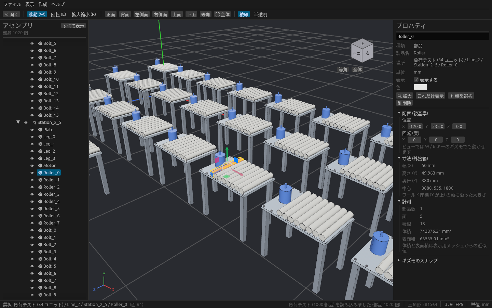

# 大規模アセンブリを軽くするしくみ

数千〜1万部品のアセンブリでも、カメラ操作・選択・ツリーの操作が重くならないようにしている工夫と、その計測結果です。

## 手法

| 手法 | どこで | 効き目 |
| --- | --- | --- |
| 面を1つのメッシュにまとめる | `cadsim_core::part_mesh` | 以前は面ごとにエンティティを作っていたので、5000 部品で約 5 万エンティティになっていた。いまは部品1つにつき2つ(面と稜線)。どの三角形がどの面かは `PartMesh::triangle_face` が持つ |
| 同じ形状でメッシュとマテリアルを共有 | `view/viewport.rs` の `SharedMeshes` | 同じボルト 100 本は Bevy がまとめて描く(自動インスタンシング)。メッシュの作成も形状ごとに1回 |
| 稜線を GPU で描く | `view/viewport.rs` の `line_mesh` | 以前は全部品の稜線を毎フレーム CPU で Gizmos に積んでいた。いまは線のメッシュ(`LineList`)。線には深度のずらしが使えないので、面のマテリアルの深度を少し奥にずらして稜線が埋もれないようにしている |
| 変わったときだけ計算し直す | `view/viewport.rs` の `sync_views`、`Model::visit_parts` | 以前は毎フレーム、部品ごとに祖先をたどり直して配置・表示・色を求めていた(部品数 × 木の深さ)。いまはモデル・選択・表示設定・干渉の結果・動作シミュレーションのどれかが変わったフレームだけ、木を1回たどる。UI も値が実際に変わったときだけ書き込む(書くだけで「変わった」扱いになるため) |
| 視錐台カリング | Bevy 標準 | 画面の外の部品は描かない |
| 画面上の大きさで簡略表示 (LOD) | `view/viewport.rs` の `update_level_of_detail` | 外接球が画面上で 60 px 未満なら粗いメッシュにして稜線も省き、2 px 未満なら描かない。粗いメッシュは頂点クラスタリング(部品の外接箱を 10 分割した格子で、同じマスの頂点を1つにまとめる)で作る。選択中・ホバー中の部品は常に詳細に描く。しきい値は「表示」メニューで変えられる |
| BVH でクリック選択 | `cadsim_core::bvh`、`view/viewport.rs` の `PartPicker`、`view/picking.rs` | 部品の外接箱の BVH → 部品内の三角形の BVH の2段で調べ、レイが通らない枝を丸ごと飛ばす(木は parry3d-f64 の `Bvh`。近い枝から順に開く)。簡略表示中の部品も詳細な形状で当たりを調べる。Bevy の picking の backend として毎フレーム1回だけ当て、計測・寸法・教示点もその結果を使う。外接箱の BVH は部品の配置・表示・形が変わったフレームだけ作り直す |
| 干渉チェックの組を絞り込む | `simulation/interference.rs` の `check_all` | 外接箱を X 方向に並べ、重なりうる組だけを調べる(sweep and prune)。以前は全部の組(5000 部品で約 1250 万組)を調べていた。簡略表示で描かない部品も干渉チェックの対象には残す(`SimBody::shown` はモデル上の表示/非表示だけを表す) |
| ツリーは見えている行だけ描く | `ui/tree.rs` | 開いているノードを1列に並べ、スクロール位置にある数十行だけを描く |
| 読み込みを並列化 | `cadsim_io::step` の `prepare_shapes` | 部品(製品)ごとのテッセレーションを CPU のコア数ぶん並列に行う。表示用メッシュ・BVH・簡略形状も読み込みのスレッドで作るので、画面は止まらない |
| 小さな穴とフィレットを省略 | `defeature.rs`、`view/viewport.rs` の `defeature_shapes` | 「表示」メニューでオンにすると、取り込んだ部品の小さな穴を埋め、フィレットを尖った角にした形で描く。形状ごとに裏のスレッドで計算する。干渉チェックは元の形で行う。詳しくは [defeature.md](defeature.md) |

`cadsim_core` の `bvh`・`part_mesh` と、アプリ側の `defeature.rs`・`stress.rs` は Bevy に依存しない計算だけを置いていて、単体テストがあります
(BVH の結果が全件を調べた結果と一致するか、簡略形状で三角形が減って形を保つか、干渉の組の絞り込みが全組を調べた結果と一致するか)。

## 負荷テストと計測

```sh
cargo run --release -- --stress 5000            # 部品 5000 個ほどの負荷テスト用シーンを開く
cargo run --release -- --stress 5000 --bench 15 # カメラを回しながら 15 秒 FPS を測り、結果を1行出して終了
```

負荷テスト用シーン(`stress.rs`)は、板・脚・モーター・ローラー・ボルトの 30 部品のユニットを格子状に並べたものです。
形状は5種類だけで、実際の設備データと同じく同じ部品を何度も使い回します。メニューの「ファイル → サンプルを開く → 負荷テスト用シーン」でも開けます。

`--bench` は読み込みが終わって 2 秒待ってから、カメラを一定の速さで回しながらフレーム時間を集め、
`BENCH parts=… frames=… avg_fps=… avg_ms=… p95_ms=… max_ms=…` を標準出力に出して終了します(`bench.rs`)。



### 結果

`--stress N --bench 15` の平均 FPS です。GPU の無いクラウド環境(Mesa llvmpipe によるソフトウェア描画、4 コア、1440×900)で測ったので値そのものは低く、
部品の無い画面でも 10 FPS 程度が上限です。実際の GPU ではもっと速くなりますが、前後の比は参考になります。

| 部品数 | 改善前 | 改善後 |
| --- | --- | --- |
| 7(サンプル) | — | 10.4 FPS |
| 1,020 | 1.8 FPS | 6.5 FPS |
| 5,010 | 0.5 FPS | 4.6 FPS |
| 10,020 | 0.3 FPS | 3.4 FPS |

ソフトウェア描画では画素を塗る時間が大きいので、描く三角形の数(ステータスバーに表示)も効きます。
