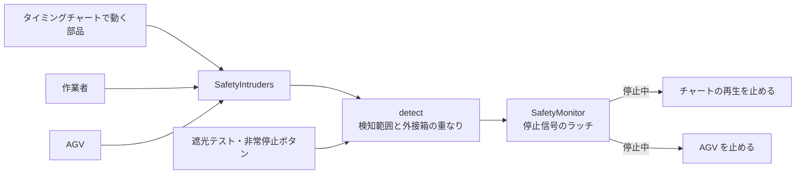

# 安全機器・作業者・AGV の設計

このドキュメントは `src/safety/`・`src/floor/` と、計算を置いた `crates/cadsim_core/src/{safety,floor}/` のしくみをまとめたものです。使い方は README の「できること」を見てください。

## 1. ファイルと層

| ファイル | 層 | 役割 |
| --- | --- | --- |
| `cadsim_core/src/floor/geom.rs` | ドメイン | 床 (XZ 平面) の上の向き付き長方形 `Rect2`、長方形 + 高さの範囲 `Zone`、線分の距離 |
| `cadsim_core/src/safety/device.rs` | ドメイン | 安全機器のデータ、侵入の検知 `detect`、停止信号のラッチ `SafetyMonitor`、ISO 13855 の安全距離 |
| `cadsim_core/src/safety/check.rs` | ドメイン | 動作範囲 (危険源) の計算と、柵・ライトカーテンの距離の確認 |
| `cadsim_core/src/floor/operator_plan.rs` | ドメイン | 作業者の手順 → 時刻表・作業時間の内訳・歩行距離・経路 |
| `cadsim_core/src/floor/agv_sim.rs` | ドメイン | AGV の経路グラフ、配車、交差点の排他、車間、台数の比較 |
| `cadsim_core/src/floor/heatmap.rs` | ドメイン | 人と AGV の動線のヒートマップ (マスごとの通った回数・いた時間、混み合う場所、動いた距離、色付けと書き出し用の画像) |
| `cadsim_core/src/floor/figure.rs` | ドメイン | 作業者と AGV の 3D の形 (箱・球・円柱・カプセルの組み合わせ)、歩く・作業する動き、向き |
| `cadsim_core/src/floor/figure_motion.rs` | ドメイン | 動きのクリップ (作業者の歩く・作業・待つ、AGV の車輪・荷) と、切り替えで混ぜる重み・クリップの時刻 |
| `safety/mod.rs`, `floor/mod.rs` | UI | Bevy のリソースとシステム。入力を集めてドメインの関数を呼ぶだけ |
| `safety/view.rs`, `floor/view.rs` | UI | 3D 表示 (半透明のメッシュとギズモの線)、床のクリック |
| `floor/heatmap_view.rs` | UI | 動線ヒートマップの記録 (毎フレーム位置を渡す)、床に敷く板のテクスチャ、PNG の書き出しのダイアログ |
| `cadsim_io/src/formats/heatmap_png.rs` | アダプター | 動線ヒートマップの画像を PNG に書く |
| `floor/figures.rs` | UI | 作業者と AGV の 3D モデル。`figure.rs` の形をメッシュに、`figure_motion.rs` のクリップを Bevy のアニメーションに写す |
| `safety/panel.rs`, `floor/panel.rs` | UI | egui のパネル |
| `floor_record.rs` | アダプター | .cadsim に書く形 (serde)。ドメインの型との写し替え |

ドメインの型は Bevy の `Resource` を付けず、UI 層で包んでいます (`SafetyLayoutRes(SafetyLayout)` など)。
長さは mm、時間は秒、上向きは +Y です。

## 2. 安全機器

### 検知と停止

- 侵入物は毎フレーム `SafetySet::Intruders` の中で `SafetyIntruders` に書き足し、`SafetySet::Detect` で検知に使ったら空にします。新しい種類の侵入物 (ワークなど) を足すときは、同じセットの中で書き足すシステムを作るだけです。
- ライトカーテンは「幅 × 高さ × 厚み」、エリアセンサは「幅 × 検知する高さ × 奥行き」の範囲で、侵入物の外接箱と重なったら検知します。範囲は Y 軸まわりに回せるので、床の上の判定は分離軸で行います。
- 検知すると停止信号を出し、`SafetyMonitor::reset` を呼ぶまで保持します (ラッチ)。検知が続いている間や非常停止が押されている間はリセットできません。
- 停止信号は `SafetyState::is_stopped()` で読めます。PLC 連携でセンサー入力に割り付けるときもこれを使います。

### 安全距離 (ISO 13855)

検知面から危険源までに必要な最小距離 S を、機器の「停止までの時間 T」(センサの応答 + 機械の停止時間) から求めます。

| 機器 | 式 |
| --- | --- |
| ライトカーテン (検出能力 d ≤ 40 mm) | S = 2000·T + 8(d − 14)。500 mm を超えたら K = 1600 で計算し直し、下限 500 mm。全体の下限は 100 mm |
| ライトカーテン (d > 40 mm) | C = 850 mm として同じ |
| エリアセンサ (床に水平) | S = 1600·T + (1200 − 0.4·H)、H は検知面の高さ。C の下限は 850 mm |

T は秒で入れ、式の中では ms にしています。

### 動作範囲と距離の確認

- 動作範囲は、タイミングチャートの 1 サイクルを 96 等分した時刻と、各動作の始まり・終わりの時刻で、アクチュエータが動かす部品の外接箱を求めて足し合わせたものです (アクチュエータごとに 1 つの箱)。
- 安全柵とライトカーテンは、床の上でいちばん近い動作範囲との距離を測り、必要な距離 (柵は設定値、ライトカーテンは S) と比べます。高さ方向の「柵越しに手が届くか」(ISO 13857) は見ていません。柵の離す距離は、柵の高さと危険源の高さから規格の表を見て設定してください。

## 3. 作業者

- 手順は「歩く (床の点へ直線で)」「ピック」「ボタン」「待つ」の並びです。最後に開始位置まで歩いて戻ったところで 1 サイクルとします。
- `OperatorPlan::new` が手順を時刻に展開し、歩行・作業・待ちの時間と歩行距離を集計します。位置は時刻から直接求めるので (状態を持たない)、時計を巻き戻してもずれません。
- 作業者の体は半径 300 mm・高さ 1700 mm の円柱とみなし、安全機器の検知の対象に入れます。

### 見た目 (作業者と AGV の 3D モデル)

- 外部のモデルファイルは使わず、`cadsim_core::floor::figure` で単純な形 (箱・球・円柱・カプセル) を組み合わせて作ります。ライセンスの心配がなく、寸法も AGV の性能の設定 (長さ・幅) に合わせて変わります。
- 作業者は頭・ヘルメット・目・首・胴 (オレンジの安全ベストと反射帯)・腰・腕・手・脚・靴でできています。前は +X で、体の向きは `OperatorPlan::heading_at` (歩いていれば進む向き、止まっていれば最後に歩いた向き。曲がるときは 0.35 秒かけて回る) で決めます。
- 歩いている間は、歩いた距離 (`OperatorPlan::walked_at`) を 1300 mm で 1 周する位相にして、脚 (±25°、ひざの曲げ) と腕 (脚と逆) を振ります。低い方の足が床に着くよう体ごと下げるので、自然に上下します。作業中は腕を前に出して手元を小さく動かします。選んでいる作業者はベストが青になります。
- AGV は車体・天板・黄色の帯・前後のバンパー・駆動輪 (走った距離に合わせてハブが回る)・四隅のキャスター・ヘッドライト・テールランプ・前のレーザーセンサー・後ろの状態ランプでできています。状態ランプは走行中が緑、積み降ろし中が橙の点滅、待ち (交差点や前の車) が赤、空車が消灯です。待っている間は帯も赤になります。荷を積んでいる間は天板に箱が乗り、積み込み・荷降ろしでは箱が上から降りる・上がる動きをします。
- 形の数と並びは毎フレーム同じで、変わるのは位置・向き・色・見える/見えないだけです。表示側 (`floor/figures.rs`) は形の寸法ごとにメッシュを 1 回だけ作って使い回します。腕や脚のカプセルは骨の長さで作るので、誤差で寸法がずれて新しいメッシュが増えることはありません。

### 動き (Bevy のアニメーション)

- 1 体は「親 (床の位置と向き) + 形ごとの子」です。子の姿勢は Bevy のアニメーション (`AnimationClip` / `AnimationGraph` / `AnimationPlayer`) が動かし、表示側は毎フレーム親の置き方と、クリップごとの時刻と重みだけを写します。
- クリップは `cadsim_core::floor::figure_motion` が、形の計算 (`person_local_parts` / `agv_local_parts`) を等間隔に取ったキーとして作ります。作業者は **歩く** (歩幅の 1 周 = クリップの 0〜1、32 キー)・**作業** (手元の動き 1 回 = 0.625 秒、16 キー)・**待つ** の 3 本で、混ぜるのですべての形を持ちます。AGV は **車輪** (ハブ 1 回転、16 キー) と **荷** (天板の 260 mm 上から降りる) の 2 本で、動く形だけを持ちます。回転のキーは隣と同じ半球にそろえ、補間が遠回りしないようにしています。
- 重み (`person_weights`) は床の時計だけから決まります。区間の始まりから 0.35 秒は、前の区間の動きから今の動きへ smoothstep で重みを移すので、歩きから作業に移るときに腕がなめらかに前へ出ます。同じ動きが続く区間の境目では混ぜません。2 周目の先頭は前の周の最後の区間から混ぜます。
- クリップの時刻も再生には任せず、歩くのは歩いた距離、作業は時刻、車輪は走った距離、荷は積み込み・荷降ろしの進み具合 (`agv_cargo_amount`。作業時間の後半で荷が降りる・上がる) で毎フレーム決めます。プレイヤーは一時停止のまま時刻を合わせるだけなので、床の時計を止めると動きも止まり、巻き戻すと同じ姿勢に戻ります。
- 色 (選んだ作業者のベスト、ランプ、帯) と荷の見える/見えないは動きではないので、マテリアルと `Visibility` に写します。
- モデルの部品は `FloorFigure` の目印を持ち、ライブラリの部品をドラッグして置くときの「面の上に置く」の対象から外しています。

## 4. AGV

### 経路と配車

- 経路は床の上のグラフです。通路は直線で、両方向に走れます (2 車線とみなし、すれ違いは止まりません)。
- 搬送の要求は「ステーション A → B を n 秒ごとに 1 件」で、時刻 0 から出ます。
- 先に出た要求から順に、空いている AGV のうち積み込み場所までの道のり (ダイクストラ法) がいちばん短いものに割り当てます。
- 1 件の流れ: 積み込み場所へ → 積込 → 降ろし場所へ → 荷降ろし → 空車 (その場で待つ)。

### 交差点の排他と車間

- 3 本以上の通路が集まる点を交差点とし、同時に 1 台しか入れません。
- 交差点の中心から「車長 / 2 + 車間」手前で予約し、取れなければそこで止まります。通り抜けて同じ距離だけ進んだら解放します。
- 交差点どうしが短い通路 (2 × (車長 / 2 + 車間) 未満) でつながっているときは、続く交差点までまとめて予約します。向かい合った 2 台がお互いの交差点を持ったまま止まる (デッドロック) のを防ぐためです。
- 同じ通路を同じ向きに走る車とは「車長 + 車間」を空けます。ステーションには何台でも並べる (待機列がある) とみなします。
- 交差点をステーションにすると、そこで待機する AGV が交差点を持ち続けるので、ステーションは通路の端か、通路が 2 本だけの点に置いてください。

### 時間の進め方と台数比較

- 状態を持つシミュレーションで、1 回に最大 0.05 秒ずつ進めます。安全停止中は時間だけ進み、AGV は動きません。
- 経路・要求・性能・台数を変えると、シミュレーションは最初からやり直しになります。
- 台数の比較 (`compare_fleets`) は、同じ条件で台数だけを変えて画面に出さずに走らせ、搬送数 / 時、平均リードタイム (要求が出てから荷降ろし完了まで)、稼働率、渋滞 (交差点や前の車を待った時間の割合)、終了時に残っていた要求の数を並べます。

### 動線のヒートマップ

- 床を一辺 `cell` mm (既定 500) のマス目に区切り、マスごとに人と AGV を分けて「入った回数」と「いた秒数」を数えます (`TrafficHeatmap`)。マスは使った分だけ `HashMap` に持つので、床の広さに上限はありません。
- 位置は毎フレーム、作業者 (時刻表から求めた位置) と AGV (シミュレーションの車体の中心) を `observe(時刻, 位置の一覧)` で渡します。前のフレームの位置から今の位置までの線分を、マスの 1/4 ごとにたどり、入ったマスの回数を 1 増やします。倍速で 1 フレームに何マスも進んでも、間のマスを飛ばしません。そのフレームの経過時間はたどった点に等分して割り振ります。
- 1 フレームで 10 m 以上動いたものは、歩いたのではなく置き直した (サンプルを置いた・手順を変えた) とみなし、間をたどりません。
- 時刻が進んでいないフレームは数えません (一時停止中に同じ場所が濃くならないように)。時刻が戻ったら (「⏮ 最初から」やライン連携の巻き戻し) 「再生し直した」として記録を消します。巻き戻した先から先の分を数え直すので、同じ時間を二重に数えません。ライン連携で回すときも同じ時計 (`FloorClock`) が進むので、そのまま数えられます。
- 表示は、1 マス = 1 画素の画像 (値のないマスは透明、周りに 1 マスの透明な縁) を作り、床から 1 mm 上に敷いた板のテクスチャにします。線形補間で拡大するので、マスの境目は少しぼけます。作り直すのは記録か設定が変わったときだけで、多くても 0.25 秒に 1 回です。
- 色は最大値で割った 0 〜 1 を、青 → 水色 → 緑 → 黄 → 赤に写します。1 回通っただけのマスも見えるよう、透明度は 0.5 〜 0.95 にしています。
- 書き出し (`render_export`) は、白地に 1 m の方眼、AGV の通路と作業者の歩行経路を灰色の線で描き、画素の中心が入るマスの色を重ねます。長い辺が 1600 画素ほどになるよう拡大します。画像の上が z の小さい側、右が +x です。
- ヒートマップの記録はプロジェクトには保存しません。プロジェクトを開き直すと消えます。

## 5. まだないもの

- 工程モデル (スループット統計) や搬送ワークとのつなぎ込み。いまは AGV の要求を「一定間隔」で出しています。
- PLC の入出力への割り付け (停止信号・非常停止・作業者の押すボタン)。
