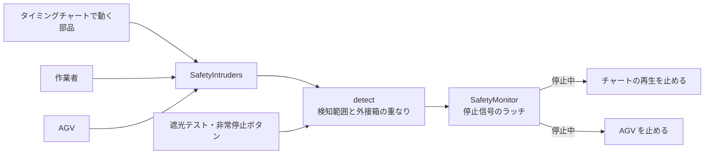

# 安全機器・作業者・AGV の設計

このドキュメントは `src/safety/` と `src/floor/` のしくみをまとめたものです。使い方は README の「できること」を見てください。

## 1. ファイルと層

| ファイル | 層 | 役割 |
| --- | --- | --- |
| `floor/geom.rs` | ドメイン | 床 (XZ 平面) の上の向き付き長方形 `Rect2`、長方形 + 高さの範囲 `Zone`、線分の距離 |
| `safety/device.rs` | ドメイン | 安全機器のデータ、侵入の検知 `detect`、停止信号のラッチ `SafetyMonitor`、ISO 13855 の安全距離 |
| `safety/check.rs` | ドメイン | 動作範囲 (危険源) の計算と、柵・ライトカーテンの距離の確認 |
| `floor/operator_plan.rs` | ドメイン | 作業者の手順 → 時刻表・作業時間の内訳・歩行距離・経路 |
| `floor/agv_sim.rs` | ドメイン | AGV の経路グラフ、配車、交差点の排他、車間、台数の比較 |
| `safety/mod.rs`, `floor/mod.rs` | UI | Bevy のリソースとシステム。入力を集めてドメインの関数を呼ぶだけ |
| `safety/view.rs`, `floor/view.rs` | UI | 3D 表示 (半透明のメッシュとギズモの線)、床のクリック |
| `safety/panel.rs`, `floor/panel.rs` | UI | egui のパネル |

ドメインの型は Bevy の `Resource` を付けず、UI 層で包んでいます (`SafetyLayoutRes(SafetyLayout)` など)。
長さは mm、時間は秒、上向きは +Y です。

## 2. 安全機器

### 検知と停止

- 侵入物は毎フレーム `SafetySet::Intruders` の中で `SafetyIntruders` に書き足し、`SafetySet::Detect` で検知に使ったら空にします。新しい種類の侵入物 (ワークなど) を足すときは、同じセットの中で書き足すシステムを作るだけです。
- ライトカーテンは「幅 × 高さ × 厚み」、エリアセンサは「幅 × 検知する高さ × 奥行き」の範囲で、侵入物の外接箱と重なったら検知します。範囲は Y 軸まわりに回せるので、床の上の判定は分離軸で行います。
- 検知すると停止信号を出し、`SafetyMonitor::reset` を呼ぶまで保持します (ラッチ)。検知が続いている間や非常停止が押されている間はリセットできません。
- 停止信号は `SafetyState::is_stopped()` で読めます。PLC 連携でセンサー入力に割り付けるときもこれを使います。

### 安全距離 (ISO 13855)

検知面から危険源までに必要な最小距離 S を、機器の「停止までの時間 T」(センサの応答 + 機械の停止時間) から求めます。

| 機器 | 式 |
| --- | --- |
| ライトカーテン (検出能力 d ≤ 40 mm) | S = 2000·T + 8(d − 14)。500 mm を超えたら K = 1600 で計算し直し、下限 500 mm。全体の下限は 100 mm |
| ライトカーテン (d > 40 mm) | C = 850 mm として同じ |
| エリアセンサ (床に水平) | S = 1600·T + (1200 − 0.4·H)、H は検知面の高さ。C の下限は 850 mm |

T は秒で入れ、式の中では ms にしています。

### 動作範囲と距離の確認

- 動作範囲は、タイミングチャートの 1 サイクルを 96 等分した時刻と、各動作の始まり・終わりの時刻で、アクチュエータが動かす部品の外接箱を求めて足し合わせたものです (アクチュエータごとに 1 つの箱)。
- 安全柵とライトカーテンは、床の上でいちばん近い動作範囲との距離を測り、必要な距離 (柵は設定値、ライトカーテンは S) と比べます。高さ方向の「柵越しに手が届くか」(ISO 13857) は見ていません。柵の離す距離は、柵の高さと危険源の高さから規格の表を見て設定してください。

## 3. 作業者

- 手順は「歩く (床の点へ直線で)」「ピック」「ボタン」「待つ」の並びです。最後に開始位置まで歩いて戻ったところで 1 サイクルとします。
- `OperatorPlan::new` が手順を時刻に展開し、歩行・作業・待ちの時間と歩行距離を集計します。位置は時刻から直接求めるので (状態を持たない)、時計を巻き戻してもずれません。
- 作業者の体は半径 300 mm・高さ 1700 mm の円柱とみなし、安全機器の検知の対象に入れます。

## 4. AGV

### 経路と配車

- 経路は床の上のグラフです。通路は直線で、両方向に走れます (2 車線とみなし、すれ違いは止まりません)。
- 搬送の要求は「ステーション A → B を n 秒ごとに 1 件」で、時刻 0 から出ます。
- 先に出た要求から順に、空いている AGV のうち積み込み場所までの道のり (ダイクストラ法) がいちばん短いものに割り当てます。
- 1 件の流れ: 積み込み場所へ → 積込 → 降ろし場所へ → 荷降ろし → 空車 (その場で待つ)。

### 交差点の排他と車間

- 3 本以上の通路が集まる点を交差点とし、同時に 1 台しか入れません。
- 交差点の中心から「車長 / 2 + 車間」手前で予約し、取れなければそこで止まります。通り抜けて同じ距離だけ進んだら解放します。
- 交差点どうしが短い通路 (2 × (車長 / 2 + 車間) 未満) でつながっているときは、続く交差点までまとめて予約します。向かい合った 2 台がお互いの交差点を持ったまま止まる (デッドロック) のを防ぐためです。
- 同じ通路を同じ向きに走る車とは「車長 + 車間」を空けます。ステーションには何台でも並べる (待機列がある) とみなします。
- 交差点をステーションにすると、そこで待機する AGV が交差点を持ち続けるので、ステーションは通路の端か、通路が 2 本だけの点に置いてください。

### 時間の進め方と台数比較

- 状態を持つシミュレーションで、1 回に最大 0.05 秒ずつ進めます。安全停止中は時間だけ進み、AGV は動きません。
- 経路・要求・性能・台数を変えると、シミュレーションは最初からやり直しになります。
- 台数の比較 (`compare_fleets`) は、同じ条件で台数だけを変えて画面に出さずに走らせ、搬送数 / 時、平均リードタイム (要求が出てから荷降ろし完了まで)、稼働率、渋滞 (交差点や前の車を待った時間の割合)、終了時に残っていた要求の数を並べます。

## 5. まだないもの

- プロジェクトファイル (.cadsim) への保存。安全機器・作業者・AGV の配置はまだ保存されません。
- 工程モデル (スループット統計) や搬送ワークとのつなぎ込み。いまは AGV の要求を「一定間隔」で出しています。
- PLC の入出力への割り付け (停止信号・非常停止・作業者の押すボタン)。
