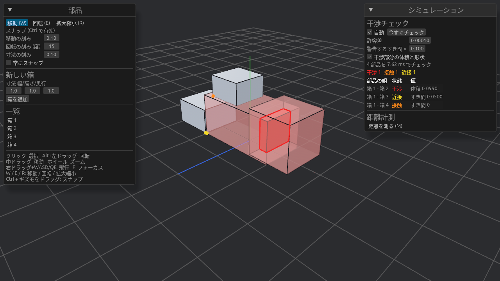
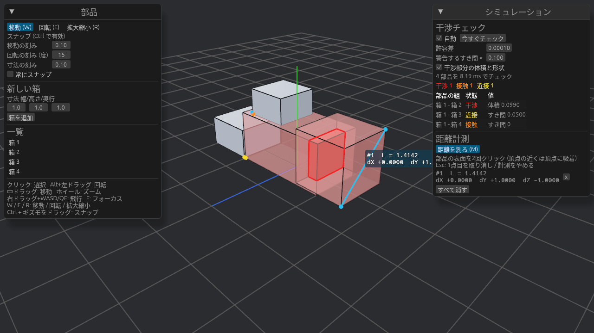
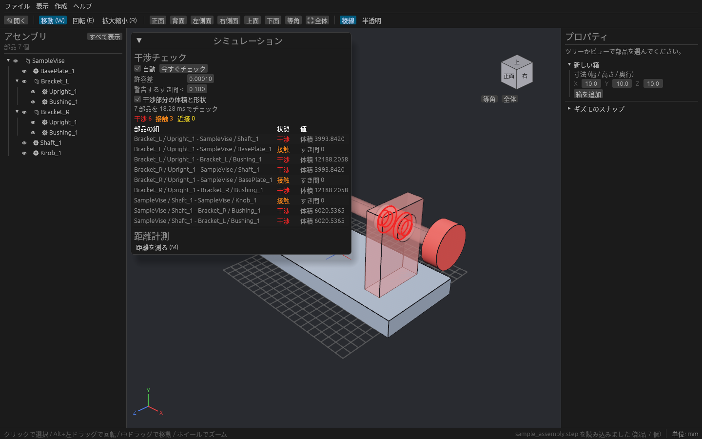
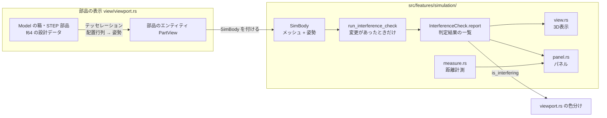
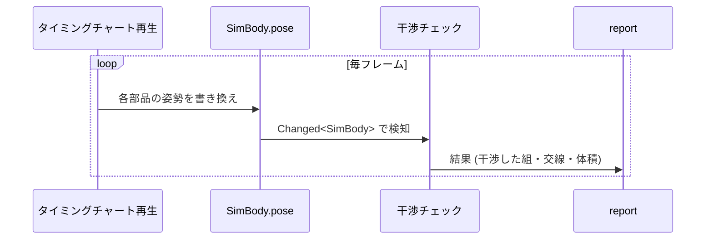
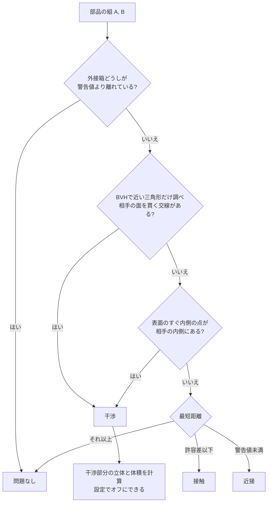

# シミュレーション機能の設計 (干渉チェック・距離計測)

このドキュメントは干渉チェックと距離計測の設計をまとめたものです。計算部分は `crates/plantwright_core/src/simulation/`、Bevy での配線・表示・パネルは `src/features/simulation/` にあります。
「何ができるか」→「どう動くか」→「どこを触ればよいか」の順に書いています。

## 1. できること

| 機能 | 内容 | 画面での見え方 |
| --- | --- | --- |
| 干渉チェック | すべての部品の組を調べ、**干渉 / 接触 / 近接** に分類する | ツールレールの「干渉」で開く「干渉チェック・計測」パネルに一覧 |
| 干渉部分の表示 | 2部品の重なっている立体 (A∩B) を作り、体積も出す | 干渉した部品は半透明の赤、重なり部分は濃い赤、交線は赤い太線 |
| 接触・近接の表示 | 最も近い2点を結ぶ | 接触 = 橙の線、近接 = 黄の線 |
| 距離計測 | 部品表面の2点を選び、距離と X / Y / Z の差を出す | 水色の線とラベル、パネルに一覧 |



箱1と箱2が干渉(濃い赤が重なり部分、赤い太線が交線)、箱1と箱3が近接(黄)、箱1と箱4が接触(橙)。



頂点に吸着した2点間の距離と、X / Y / Z 方向の差。



STEP サンプル (`assets/sample_assembly.step`) を開いたところ。軸が軸受と支柱を貫いているので干渉、支柱とベースは接触。
体積は手計算 (例: 軸 φ16 × 軸受の長さ 30 → 約 6032) とほぼ一致します。

判定の分類は次のとおりです。

| 分類 | 意味 | 例 |
| --- | --- | --- |
| 干渉 (Interference) | 体積をもって食い込んでいる | 箱どうしがめり込んでいる、完全に内側に入っている、ぴったり同じ位置にある |
| 接触 (Contact) | 表面どうしが触れているだけ (距離 ≤ 許容差) | 箱の上に箱を積んだ |
| 近接 (Near) | 離れているが、すき間が警告値より小さい | 装置どうしのクリアランス不足 |

許容差と警告値 (警告するすき間) はパネルで変えられます。単位はモデルの長さ単位です。

## 2. 全体の流れ



ほかの機能とのつなぎ目は **`SimBody` コンポーネントだけ** です。
部品のルートエンティティに `SimBody` (と表示名の `Name`) を付ければ、シミュレーション側が自動で拾います。
箱も STEP から取り込んだ部品も、`view/viewport.rs` が部品のエンティティを作るときに `SimBody` を付けています。取り込んだ部品のメッシュは同じ製品のインスタンスで共有します (同じボルト100本でも検索木は1回だけ作る)。
`SimBody::group` が同じ部品どうしは調べません。ふつうは部品ごと、標準部品の本体は部品全体、
アセンブリに「中の部品どうしは調べない」(`Node::skip_inner_interference`) を付けたときはその中の部品すべてが同じまとまりです
(`Model::interference_group`。印が入れ子なら、いちばん上のアセンブリ)。印を付け外ししたら、`sync_views` が次のフレームで `group` を書き直します。
非表示にした部品は判定から外します。

```rust
pub struct SimBody {
    pub id: u32,             // 部品ID (結果の a / b に入る)
    pub mesh: Arc<TriMesh>,  // 部品ローカル座標の形状 (f64)
    pub pose: Pose,          // ローカル → ワールドの姿勢 (回転 + 平行移動, f64)
}
```

## 3. タイミングチャート再生との関係 (毎フレームの判定)

工場ラインの装置をタイミングチャートどおりに動かしながら、干渉をフレームごとに調べられるようにしています。

- 形状 (`mesh`) と位置 (`pose`) を分けています。**動かすときは `pose` だけを書き換えます。**
  いまは `view/viewport.rs` の `sync_placement_and_visibility` が `Model` の配置行列から毎フレーム `pose` を写しています。
  再生で部品を動かすときは、`Model` の配置を動かすか、このシステムの後で `pose` を上書きしてください。
  メッシュと検索木 (BVH) は作り直さないので、毎フレームの判定でも軽く済みます。
- `SimBody` が変わったフレームだけ判定が走ります (「自動」がオンのとき)。再生中は毎フレーム、止まっていれば判定しません。
- 干渉部分の立体と体積は **別スレッドで計算** します。判定直後のパネルは「計算中…」になり、終わると体積と赤い立体が出ます。
  その間に部品が動いたら、古い計算は捨てて新しい姿勢で計算し直します。UI や再生は止まりません。
- 干渉部分の立体を計算しない場合は `InterferenceCheck.settings.compute_overlap = false` (パネルの「干渉部分の体積と形状」)。干渉の有無と交線は出ます。
- 判定にかかった時間はパネルに表示されます (「N 部品を X ms でチェック」)。



結果を記録したり CSV に書き出したりするときは、`InterferenceCheck.report.pairs` (`Vec<PairResult>`) を読んでください。

```rust
pub struct PairResult {
    pub a: u32, pub b: u32,              // 部品ID
    pub status: PairStatus,              // Interfering { overlap } / Contact / Near { clearance }
    pub curves: Vec<[DVec3; 2]>,         // 交線 (ワールド座標)
    pub closest: Option<[DVec3; 2]>,     // 最も近い2点 (接触・近接時)
}
```

## 4. 干渉判定のしくみ

軽い判定から順に行い、必要な組だけ重い判定に進みます。



ポイント:

- **貫く交線**: 2つの三角形が互いに相手の平面の両側にまたがっているときだけ「食い込み」とみなします。
  面どうしが触れているだけ・辺が触れているだけなら食い込みにはなりません。これで「積んだ箱」は接触になります。
- **内側の点**: 交線がなくても、片方がまるごと内側にある場合や、ぴったり同じ位置にある場合があります。
  表面から許容差の2倍だけ内側にずらした点を、相手の内側か (レイを飛ばして交差数の偶奇で判定) 調べます。
- **BVH**: 三角形を外接箱の木にまとめたものです。部品ごとに一度作れば、姿勢が変わっても使い回せます。
  木の構築と2つの木の同時のたどり方は `parry3d-f64` の `Bvh` を使い、三角形どうしの判定 (交線・最短距離・内外) は許容差の扱いを決めた自前の計算 (`geometry.rs`) で行います。

### 干渉部分の立体 (overlap.rs)

A∩B の表面は「A の表面のうち B の内側にある部分」と「B の表面のうち A の内側にある部分」でできています。
両方の表面の三角形を、相手の内側か外側かで振り分けます。相手の表面をまたぐ三角形は長い辺で2分割をくり返して細かくします。
同じ床に置いた箱の底面のように、両者の面がぴったり重なる部分は A 側からだけ取ります。

- 体積は、得られた閉じた表面から計算します (符号付き四面体の和)。
- 境界は分割の細かさ分だけギザギザになり、体積も近似値です (重なり部分の大きさの 1/32 程度まで細かくします)。
- 輪郭は交線を重ねて描くので、見た目の境界ははっきりします。

## 5. 距離計測のしくみ (measure.rs)

1. M キー (またはパネルの「距離を測る (M)」) で計測モードに入ります。計測モード中は面の選択は止まります。
2. カーソルの下の表面を `MeshRayCast` で探し、当たった点を **f64 の形状の表面に載せ直します**。
3. 画面上で 12 ピクセル以内に頂点があれば、その頂点に吸着します (角から角を正確に測れます)。
4. 2回クリックすると計測が確定し、距離 L と dX / dY / dZ を表示します。
5. Esc で1点目を取り消し、もう一度押すと計測モードを抜けます。

## 6. ファイルと役割

| ファイル | 役割 | 層 |
| --- | --- | --- |
| `crates/plantwright_core/src/simulation/geometry.rs` | 姿勢・外接箱・三角形の交差と距離 (純粋な f64 計算) | ドメイン |
| `crates/plantwright_core/src/simulation/mesh.rs` | `TriMesh` と BVH (`parry3d-f64` の `Bvh`)、内外判定、最近点 | ドメイン |
| `crates/plantwright_core/src/simulation/interference.rs` | 組ごとの判定 (干渉 / 接触 / 近接) | ドメイン |
| `crates/plantwright_core/src/simulation/overlap.rs` | 干渉部分の立体と体積 | ドメイン |
| `src/features/simulation/mod.rs` | プラグイン、`SimBody`、判定の実行タイミング | UI (Bevy) |
| `src/features/simulation/view.rs` | 判定結果の3D表示 | UI (Bevy) |
| `src/features/simulation/measure.rs` | 距離計測ツール | UI (Bevy) |
| `src/features/simulation/panel.rs` | 「干渉チェック・計測」パネル | UI (Bevy) |

計算部分は Bevy に依存しない `plantwright_core` にあるので、`cargo test -p plantwright_core` で Bevy をビルドせずに単体テストできます。

## 7. 結果の CSV 出力 (src/features/result_export/)

メニューの「ファイル → シミュレーション結果 (CSV)」から2種類を書き出します。どちらも Excel でそのまま開けるよう、BOM 付き UTF-8・改行 CRLF です。

| 層 | ファイル | 役割 |
| --- | --- | --- |
| ユースケース | `report/cycle_time.rs` | タイミングチャートと時刻表から、ステップごとの行を作る |
| ユースケース | `report/interference.rs` | 1サイクルを一定間隔で動かしながら `check_all` で判定し、同じ組・同じ状態が続いた時間帯にまとめる |
| ユースケース | `report/csv.rs` | CSV の書式 (クォート・BOM・CRLF) |
| UI・フレームワーク | `plugin.rs` | メニューからの要求 → 保存ダイアログ (メインスレッド) → 別スレッドで作成・書き込み → ステータスバーに結果 |

`report/` は Bevy の ECS・egui・ファイルシステムに触れず、文字列を返すだけなので `cargo test` で確かめられます。

### サイクルタイム (cycle_time.csv)

| 列 | 内容 |
| --- | --- |
| ステップ / コメント | ステップ番号 (1始まり) と説明 |
| 開始[s] / 終了[s] / 所要時間[s] | サイクル開始からの時刻と、ステップの長さ |
| 動作時間[s] / タイマー[s] | 一番遅い動作の時間と、動作完了後の待ち時間 (所要時間 = 動作時間 + タイマー) |
| 最も長い動作 | 動作時間を決めているアクチュエータ |
| 動作 | 指令の一覧 (`横行軸 → 2.00 (1.000s) / シリンダ 1 → 出 (0.400s)` など) |

最後の行が「サイクルタイム」です。

### 干渉結果 (interference.csv)

1. 時刻を「干渉チェックの間隔」(初期値 0.02 秒) ごとに進める。ステップの切り替わりとサイクルの終わりも必ず調べる。チャートが空なら時刻 0 だけ。
2. 各時刻で `part_poses` からノードごとの動きを求め、部品にいちばん近い祖先の動きを設計上の配置に重ねる (`SimulationPose::pose_of` と同じ決め方)。
3. `check_all` で判定し、組 (部品A, 部品B) ごとに状態 (干渉 / 接触 / 近接) が同じあいだを1つの区間にする。

| 列 | 内容 |
| --- | --- |
| 判定 | 干渉 / 接触 / 近接 |
| 部品A ID / 部品A / 部品B ID / 部品B | 組になった部品 (ID はツリーのノード ID) |
| 開始[s] / 終了[s] / 継続時間[s] | その状態だった最初と最後のサンプル時刻。精度はチェックの間隔と同じ |
| 開始ステップ / 開始ステップのコメント / 終了ステップ | 区間の始まりと終わりのステップ |
| 最大干渉体積 | 区間中で一番大きかった食い込みの体積 (干渉で、体積計算がオンのとき) |
| 最小クリアランス | 区間中で一番小さかったすき間 (近接のみ) |

判定の設定 (許容差・警告値・体積計算) は「干渉チェック・計測」パネルのものを使います。

## 8. 制約と今後

- 部品のメッシュは閉じている (穴のない立体) 前提です。開いた面だけのデータは内外判定が正しくできません。
- 曲面はテッセレーションした三角形で判定するので、誤差はテッセレーションの許容差 (`TESSELLATION_TOL`) 程度あります。
- 組の総当たり (部品数 N に対して N(N-1)/2 組) を外接箱でふるい分けています。部品が数百を超える場合は、
  全体の空間分割 (スイープ&プルーンなど) を足すと速くなります。
- 物理挙動 (重力・衝突応答) はまだありません。
