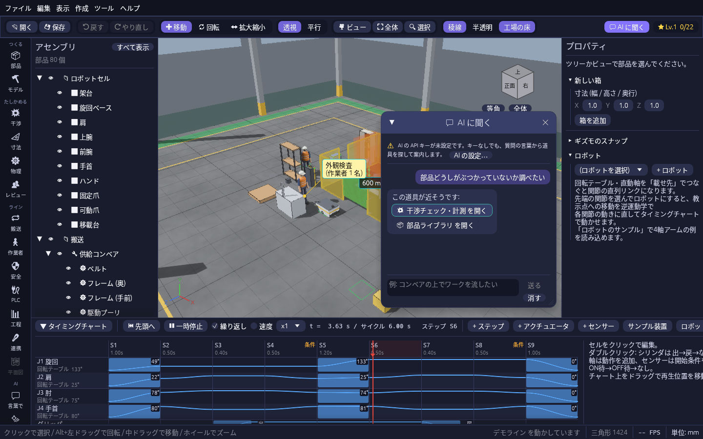
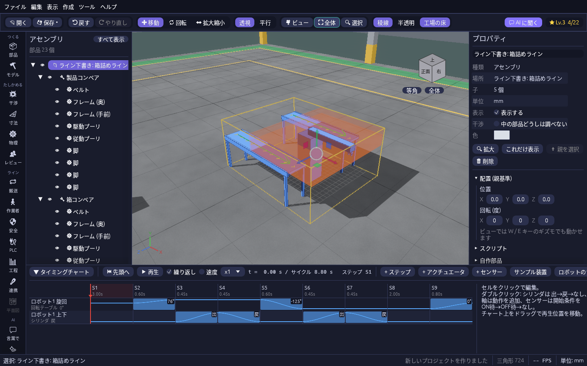

# 生成 AI を使う

plantwright では、生成 AI(Anthropic の Claude)を次の 3 か所で使います。どれも API キーがなくても、キーワードから近いものを作る簡易版で動きます。

| 道具 | 開き方 | すること |
| --- | --- | --- |
| AI に聞く | ツールバー右上の **💬 AI に聞く**(F1) | 使い方を文で聞く |
| 言葉でラインを組む | ツールレールの **💬 言葉で** | 文から設備の配置とチャートの下書きを作る |
| チャート・ラダーの自動生成 | ツールレールの **✨ ラダー** | 説明文からチャート、チャートからラダーと I/O 表を作る |

## AI に聞く

ツールバー右上の **💬 AI に聞く**(F1、または「ヘルプ → AI に聞く…」)で、したいことを文で質問できます。「部品どうしがぶつかっていないか調べたい」「非常停止で設備が止まるか確かめたい」のように聞くと、いま開いている道具や選んでいる部品を踏まえて、画面のどこを押せばよいかを手順で答えます。

- 答えに出てきた道具は **「○○ を開く」** ボタンになるので、押せばすぐその道具のパネルが開きます。
- 会話は続けて聞けます(「その次は?」など)。Enter で送り、Shift + Enter で改行します。「消す」で最初からにできます。
- API キーがないときは、質問の言葉から近い道具を探してボタンで案内します。

## 言葉でラインを組む

ツールレールの **言葉で**(または「ツール → 言葉でラインを組む」)で開くウィンドウに、作りたいラインを文で書きます(例:「コンベア2本とロボット1台で箱詰め」「コンベア1本、センサー1個、ストッパで外観検査」)。

1. **下書きを作る。** 「下書きを作る」を押すと、上から見た配置図、設備の一覧、ステップの一覧が出ます。設備の種類(コンベア・ロボット・シリンダ・センサー・作業台)と台数、作業(箱詰め・検査・組立・移載)を書くと、それに合った並べ方と動きの順番になります。直したところや前提は、⚠ やメモとして出ます。
2. **置く。** 「モデルとチャートに置く」で、設備が標準部品(ベルトコンベア・エアシリンダ・光電センサー・エアチャック)でまとめて置かれ(アセンブリ「ライン下書き: …」。ロボットの土台と腕、作業台は箱)、タイミングチャートの後ろにステップが足されます。ロボットの「取る・置く」は旋回・下降・上昇の3ステップになり、センサーの ON 待ちはインターロックになります。▶ で再生して動きを確かめ、寸法や時間はいつもどおりプロパティとチャートで直します。Ctrl+Z で戻せます。

API キーを入れておくと、生成 AI が文を読んで下書きを作ります(「作業者が目視検査したあと、良品だけロボットで箱へ」のような書き方でも組めます)。キーがないとき、または生成 AI が使えなかったときは、文のキーワード(設備の種類と台数、箱詰め・検査・組立)から作ります。どちらで作ったかは下書きの見出しに出ます。

センサーは、ワークを流さなくても再生が止まらないよう強制 ON にしてあります。「ワーク搬送」でワークを流して確かめるときは、チャートのセンサーの強制を外してください。

## チャート・ラダーの自動生成

ツールレールの **ラダー**(または「ツール → チャート・ラダーの自動生成」)を開くと、3つのタブがあります。

- **説明文から作る**: 設備の動きを文章で書いて **下書きを作る** を押すと、生成 AI がステップ・開始条件(インターロック)・装置とセンサーを下書きします。
  今のチャートにある装置は同じ名前で使い、足りない装置やセンサーは新しく足します。下書きと「反映後の I/O 表」を確かめてから **チャートに反映** します(Ctrl+Z で戻せます)。
  「ステップを置き換える」か「後ろに足す」かを選べます。新しく足した装置には、プロパティで動かす部品を割り当ててください。
- **ラダーを書き出す**: 今のチャートから、三菱 PLC(MELSEC Q / iQ-R)向けのステップラダーと I/O 表を作ります。生成 AI は使わず、キーがなくても使えます。
  **命令リストを保存…**(コメント付きのテキスト)、**GX Works 用 CSV を保存…**、**I/O 表を保存…** / **I/O 表をコピー** があります。
  起動 X0・停止 X1・異常リセット X2 の押しボタンと、運転中・異常のランプも入ります。開始条件が 5 秒成立しないと異常で止まります。
- **動作を説明させる**: 「今のチャート」「ラダー」(貼り付け・ファイル・今のチャートから作ったもの)「PLC のログ」(GX LogViewer などの CSV)のどれかを選んで **説明させる** を押すと、概要・動作の流れ・インターロック・気になる点を文章で返します。**コピー** で報告書などに貼れます。

作ったラダーは決まった型の下書きです。実機に入れる前に、デバイスの割り付けと安全回路を必ず確認してください。

## AI の設定(API キー)

使うには Claude API のキーが要ります。

1. [Claude Console](https://platform.claude.com/settings/keys) で API キーを発行する。
2. メニューの **ツール → AI の設定…** を開き、キーを貼って **保存**。モデルも選べます(標準は Claude Opus 5.5)。

キーはこのパソコンにだけ保存され、プロジェクトファイルには入りません。環境変数 `ANTHROPIC_API_KEY` があれば、設定しなくてもそれを使います。
AI に頼んだ内容(説明文やチャート・ラダー・ログの中身)は Anthropic に送られ、料金はキーの持ち主に請求されます。

Claude に plantwright の画面そのものを操作してもらうこともできます。[Claude に画面を操作させる(MCP)](mcp.md) を見てください。
