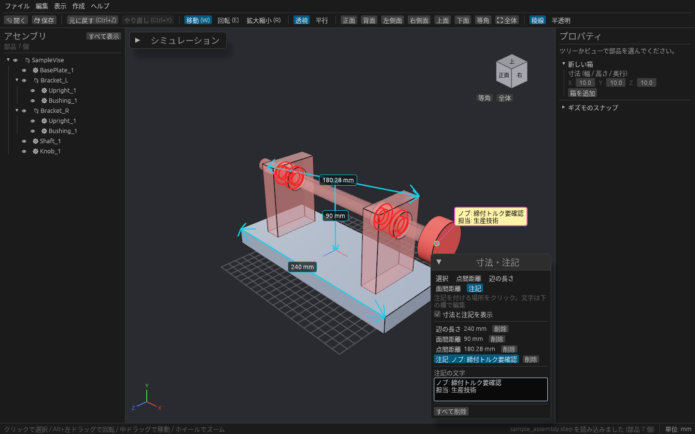
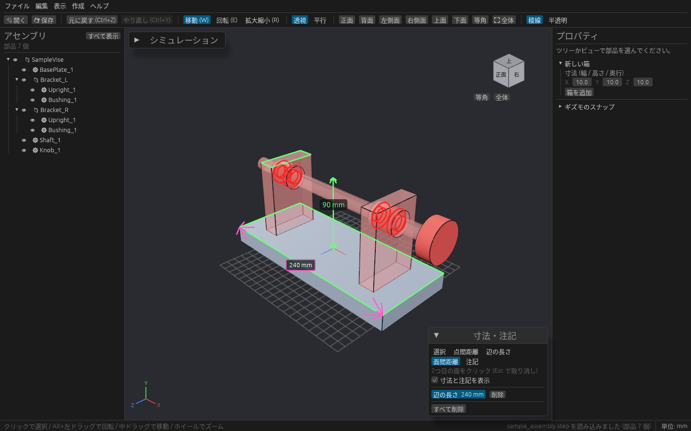

# 寸法と注記

3D ビューの上に寸法線やメモを置いて、プロジェクトに残せます。部品を動かしても付いて行きます。

## 置きかた

ツールレールの **寸法** で開く **寸法・注記** パネルで道具を選び、ビューをクリックします。

| 道具 | 置きかた | 表示 |
| --- | --- | --- |
| 点間距離 | 2 点をクリック。頂点・辺の中点・面の中心の近くでは吸い付き、緑の四角が出る | 2 点を結ぶ両矢印と距離 |
| 辺の長さ | 辺をクリック(近くの辺が緑になる) | 直線なら両矢印、円弧などは線に沿った長さ |
| 面間距離 | 面を 2 つクリック | 平行な平面なら面と面の距離。平行でなければ面どうしの角度。曲面を含むと中心どうしの距離 |
| 注記 | 部品の上をクリックし、パネルの **注記の文字** 欄に書く(複数行・日本語可) | 引き出し線付きの付箋 |

置いている途中は、仮の寸法と値が緑で出ます。値の単位はモデルの単位(mm など)です。

道具を使っている間は、クリックしても部品は選択されません。パネルの **選択** に戻すか、**Esc** で抜けます(1 点目を置いたあとなら、最初の Esc で 1 点目を取り消します)。

## 選択・削除・表示

- パネルの一覧か、ビュー上のラベルをクリックすると選択(ピンク)されます。**削除** で消せます。**すべて削除** で全部消せます。
- **寸法と注記を表示** のチェックを外すと、まとめて隠せます。部品を隠すと、その部品の寸法も隠れます。
- 追加・削除・注記の文字の編集は **Ctrl + Z** で戻せます。
- 寸法と注記はプロジェクト(`.cadsim`)に保存されます。

> 「干渉チェック・計測」パネルの **距離計測**(M キー)は、その場で測るだけの道具です。残しておきたい寸法はこちらを使ってください。どちらかを始めると、もう片方は止まります。
