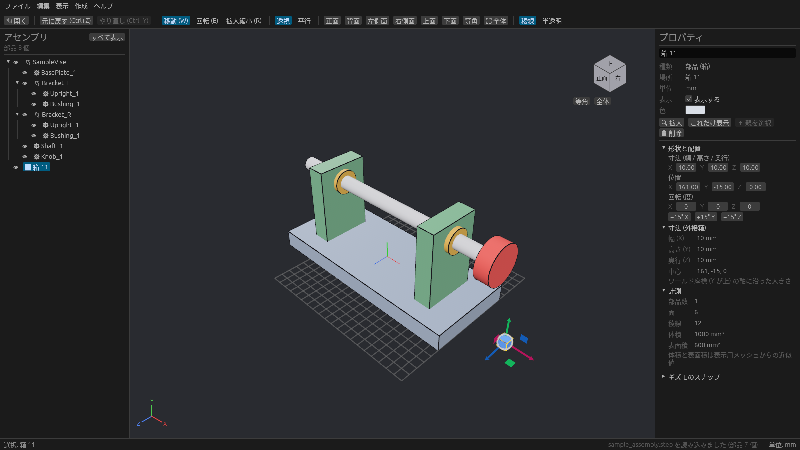

# 箱の作成と編集

STEP の部品とは別に、plantwright の中で直方体(箱)を作れます。架台や仮置きのワーク、設置スペースの目安などに使えます。

## 箱を追加する

1. 何も選んでいない状態(**Esc**)にします。
2. 右のプロパティの **新しい箱** に、幅・高さ・奥行を入れます。
3. **箱を追加** を押します。メニューの **作成 → 箱を追加** でも同じです。

新しい箱は、ほかの部品と重ならない場所に置かれ、そのまま選択された状態になります。ツリーには ⬛ のアイコンで並びます。

## 数値で編集する

箱を選ぶと、プロパティに **形状と配置** の欄が出ます。

| 欄 | 内容 |
| --- | --- |
| 寸法 (幅 / 高さ / 奥行) | X / Y / Z 方向の大きさ |
| 位置 | 箱の中心の座標 X / Y / Z |
| 回転 (度) | X → Y → Z の順に回す角度 |
| +15° X / Y / Z | その軸まわりに 15° 回す |

ビューでは W / E / R のギズモでも動かしたり大きさを変えたりできます([ギズモとスナップ](gizmo.md))。

## 削除する

箱を選んで **Delete** キーを押すか、プロパティの **削除** を押します。
