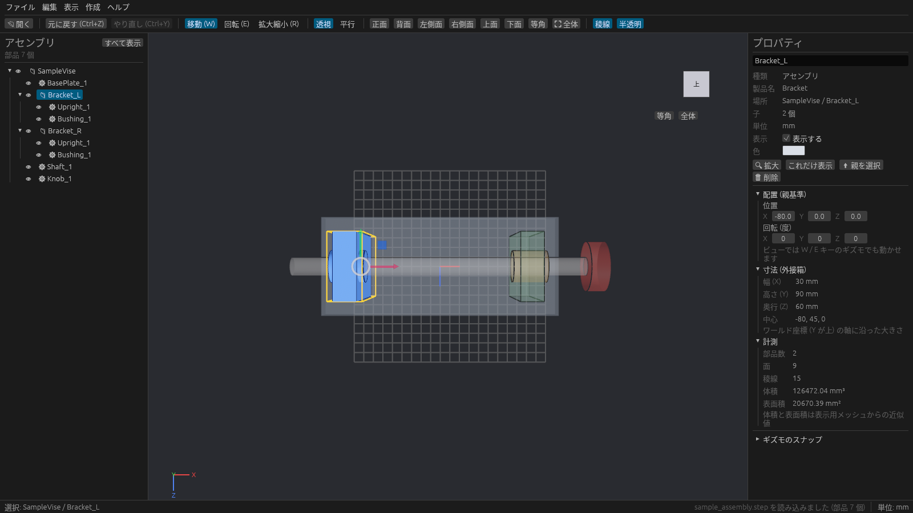
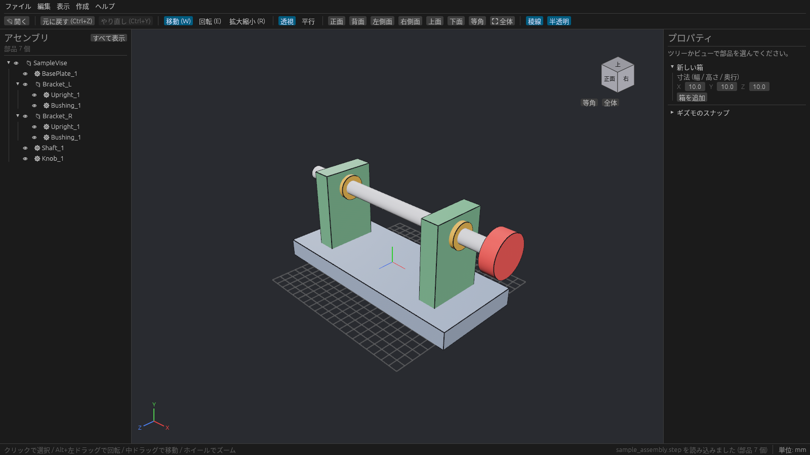
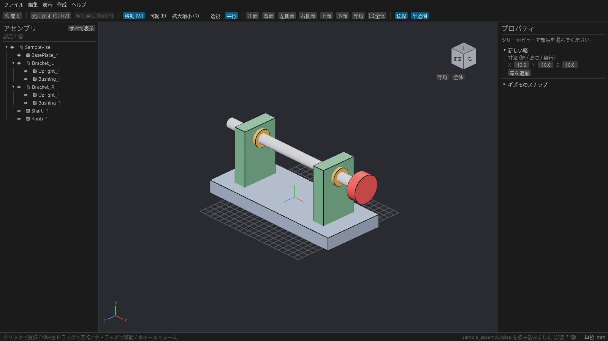

# カメラとビュー

## マウスでの操作

Unity / Unreal Engine のシーンビューと同じ割り当てです。

| 操作 | 動き |
| --- | --- |
| **Alt + 左ドラッグ** | 注視点のまわりを回る(オービット) |
| **中ボタンドラッグ** | 画面と平行に動かす(パン) |
| **ホイール** / **Alt + 右ドラッグ** | 近づく / 遠ざかる(ズーム) |
| **右ドラッグ** | その場で首を振って見回す |

右ボタンを押している間は、キーボードで飛び回れます。

| キー | 動き |
| --- | --- |
| W / S | 前 / 後ろ |
| A / D | 左 / 右 |
| Q / E | 下がる / 上がる |
| Shift | 押している間は速く動く |

> 右ボタンを押していないときの W / E / R はギズモの切り替えになります。

## 全体表示と選択の拡大

| 操作 | 内容 |
| --- | --- |
| **Home**、ツールバーの **全体** | すべての部品が入るように引く |
| **F**、プロパティの **拡大** | 選んだ部品が画面いっぱいになるように寄る |

どこを見ているかわからなくなったら **Home** を押してください。

## 標準ビューとビューキューブ

決まった方向から見るには、ツールバーのボタン、テンキーと同じ数字キー、またはビューキューブを使います。

| ビュー | キー |
| --- | --- |
| 正面 / 背面 | 1 / Ctrl + 1 |
| 右側面 / 左側面 | 3 / Ctrl + 3 |
| 上面 / 下面 | 7 / Ctrl + 7 |
| 等角 | 0 |

3D ビュー右上の **ビューキューブ** の面(正面・右・上など)をクリックすると、その方向から見たビューになります。下の **等角** と **全体** ボタンも使えます。

## 透視投影と平行投影

ツールバーの **透視** / **平行**、または **5** キーで切り替えます。

- **透視投影**: 遠くのものほど小さく見えます。見た目が自然です。
- **平行投影**: 距離によらず同じ大きさに見えます。図面のように寸法や並びを確かめるときに向いています。

平行投影でも、カメラ操作・選択・ギズモはそのまま使えます。

| 透視 | 平行 |
| --- | --- |
|  |  |

## 表示の切り替え

メニューの **表示** とツールバーで切り替えます。

| 項目 | 内容 |
| --- | --- |
| 稜線を表示(ツールバーの **稜線**) | 部品の輪郭の黒い線 |
| グリッドを表示 | 床のマス目。間隔はモデルの大きさに合わせて 1, 10, 100… と変わる |
| 選択の外接箱を表示 | 選んだものを囲む黄色い枠 |
| 選択以外を半透明にする(ツールバーの **半透明**) | 選んだ部品以外を透かして、奥にある部品や位置関係を見やすくする |
| すべて表示 | 隠した部品をすべて表示に戻す |

## 一人称で歩く

ツールバーの **🎥 ビュー → 🚶 一人称で歩く**(または **表示 → 一人称で歩く**)で、作業者の目の高さに立って工場の中を歩けます。
いまカメラが見ている場所の床に立ち、同じ向きを向きます。設備にはぶつかって止まり、低い段は乗り越え、頭より上の梁はくぐれます。

| 操作 | 内容 |
| --- | --- |
| W / S または ↑ / ↓ | 前へ / 後ろへ歩く |
| A / D | 左へ / 右へ横歩き |
| Shift を押しながら | 走る(3 倍の速さ) |
| 右ドラッグ / ← / → | 見回す / 向きを変える |
| Esc | 歩くのをやめて、その場所から普段のカメラに戻る |

3D ビューの左上に、通路幅(80 cm より狭いと赤)、前の設備までの距離、手の届く範囲にある部品、目の高さが出ます。
床の線が通路幅、水色の円が手の届く範囲で、届く部品は水色の枠で囲みます。目の高さを変えると、背の低い人・高い人からの見通しを確かめられます。
