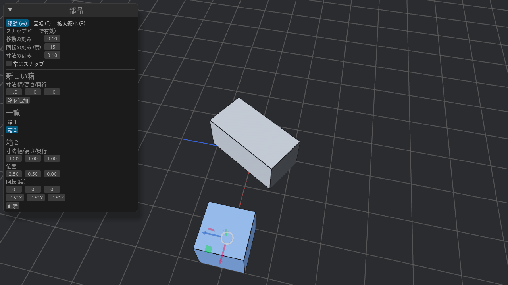

# カメラ操作

Unity / Unreal Engine のシーンビューと同じ割り当てです。どちらかに慣れていればそのまま使えます。

## マウス

| 操作 | 動き |
| --- | --- |
| **Alt + 左ドラッグ** | 注視点のまわりを回る(オービット) |
| **中ボタンドラッグ** | 画面と平行に動かす(パン) |
| **ホイール** / **Alt + 右ドラッグ** | 近づく / 遠ざかる(ズーム) |
| **右ドラッグ** | その場で首を振って見回す |

## 飛び回る(フライ操作)

右ボタンを押している間だけ、キーボードで移動できます。

| キー | 動き |
| --- | --- |
| W / S | 前 / 後ろ |
| A / D | 左 / 右 |
| Q / E | 下がる / 上がる |
| Shift | 押している間は速く動く |

> 右ボタンを押していないときの W / E / R はギズモの切り替えになります。

## 部品に寄る

部品を選んで **F** を押すと、その部品が画面の中央に来るようにカメラが寄ります。どこを見ているかわからなくなったときにも便利です。
