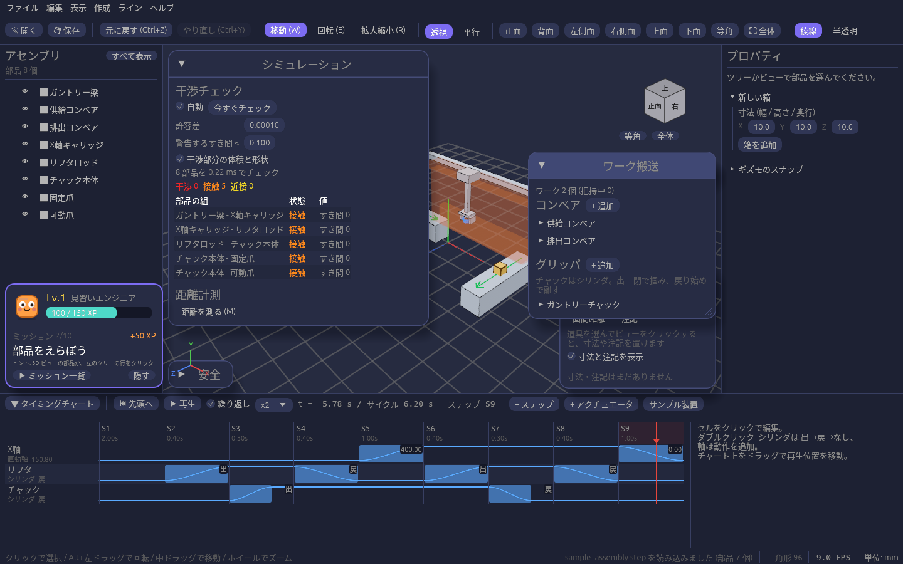

# コンベアでワークを流し、チャックで掴んで運ぶ

タイミングチャートの再生に合わせて、ワーク(黄色い箱)をコンベアで流し、グリッパのチャックで掴んで別の場所へ運べます。
ピック & プレースの動きが、ワークの位置と合っているかを確かめられます。

## ワーク搬送ウィンドウ

ツールレールの **搬送** で開く **ワーク搬送** パネルで、コンベアとグリッパを設定します。
動きそのものは [タイミングチャート](timing-chart.md) で組むので、先にシリンダや軸のアクチュエータを作っておいてください。

## コンベアを置く

1. コンベアの **+ 追加** で作ります。
2. **ベルト部品** に、ベルトにする部品を選びます。ツリーかビューで部品を選んでから **選択中** を押しても選べます。
3. 流れる向き(X / Z)を選びます。部品の上面を、その向きへワークが流れます。3D ビューに緑の矢印で向きが出ます。

| 欄 | 内容 |
| --- | --- |
| ワーク供給 | 「あり」にすると、決めた間隔ごとにコンベアの始端へワークが出ます |
| 終端 | **ストッパ** ならワークは終端から詰まって並び、**排出** なら終端から流れ出て消えます |

## グリッパを作る

1. グリッパの **+ 追加** で作ります。
2. **チャック** に、タイミングチャートのシリンダを選びます。
3. **掴む位置** と **掴める距離** を決めます。掴む位置は 3D ビューに青い球で出ます(掴んでいる間は赤)。

チャックのシリンダが **出** になり切った瞬間に、掴む位置から掴める距離以内にあるワークを掴み、**戻** を始めた瞬間に離します。

## 運ぶ

掴んだワークは、チャックの **載せ先** のアクチュエータ(上下シリンダや X 軸など)と一緒に動きます。コンベアの上で離せば、そのコンベアで流れます。

- 繰り返し再生では、サイクルをまたいでもワークが残ります。**⏮ 先頭へ** でワークは空に戻ります。
- いまはワークの到着を待つ条件がないので、最初のステップにタイマーを入れて、ワークが来るまで待たせてください。

## 保存と元に戻す

ワーク種類・投入口・排出口・コンベア・グリッパの設定はプロジェクト(.plantwright)に保存され、追加・削除・設定の変更は Ctrl+Z で戻せます。流れているワークは保存されません(再生し直すと 0 秒から流れ直します)。
