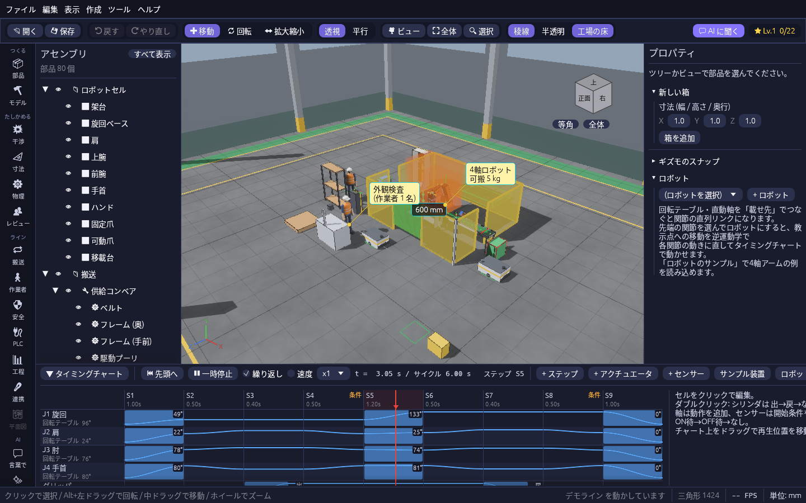
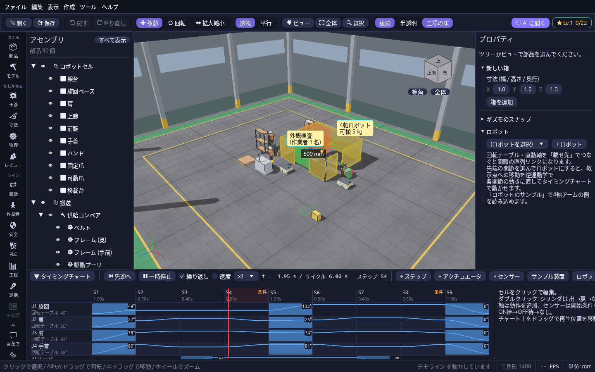

# 画質と工場の背景

## 画質

「表示 → 画質」で、3D ビューの描き方を3段階から選べます。選んだ段階は次に起動したときも使われます。

| 画質 | 見え方 |
| --- | --- |
| きれい(既定) | 部品が床にやわらかい影を落とし、部品の隅や接地面に陰影が付きます。光るエフェクトは少しにじんで見えます |
| 標準 | 部品の影と、天井・壁・床から回り込む光が付きます |
| 軽い | 影や後処理を使わず、いちばん軽く描きます。動きがカクつく PC ではこれを選んでください |

部品の色はプロパティの「色」で変えられます。稜線・グリッド・半透明などの切り替えは [カメラとビュー](camera.md#表示の切り替え) を見てください。

## 工場の床と壁

3D ビューの背景には、コンクリートの床・壁際の緑の歩行者通路・黄色の通路の線・柱・高窓のある工場の建屋が出ます。床のグリッドは **1 マス 1 m**(太い線は 5 m ごと)なので、装置の大きさや通路幅を見ながら並べられます。

- 建屋はモデルを囲むように自動で広がります(周りに 6 m 以上の余裕を取り、5 m 単位で広げるので、部品を少し動かしたくらいでは変わりません)。
- 「表示 → 工場の床と壁 → 広さ」で、20 m × 15 m・40 m × 30 m・60 m × 40 m・100 m × 60 m の決まった広さにもできます。建屋の広さを決めてから装置を並べたいときに使います。
- 建屋の外から見ているときは、手前の壁と柱を自動で隠すので、中の装置が隠れません。
- ツールバーの「工場の床」で床ごと出し入れできます。壁と柱だけ消すなら「表示 → 工場の床と壁 → 壁・柱・高窓を表示」を外します。
- 背景は設計データではないので、プロジェクトには保存されず、干渉チェックや書き出しにも入りません。

## 浮かぶウィンドウを透かす

音の設定・AI の設定・動画の書き出しなど 3D ビューの上に浮かぶウィンドウは、カーソルが乗っていない間は少し透けて、後ろのモデルが見えます。カーソルを乗せる・入力欄に文字を打つ・別のウィンドウに重なっているときは、読みやすいよう透けなくなります。3D ビューをドラッグして視点を回したり部品を動かしたりしている間は、さらに薄くなります。透かしたくないときは「表示 → 浮かぶウィンドウを透かす」を外します。
