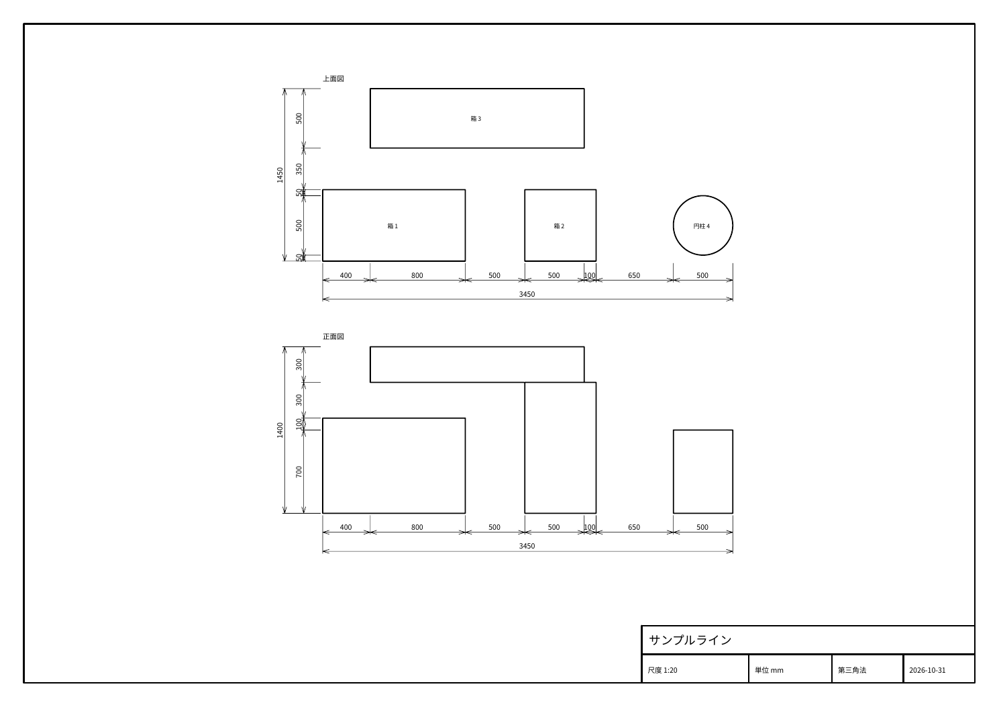

# 図面と部品表を書き出す

並べた設備のレイアウトを 2D の図面にしたり、使っている部品の一覧(部品表)を Excel や CSV にしたりできます。

## 図面を書き出す

**ファイル → 書き出し → 図面 (PDF / DXF)…** を押すと、設定の画面が出ます。

| 設定 | 内容 |
| --- | --- |
| 上面図 / 正面図 | 描く図(両方なら、正面図の上に上面図を並べる第三角法) |
| かくれ線 (破線) を描く | 手前の部品に隠れた線を破線で描く |
| 全体寸法 | 全体の幅・奥行・高さ |
| 設備の間隔寸法 (直列寸法) | 設備の端どうしの間隔を並べて書く |
| 上面図に設備名を書く | 設備の名前を上面図に書く |

**保存先を選んで書き出し…** を押し、ファイルの種類を PDF か DXF にして保存します。

- 用紙は A3 横で、図枠と表題欄(図面名・尺度・単位・投影法・日付)が付きます。図面名にはプロジェクトのファイル名が入ります(保存前は「無題」)。
- 尺度は 1:1、1:2、1:5、1:10、1:20、1:25、1:50 … のうち、図が用紙に収まるものを自動で選びます。
- 表示中の部品だけを描きます。描きたくない部品は 👁 で隠してから書き出してください。
- 寸法を付ける「設備」の単位は、ツリーの最上位のノードです。最上位がアセンブリ1つだけのときは、その中の1段目を1台ずつの設備とみなします。

DXF は実寸(尺度をかけない大きさ)で書き出すので、AutoCAD などで開いてそのまま寸法を測れます。外形線・かくれ線・寸法・文字・図枠は別の画層に分かれています。

## 部品表を書き出す

**ファイル → 書き出し → 部品表 (Excel / CSV)…** を押し、ファイルの種類を Excel(.xlsx)か CSV にして保存します。

部品表には、同じ部品(同じ取り込み元・名前・寸法)をまとめて数えた一覧が入ります。

| 列 | 内容 |
| --- | --- |
| No. / 品名 / 種類 | 部品の名前と、箱・部品の別 |
| 取り込み元 | 取り込んだ STEP などのファイル名 |
| 幅 / 高さ / 奥行 | 部品の大きさ(モデルの単位) |
| 数量 | 同じ部品の個数 |
| 体積 | 1個あたりの体積 |
| 使用箇所 | その部品が入っているアセンブリ |

Excel ではもう1枚 **構成** のシートが付き、アセンブリの木の形(字下げ付き)と、各部品の部品表 No.・位置が並びます。
CSV は Excel でそのまま開けるよう、文字コード UTF-8(BOM 付き)で書き出します。
