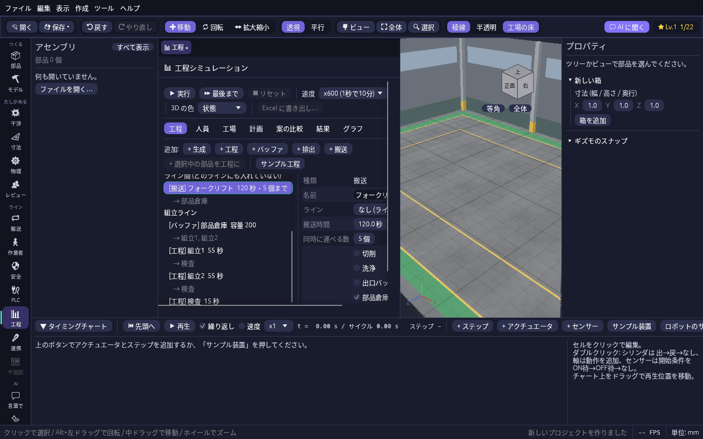
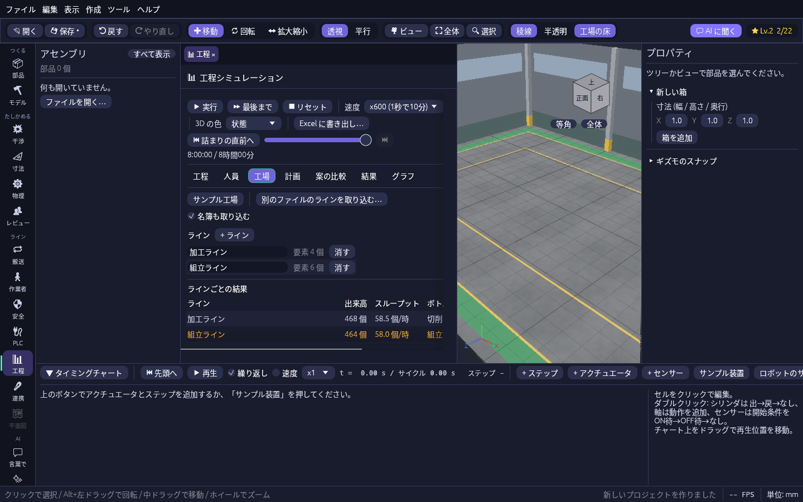
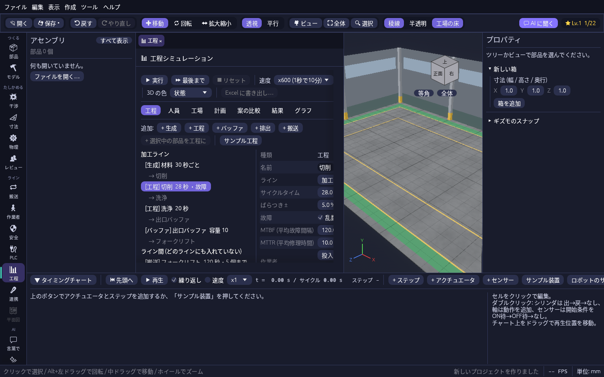
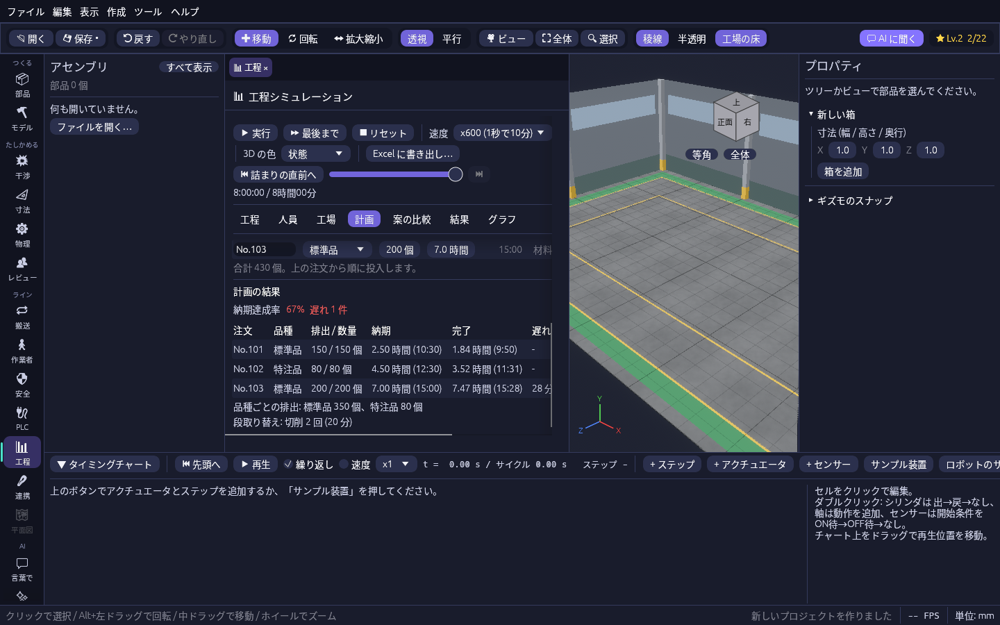
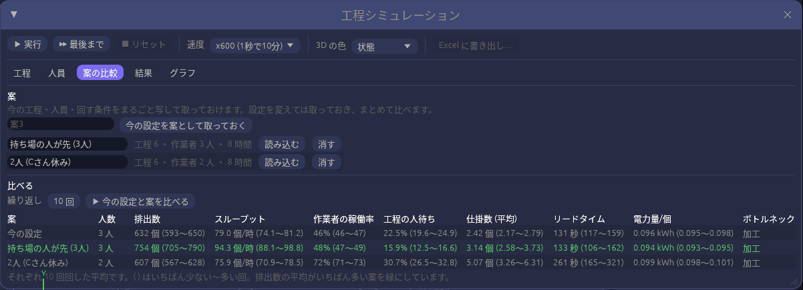

# 工場・生産計画・案の比較

[工程シミュレーション](flow.md) のウィンドウの「工場」「計画」「案の比較」タブで、複数のラインをまとめた工場、品種と納期のある生産計画、設定の違う案どうしの比較を扱います。

## 複数のラインを並べて工場にする

「工場」タブで、工程を **ライン** ごとにまとめ、ライン間をフォークリフトや手運びの **搬送** と倉庫(バッファ)でつないで、工場全体を1つの時計で回せます。名簿は工場で1つなので、持ち場のラインの手が空いた人がほかのラインを **応援** する様子も出ます。
試すときは「工場」タブの **サンプル工場** を押して ⏩ 最後まで を押してください(加工ライン → フォークリフト → 組立ライン、日勤 4 人)。

| 工程タブ(ラインごとの一覧と搬送の設定) | 工場タブ(ラインごとの結果と応援) |
| --- | --- |
|  |  |

1. **ラインを作る。** 「工場」タブの **+ ライン** でラインを足し、名前を付けます。今ある工程をまとめて 1 本目にするときは **今の要素を 1 本のラインにまとめる** を押します。
2. **要素をラインに入れる。** 「工程」タブで要素を選び、**ライン** を選びます。一覧はラインごとに見出しが付きます。ライン間の搬送や倉庫は「なし (ライン間など)」のままにできます。
3. **ライン間をつなぐ。** 「+ 搬送」で搬送を足し、**搬送時間** と **同時に運べる数**(フォークリフトの台数 × 1 回に積む数)を入れます。前のラインの最後の要素の送り先を搬送に、搬送の送り先を次のラインの倉庫(容量の大きいバッファ)にします。
4. **別のファイルのラインを取り込む。** **別のファイルのラインを取り込む…** で、別に作った .plantwright の工程を 1 本のラインとして足せます。**名簿も取り込む** にチェックを入れると、そのファイルの作業者とシフトも足されます(同じシフトは 1 つにまとまります)。取り込んだあと、ライン間の送り先を「工程」タブでつなぎます。
5. **回して比べる。** ⏩ 最後まで で回すと、「工場」タブの下にラインごとの出来高・スループット・ボトルネック・仕掛数・人待ちが出て、出来高がいちばん少ないラインが黄色になります。持ち場のライン以外で作業した人は「ほかのラインの応援」に回数が出ます(「結果」タブの作業者の表の「応援」も同じ)。

サンプルでは A さんが切削の合間に組立ラインの組立2 を応援しますが(作業の 15%)、その間は切削が人待ちになり、加工ラインの人待ちが 35% になります。人を足すか、A さんの応援をやめる案を「案の比較」で比べてみてください。ラインと搬送もプロジェクトに保存され、「Excel に書き出し…」には「ライン別」のシートが加わります。

## 品種と生産計画で納期に間に合うかを見る

「計画」タブで、**品種**(標準品・特注品など)と **注文**(品種・数量・納期)を並べ、その順に流したときに納期に間に合うかを見られます。品種ごとに加工時間や通る工程を変えられ、品種が切り替わる工程では **段取り替え** の時間がかかります。人が要る工程なら、段取り替えも作業者の仕事になります。
試すときは「計画」タブの **サンプル計画** を押して ⏩ 最後まで を押してください(サンプル工場に、標準品と特注品の 3 件の注文を足したものです)。

| 工程タブ(品種ごとの加工時間と段取り替え) | 計画タブ(注文ごとの結果) |
| --- | --- |
|  |  |

1. **品種と注文を入れる。** 「計画」タブの **+ 品種** で品種を足して名前を付け、**+ 注文** で注文を足して品種・数量・納期(回し始めてから何時間後か。横に時刻も出ます)・投入する生成を選びます。上の注文から順に投入され、↑ ↓ で順番を変えられます。
2. **Excel や CSV から読み込む。** **Excel / CSV から読み込む…** で、1 行目に「品種」「数量」「納期」の見出しがある表(最初のシート)を読み込めます。納期は回し始めてからの時間数です。「注文」の列があれば注文の名前に、「投入」の列があれば投入する生成の名前に使います。読み込むと今の注文は置き換わり、知らない品種は足されます。
3. **工程ごとに品種の違いを入れる。** 「工程」タブで工程を選び、**品種ごとの加工時間** にチェックを入れて時間を入れます(チェックしない品種は工程のサイクルタイム)。**段取り替え** には、前と違う品種が来たときにかかる時間を入れます。**受け取る品種** にチェックを入れると、その品種だけがその工程に送られます(品種で行き先を分けるときに使います)。注文を入れていない生成は、**作る品種** で 1 つの品種を作り続けます。
4. **結果を見る。** ⏩ 最後まで で回すと、「計画」タブの下に納期達成率と、注文ごとの排出数・完了時刻・遅れ・結果(間に合った / 遅れ / 未完了)、品種ごとの排出数、工程ごとの段取り替えの回数と時間が出ます。

サンプルでは No.101 と No.102 は間に合いますが、No.103 は 7 時間の納期に 28 分遅れます。特注品の段取り替えで切削が 20 分止まるのが効いているので、注文の順番を変えたり、段取り替えを短くしたりした案を「案の比較」で比べてみてください(比較の表に納期達成率の列が出ます)。品種と注文もプロジェクトに保存され、「Excel に書き出し…」には「生産計画」のシートが加わります。

## 案を取っておいて並べて比べる

「案の比較」タブで、今の工程・人員・回す条件をまるごと **案** として取っておき、設定を変えた案と並べて比べられます。「3 人で持ち場を決めた場合」「C さんが休んだ場合」「加工を速い機械にした場合」のような案を、同じ条件で何回か回した平均で比べます。

1. **案を取っておく。** 名前を入れて **今の設定を案として取っておく** を押します(名前が空なら「案1」のように付きます)。
2. **設定を変えて、また取っておく。** 「工程」「人員」タブで設定を変え、別の名前で取っておきます。案の名前は一覧で直接書き換えられ、**読み込む** でその案の設定に戻せます(今の設定は上書きされます)。**消す** で案を消します。
3. **比べる。** **繰り返し** の回数(1〜100、既定 10 回)を決めて **▶ 今の設定と案を比べる** を押すと、今の設定とすべての案を、乱数の種を 1 つずつずらしながらその回数ずつ回します。排出数・スループット・作業者の稼働率・人待ち・仕掛数・リードタイム・1 個あたりの電力量の平均と、( ) にいちばん少ない〜多い回、いちばん多くボトルネックになった工程が並びます。排出数の平均がいちばん多い案が緑になります。

故障やばらつきがあると 1 回の結果は偶然に左右されます。幅( )が重なっている案どうしは、差が偶然の範囲かもしれないので、回数を増やして確かめてください。案はプロジェクトに保存されます。
