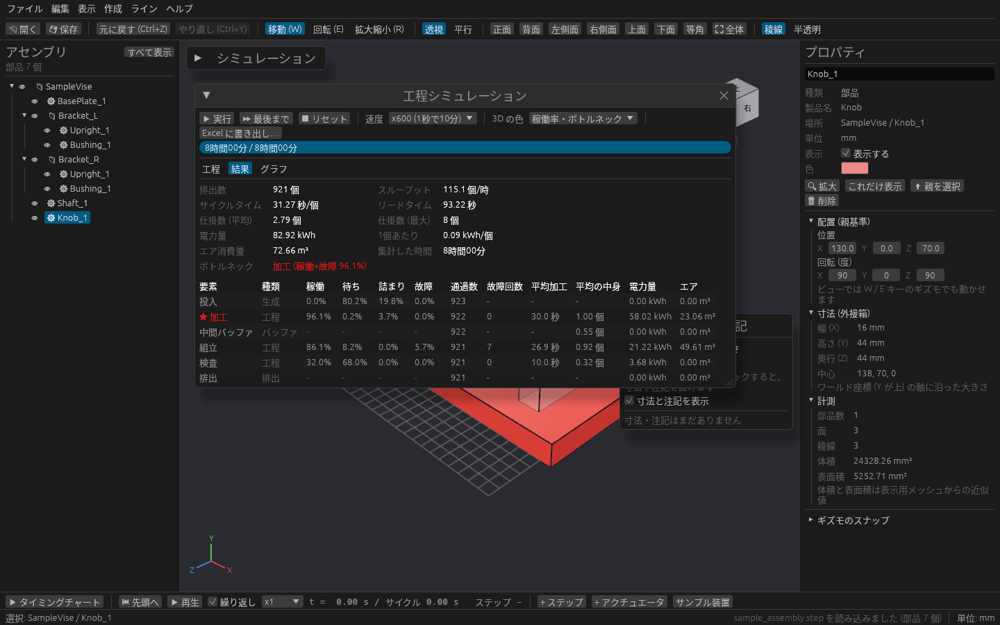
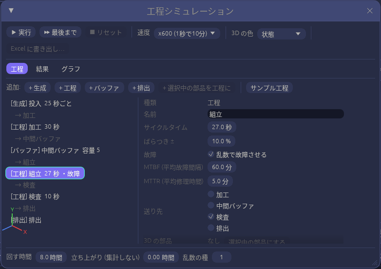
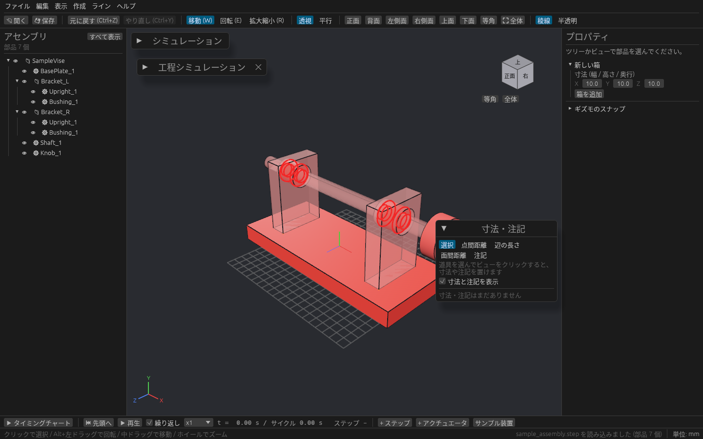
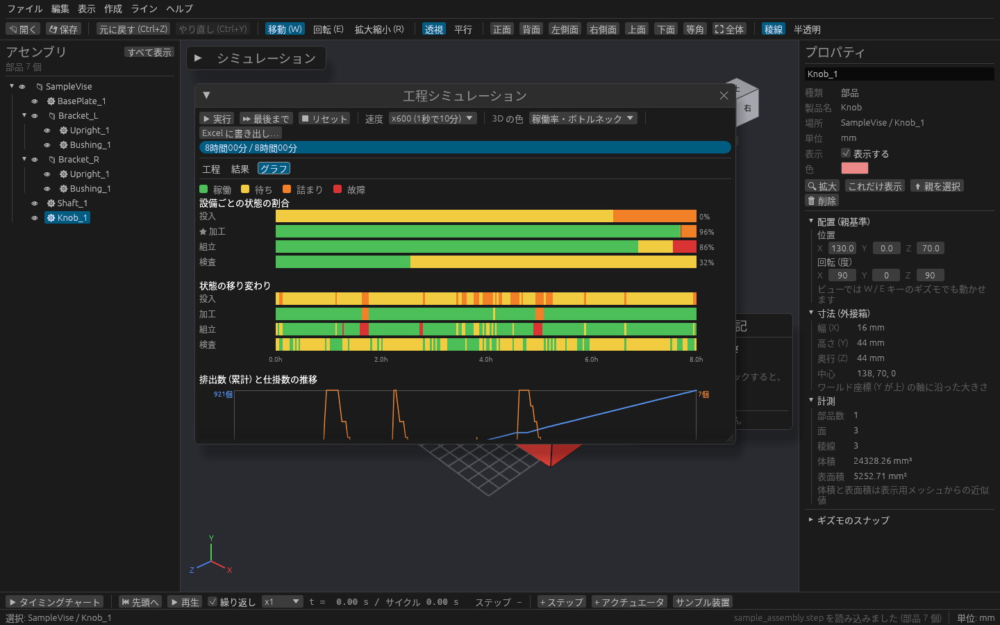

# 工程シミュレーションでスループットを見る

「加工 30 秒」「検査 10 秒」のような工程とバッファを並べて、ラインを数時間分まとめて早回しできます。
1時間に何個できるか、どの設備がボトルネックか、バッファはいくつあれば足りるかを、設備を置く前に確かめられます。

## 開く

メニューの **ライン → 工程シミュレーション…** で、工程シミュレーションのウィンドウが開きます。もう一度選ぶと閉じます。

まず試すときは **ライン → サンプル工程を読み込む**(ウィンドウの工程タブの **サンプル工程** でも同じ)を押してから、ウィンドウの **⏩ 最後まで** を押してください。投入 → 加工 → バッファ → 組立(故障あり)→ 検査 → 排出 のラインが 8 時間分回り、結果が出ます。

ウィンドウの上の段に回すためのボタン、その下に **工程**・**結果**・**グラフ** の3つのタブ、いちばん下に回す時間の欄があります。

## ラインを組む(工程タブ)

### 要素を並べる

**追加:** の **+ 生成**・**+ 工程**・**+ バッファ**・**+ 排出** を押すと、一覧の末尾に要素が増え、直前の要素とつながります。左から順に押せば、そのままつながったラインになります。

| 要素 | 役割 |
| --- | --- |
| 生成 | ワーク(材料)を一定の間隔で投入する。個数の上限も決められます |
| 工程 | ワークを1個ずつ加工する設備。サイクルタイムと故障を設定します |
| バッファ | 工程の間の置き場。容量までワークをためられます |
| 排出 | できあがったワークの出口。ここに着いた数が排出数になります |

要素を選んだときの設定欄の下にある ↑ ↓ で並べ替え、🗑 削除 で消せます。

### 3D の部品と結びつける

3D ビューかツリーで設備の部品(アセンブリでも可)を選んでから **+ 選択中の部品を工程に** を押すと、その部品の名前で工程が増えます。
結びつけた部品は、回している間に状態や稼働率の色で塗られるので、どの設備が詰まっているかを 3D で見られます。
あとから結びつけるときは、要素の設定の **選択中の部品にする**、外すときは **対応付けを外す** を押します。

### 値を入れる

一覧で要素を選ぶと、右側で設定できます。

| 欄 | 内容 |
| --- | --- |
| 名前 | 一覧・結果・グラフに出る名前 |
| サイクルタイム | 工程が1個を加工する時間(秒) |
| 間隔 | 生成がワークを投入する間隔(秒) |
| 容量 | バッファにためられる数 |
| ばらつき ± | サイクルタイムや間隔をこの割合(%)の範囲で毎回ばらつかせます |
| 乱数で故障させる | オンにすると、**MTBF**(平均故障間隔)と **MTTR**(平均修理時間)で工程がときどき止まります |
| 定格電力・待機電力・エア消費量 | 入れると、電力量とエア消費量も集計されます。待ち・詰まり・故障中は待機電力で数えます |
| 送り先 | ワークを送る先。複数にチェックを入れると、上から順に空いている先へ送ります(並列の設備に使えます) |

工程の設定を変えると、前の結果の上に「工程の設定が変わりました」と出ます。▶ で回し直してください。

## 回す

ウィンドウのいちばん下で、回し方を決めます。

| 欄 | 内容 |
| --- | --- |
| 回す時間 | 何時間分回すか(既定 8 時間) |
| 立ち上がり (集計しない) | 最初のうちの、ラインが空の状態から埋まるまでの時間。ここは集計に入れません |
| 乱数の種 | 同じ種なら毎回同じ結果になります。種を変えて回すと、故障やばらつきでどのくらい差が出るかを見られます |

ウィンドウの上の段のボタンで回します。

| 操作 | 内容 |
| --- | --- |
| ▶ 実行 | **速度** で選んだ速さで早送りしながら回します。速度は x1 〜 x36000(x3600 なら 1 秒で 1 時間) |
| ⏸ 一時停止 / ⏹ リセット | 止める / 結果を消して最初に戻す |
| ⏩ 最後まで | 回す時間の最後まで一気に回して集計します |
| 3D の色 | なし / 状態 / 稼働率・ボトルネック から選びます(下の表) |

| 3D の色 | 塗り分け |
| --- | --- |
| 状態 | 稼働 緑・待ち 黄・詰まり 橙・故障 赤。▶ 実行 で回している間、刻々と変わります |
| 稼働率・ボトルネック | 稼働率の低い設備ほど青、高いほど橙。ボトルネックの設備は赤 |

「待ち」は前からワークが来ない状態、「詰まり」は加工が終わったのに次が空かず送れない状態です。

## 結果を見る(結果タブ・グラフタブ)

**結果** タブには、ライン全体の値と設備ごとの表が出ます。

- 排出数、スループット(個/時)、サイクルタイム(秒/個)、リードタイム(投入から排出までの時間)
- 仕掛数(ライン上にあるワークの数)の平均と最大
- 電力量(kWh、1個あたり)とエア消費量
- 設備ごとの稼働・待ち・詰まり・故障の割合、通過数、故障回数。ボトルネックの設備には ★ が付きます

**グラフ** タブには、設備ごとの状態の割合、状態の移り変わり、排出数(累計)と仕掛数の推移が出ます。

上の段の **Excel に書き出し…** を押すと、集計・設備別の表・推移を xlsx ファイルに保存します。グラフも Excel のグラフとして入ります。

## 保存と元に戻す

組んだ工程と設定はプロジェクト(.cadsim)に保存されます。結果は保存されないので、開き直したら回し直してください。
工程の編集は Ctrl+Z では戻せません。
