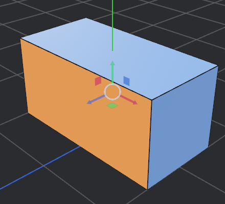
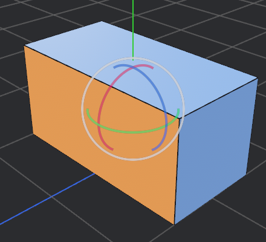
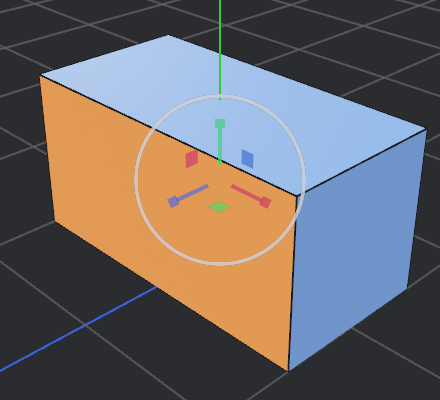
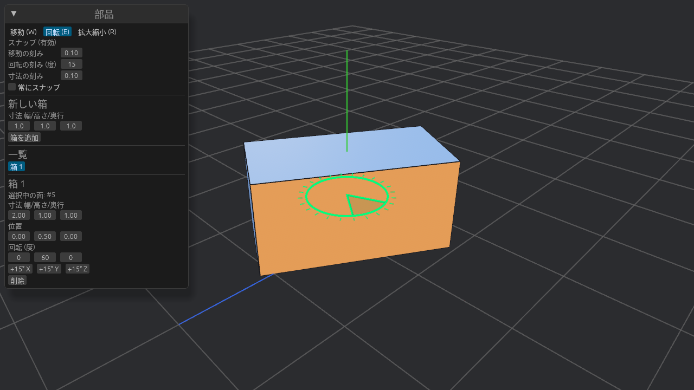

# ギズモとスナップ

箱を選ぶと、3D ビューにギズモ(つまんで動かすための矢印や輪)が出ます。

## ギズモの種類

**W / E / R** キー、またはパネル上部のボタンで切り替えます。

| キー | ギズモ | 使いかた |
| --- | --- | --- |
| W | 移動 | 矢印をドラッグするとその軸の向きに動く。矢印の間の四角をドラッグすると平面上を動く |
| E | 回転 | 輪をドラッグするとその軸まわりに回る |
| R | 拡大縮小 | 軸をドラッグするとその向きの寸法が変わる |

| 移動 (W) | 回転 (E) | 拡大縮小 (R) |
| --- | --- | --- |
|  |  |  |

ギズモで動かした結果は、パネルの寸法・位置・回転の数値にすぐ反映されます。

## スナップ(一定量ずつ動かす)

**Ctrl を押しながら** ギズモをドラッグすると、決まった刻みで動きます。パネルの **常にスナップ** をオンにすると、Ctrl を押さなくてもスナップします。スナップが効いている間、パネルの表示は「スナップ (有効)」になります。

| ギズモ | 刻み(初期値) | 動きかた |
| --- | --- | --- |
| 移動 | 移動の刻み(0.1) | ドラッグを始めた位置から 0.1 ずつ動く |
| 回転 | 回転の刻み(15°) | ドラッグを始めた向きから 15° ずつ回る。輪に目盛りが出る |
| 拡大縮小 | 寸法の刻み(0.1) | 動かした軸の寸法が 0.1 の倍数になる |

移動と回転は「ドラッグを始めてからの変化量」を丸めます。拡大縮小だけは寸法そのものを丸めるので、半端な寸法の箱もきりのいい値にそろえられます。触っていない軸の寸法は変わりません。
