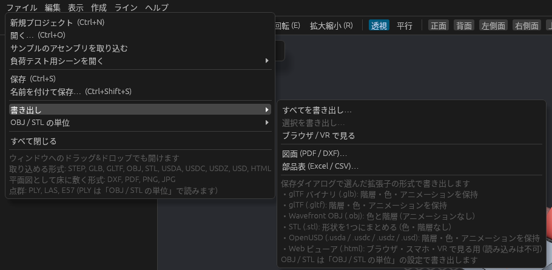
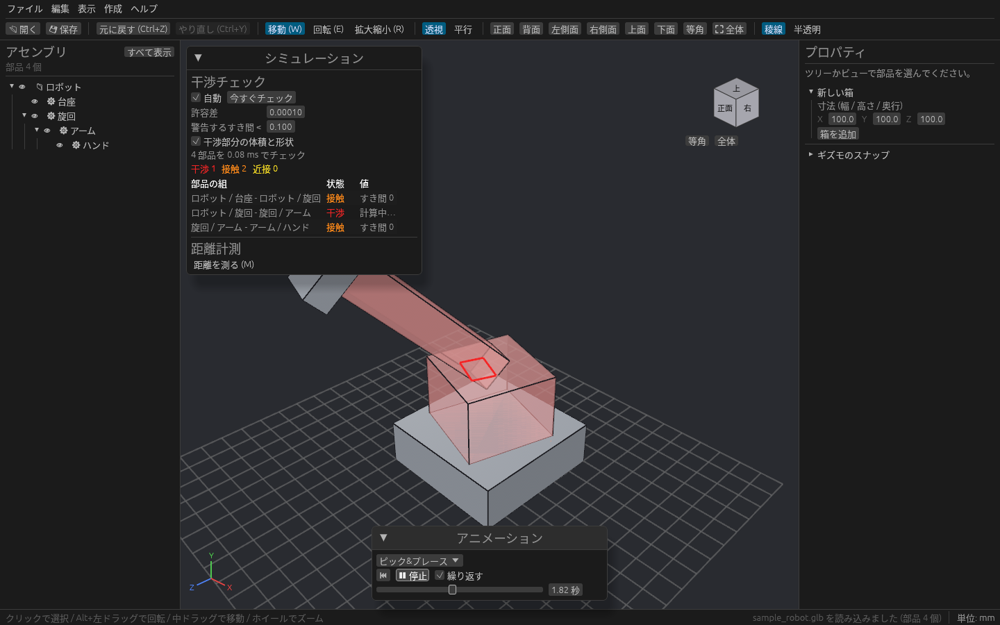

# glTF・OBJ・STL・USD の読み書き

STEP のほかに、glTF / GLB・OBJ・STL・OpenUSD の 3D ファイルを取り込んだり、書き出したりできます。

## 取り込む

STEP と同じく、**ファイル → 開く…**(**Ctrl + O**)か、ウィンドウへのドラッグ&ドロップで取り込めます。今のプロジェクトに追加されます。

| 形式 | 取り込まれるもの |
| --- | --- |
| glTF / GLB(`.gltf` / `.glb`) | 階層(親子と配置)、名前、色、アニメーション |
| OBJ(`.obj`) | 部品(`o` / `g`)ごとの形状と色(`.mtl`) |
| STL(`.stl`) | 形状だけ(アスキー / バイナリとも可) |
| OpenUSD(`.usda` / `.usdc` / `.usdz` / `.usd`) | 階層、名前、色、動き。単位と上方向はファイルに従って換算 |

テクスチャ・スキン・モーフターゲットは読み飛ばします。

## OBJ / STL の単位

OBJ と STL は単位を持たないので、**ファイル → OBJ / STL の単位** で、長さの単位(mm / cm / m / inch)と、Z 軸が上のデータかどうかを選んでから取り込みます。既定は mm・Y 軸が上です。書き出すときもこの設定を使います。

## 書き出す

**ファイル → 書き出し** から選びます。

- **すべてを書き出し…**: モデル全体
- **選択を書き出し…**: 選んでいる部品やアセンブリだけ

保存ダイアログで選んだ拡張子の形式で書き出します。

| 形式 | 書き出されるもの |
| --- | --- |
| glTF バイナリ(`.glb`) / glTF(`.gltf`) | 階層・色・アニメーション |
| OBJ(`.obj`) | 色と階層(アニメーションなし) |
| STL(`.stl`) | 形状を 1 つにまとめる(色・階層なし) |
| OpenUSD(`.usda` / `.usdc` / `.usdz`) | 階層・色・アニメーション。Omniverse などでそのまま再生できる |

## アニメーションを再生する

アニメーション付きの glTF や USD を取り込むと、3D ビューの下に **アニメーション** パネルが出ます。

| 操作 | 内容 |
| --- | --- |
| 一番上の選択欄 | 再生するアニメーションを選ぶ |
| ⏮ | 最初に戻す |
| ▶ 再生 / ⏸ 停止 | 再生と停止 |
| 繰り返す | オンにすると最後まで行ったら最初から再生する |
| 横のスライダー | ドラッグして好きな時刻(秒)を表示する |

再生中も干渉チェックが動きの通りに追いかけるので、動かしたときにぶつかるところを確かめられます。

