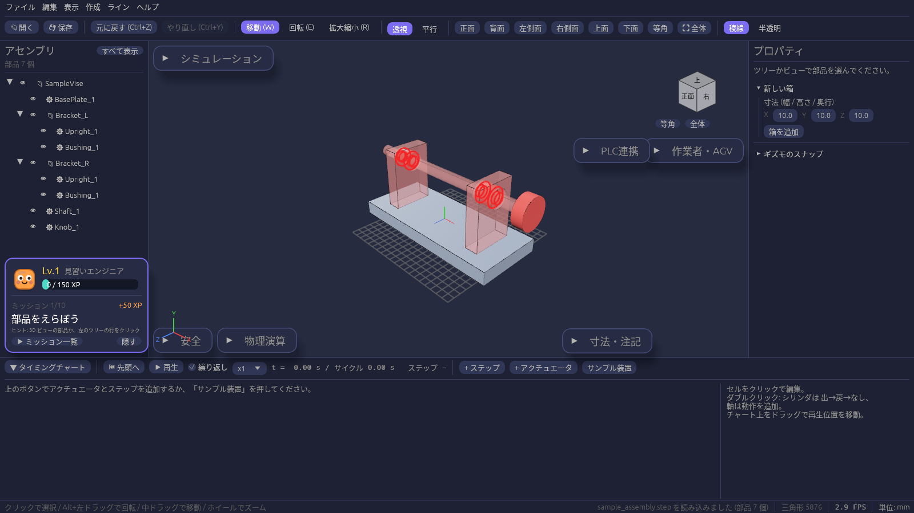

# はじめに

cadsim は、工場のライン設備を 3D で組み立てて動きを確かめるための CAD / 動作シミュレーターです。
設備メーカーの STEP データを読み込み、部品を並べたり動かしたり、ぶつかりを調べたりできます。
このマニュアルでは、画面の見かたと操作方法を画像付きで説明します。

## できること

| 機能 | 状況 | 説明 |
| --- | --- | --- |
| STEP の取り込み(AP203 / AP214 / AP242) | 使える | [STEP ファイルを開く](step-import.md)、[各 CAD から STEP を書き出す](step-export.md) |
| プロジェクトの保存と読み込み(.cadsim) | 使える | [プロジェクトの保存と読み込み](project.md) |
| glTF / GLB・OBJ・STL・OpenUSD の取り込みと書き出し、アニメーション再生 | 使える | [glTF・OBJ・STL・USD の読み書き](interchange.md) |
| HTML ビューアの書き出し(ブラウザ・スマホ・VR / AR で実寸表示) | 使える | [ブラウザ・スマホ・VR で見る](web-viewer.md) |
| アセンブリツリー、選択の強調表示 | 使える | [アセンブリツリーと選択](tree.md) |
| プロパティ(配置・寸法・体積など) | 使える | [プロパティ](properties.md) |
| Unity / Unreal と同じカメラ操作、標準ビュー、透視 / 平行投影 | 使える | [カメラとビュー](camera.md) |
| 箱の作成と編集 | 使える | [箱の作成と編集](boxes.md) |
| 円柱・押し出し・穴あけ・ブーリアン | 使える | [円柱・押し出し・穴・ブーリアン](modeling.md) |
| 移動 / 回転 / 拡大縮小ギズモ、Ctrl スナップ | 使える | [ギズモとスナップ](gizmo.md) |
| 元に戻す / やり直し | 使える | [元に戻す・やり直し](undo.md) |
| 干渉チェック(干渉・接触・近接)と距離計測 | 使える | [干渉チェックと距離計測](simulation.md) |
| 3D 上の寸法(点間距離・辺の長さ・面間距離)と注記 | 使える | [寸法と注記](annotations.md) |
| 上面図・正面図の図面(PDF / DXF)と部品表(Excel / CSV) | 使える | [図面と部品表を書き出す](drawing.md) |
| 平面図(DXF / PDF / 画像)を床に敷く、縮尺合わせ | 使える | [平面図を床に敷く](floor-plan.md) |
| 点群(PLY / LAS / E57)の表示と干渉チェック | 使える | [点群を読み込む](point-cloud.md) |
| タイミングチャートと動作シミュレーション | 使える | [タイミングチャート](timing-chart.md) |
| 光電・近接センサーとステップの開始条件(インターロック) | 使える | [センサーとインターロック](sensors.md) |
| Windows / Mac 向けのダウンロード版 | 使える | [インストールと起動](install.md) |
| シーケンサー(PLC) | 予定 | [シーケンサー(PLC)](upcoming/sensors-plc.md) |
| 関節とロボットの動き | 予定 | [関節とロボット](upcoming/robot.md) |
| 標準部品ライブラリ | 予定 | [部品ライブラリ](upcoming/parts-library.md) |
| タイミングチャート・干渉チェックの結果の CSV 出力 | 予定 | [結果の CSV 出力](upcoming/csv.md) |

「開発中」「予定」の章は、機能ができしだい中身を書き足していきます。

## 単位と座標

- 長さの単位は STEP ファイルに書かれた単位(mm / cm / m / inch)に合わせます。画面右下のステータスバーに今の単位が出ます。
- Y が上、X が右、Z が手前です。左下の座標軸と、原点に描かれる赤・緑・青の線が X・Y・Z 軸です。STEP は Z が上のことが多いですが、読み込むときに Y が上になるよう向きを直します。
- 形状は内部で倍精度(f64)の B-rep として持っているので、寸法の値はそのまま正確に保たれます。
