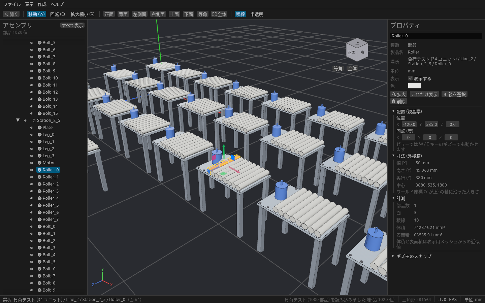
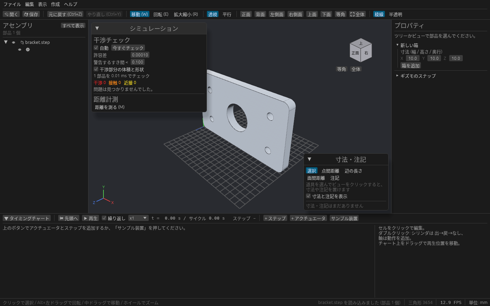
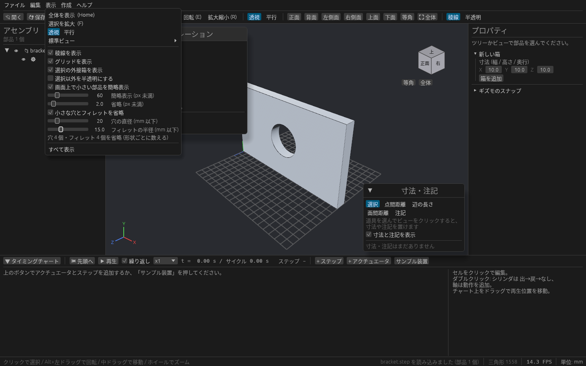

# 大きなアセンブリを軽く扱う

数千〜1 万部品のライン全体を読み込んでも、回転・ズーム・クリックでの選択・ツリーの操作が重くならないようにしています。
ここでは、重さの見かたと、重いと感じたときの設定を説明します。

## 重さを見る

ステータスバーの右端に、次の 2 つが出ます。

| 表示 | 内容 |
| --- | --- |
| FPS | 1 秒あたりの描画回数。30 以上あれば操作に困りません |
| 三角形の数 | いま描いている三角形の数 |

三角形の数にカーソルを乗せると、細かく描いている部品・簡略に描いている部品・小さくて省いた部品・画面の外の部品が、それぞれいくつあるかが出ます。

## 小さい部品の簡略表示

**表示 → 画面上で小さい部品を簡略表示** がオン(既定)のときは、遠くて画面上で小さく見える部品を粗い形で描き、ごく小さい部品(ねじなど)は描きません。近づけば元の細かい形に戻ります。
選んでいる部品は、小さくてもいつも細かく描きます。

どのくらい小さければ簡略にするかは、同じメニューのスライダーで変えられます。

| スライダー | 内容 |
| --- | --- |
| 簡略表示 (px 未満) | 画面上の大きさがこれより小さい部品を粗い形にします |
| 省略 (px 未満) | これより小さい部品は描きません |

形状そのものは変わらないので、干渉チェック・計測・書き出しには影響しません。

## 小さな穴とフィレットを省略する

**表示 → 小さな穴とフィレットを省略** をオンにすると、STEP で読み込んだ部品の小さな穴を埋め、角の丸み(フィレット)を尖った角にして描きます。ボルト穴や丸みの多い部品が並ぶアセンブリで、描く三角形が大きく減ります。

| オフ | オン(穴 4 個とフィレット 4 個を省略、三角形 3654 → 1558) |
| --- | --- |
|  |  |

- 消す大きさは、その下の **穴の直径**・**フィレットの半径** のスライダーで決めます(モデルの単位)。
- 計算は部品の形ごとに裏で行い、できたものから表示が変わります。メニューに計算の進み具合と、省略した穴・フィレットの数が出ます。
- 干渉チェックは元の形のまま行います。クリックでの選択や距離計測は、表示している形に当たります。
- glTF / OBJ / STL などメッシュで読み込んだ部品と、cadsim で作った箱は変わりません。

## 重いと感じたら

1. **表示 → 画面上で小さい部品を簡略表示** がオンになっているかを確かめます。
2. スライダーの値を上げて、簡略にする・省く部品を増やします。
3. **表示 → 小さな穴とフィレットを省略** をオンにします。
4. **表示 → 稜線を表示** を外します。部品が多いときは稜線の描画が効きます。
5. 作業に関係ない部分は、ツリーの 👁 や **H** キーで隠します。隠した部品は描かず、干渉チェックからも外れます。

## 負荷テスト用シーンで試す

**ファイル → 負荷テスト用シーンを開く** で、部品 1000 個 / 5000 個 / 10000 個の設備の並びを開けます。
お使いの PC でどのくらいの規模まで快適に動くかを、自分のデータを読み込む前に確かめられます。
