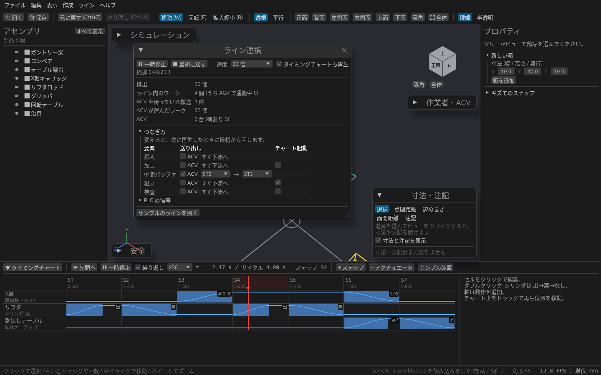
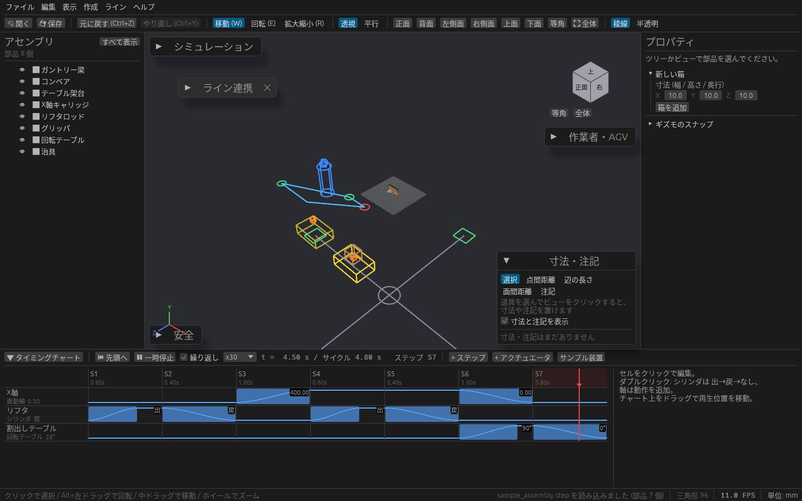
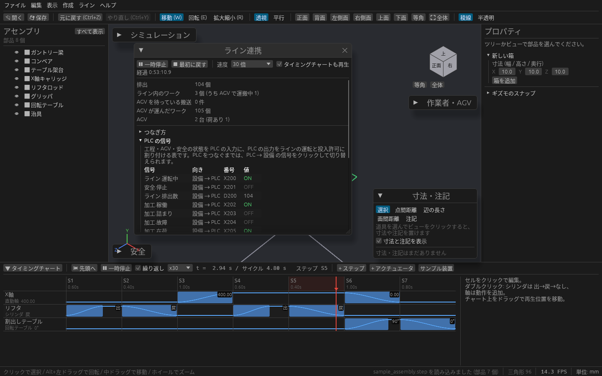

# 工程・AGV・安全機器をつないでラインとして動かす

[工程シミュレーション](flow.md)・[AGV と作業者](operator-agv.md)・[タイミングチャート](timing-chart.md)・[安全機器](safety.md) を、同じ時計でまとめて動かせます。
「バッファから組立へは AGV で運ぶ」「作業者がライトカーテンを横切ったらライン全体が止まる」といった、設備どうしのつながりを含めて確かめられます。

## 開く

ツールレールの **連携**(またはメニューの **ツール → ライン連携**)で、ライン連携のウィンドウが開きます。

まず試すときは、ウィンドウの下の **サンプルのラインを置く** を押してから ▶ 再生 を押してください。サンプル工程と十字の AGV 通路が置かれ、バッファから組立へ AGV で運ぶようにつながります。

## つなぐ

**つなぎ方** の表に、工程シミュレーションの要素(生成・工程・バッファ)が並びます。要素ごとに、終わったワークをどう下流へ送るかを決めます。

| 列 | 内容 |
| --- | --- |
| 送り出し | 「すぐ下流へ」なら工程シミュレーションと同じく、そのまま次の要素へ送ります。**AGV** にチェックを入れ、積み込みと荷降ろしの [ステーション](operator-agv.md#経路を引く) を選ぶと、AGV が運ぶまで下流へ進みません |
| チャート起動 | チェックを入れた工程は、加工を始めるたびにタイミングチャートを頭から再生します |

AGV が足りないと、その要素は「詰まり」になります。工程シミュレーションの結果で、AGV の台数がラインの速さを決めていないかを確かめられます。

つなぎ方を変えると、次に再生したときに最初から回します。

## 再生する

ウィンドウの上の段で動かします。

| 操作 | 内容 |
| --- | --- |
| ▶ 再生 / ⏸ 一時停止 | ライン全体を動かす / 止める |
| ■ 最初に戻す | 時刻 0 に戻します |
| 時間スライダー | ドラッグでその時刻に巻き戻す(下の「巻き戻す」) |
| 速度 | 1 〜 120 倍 |
| タイミングチャートも再生 | チェックを入れると、チャートも同じ時計で動きます |

再生中は、排出数、ライン内のワークの数(うち AGV で運搬中)、AGV を待っている搬送、AGV が運んだワーク、AGV の台数(荷ありの台数)が出ます。

3D ビューには、設備の上にたまっているワーク、設備から設備へ渡るワーク、AGV に積まれたワークがオレンジの箱で出ます。3D の部品を対応付けていない要素のワークは、AGV のステーションの上に出ます。

### 巻き戻す

経過時間の下の **時間スライダー** をドラッグすると、ライン全体(工程、AGV、コンベアのワーク、作業者、タイミングチャート)がその時刻に戻ります。**⏮ 詰まりの直前へ** で、どこかの工程が詰まり始める直前に戻れます(**⏭** で次の詰まりへ)。

戻したところから **▶ 再生** すると、その先を回し直します。それまでに記録していた先の分は消えます。「ライン.運転」や「投入許可」を切り替えて回し直せば、詰まらずに済むかを試せます。

ライン連携で再生している間は、工程シミュレーションのウィンドウと「作業者・AGV」パネルの、それぞれの再生は使いません。工程モデルや AGV の経路を変えると止まり、次の再生で最初から回します。

## 止まり方を見る

安全機器が作業者や AGV を検知して安全停止になると、ライン全体が止まります。「安全」パネルで **リセット** すると、続きから動きます。

## PLC の信号を見る

**PLC の信号** を開くと、ラインの状態が番号付きの信号の表で並びます。

| 向き | 信号 |
| --- | --- |
| 設備 → PLC | 工程の稼働・詰まり・故障・在荷、バッファの数、排出数、安全停止、AGV の状態 |
| PLC → 設備 | 「ライン.運転」、生成ごとの「<生成の名前>.投入許可」 |

PLC → 設備の信号はクリックで ON / OFF を切り替えられます。「ライン.運転」を OFF にするとライン全体が、「投入許可」を OFF にするとその生成からの投入が止まります。

## 保存

つなぎ方は工程モデルと一緒にプロジェクト(.cadsim)に保存されます。
