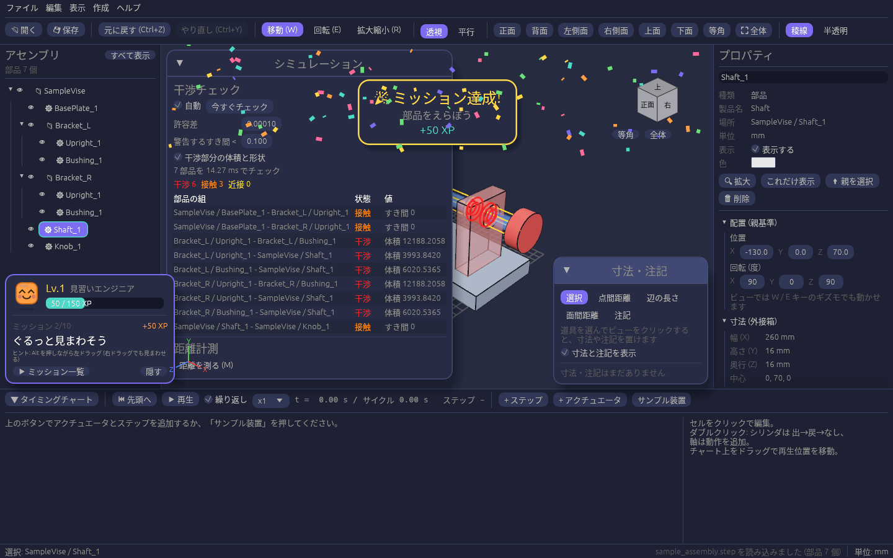

# ミッション

## ミッションで操作を覚える

画面左下の **ミッションカード** に、次にやってみることとヒントが出ます。言われたとおりに操作するとミッションクリアです。紙吹雪が舞い、経験値(XP)がもらえます。

| ミッション | やること |
| --- | --- |
| 部品をえらぼう | 3D ビューの部品か、左のツリーの行をクリック |
| ぐるっと見まわそう | Alt を押しながら左ドラッグ(右ドラッグでも見まわせる) |
| 部品を動かそう | 部品を選んで W を押し、矢印をドラッグ |
| 時間を巻き戻そう | Ctrl+Z で元に戻す |
| 図面モードに切り替えよう | 5 キーか、ツールバーの「平行」 |
| 距離をはかろう | M を押して、部品の表面を2回クリック |
| ぶつかりを見つけよう | 部品を動かして別の部品に重ねる(赤く光る) |
| 寸法を書きこもう | ツールレールの「寸法」で「寸法・注記」パネルを開き、点間距離などを置く |
| 設備を動かそう | タイミングチャートの「▶ 再生」を押す |
| セーブしよう | Ctrl+S でプロジェクトを保存 |

- 150 XP ごとにレベルが上がり、称号が変わります(見習いエンジニア → かけだし設計者 → …)。
- 「▶ 一覧」で達成状況を見られます。カードの背景をドラッグすると動かせます。
- 「隠す」で消したカードは、ツールバー右端のレベル表示(★ Lv.)を押すとまた出せます(「表示 → ミッションカードを表示」でも)。
- 「ヘルプ → ミッションを最初からやり直す」で最初に戻せます。進み具合はアプリを閉じても残ります。
