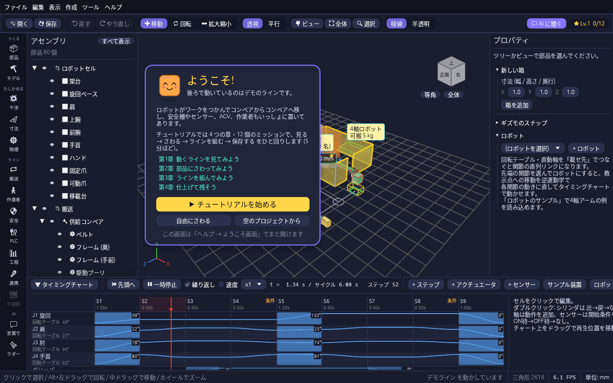
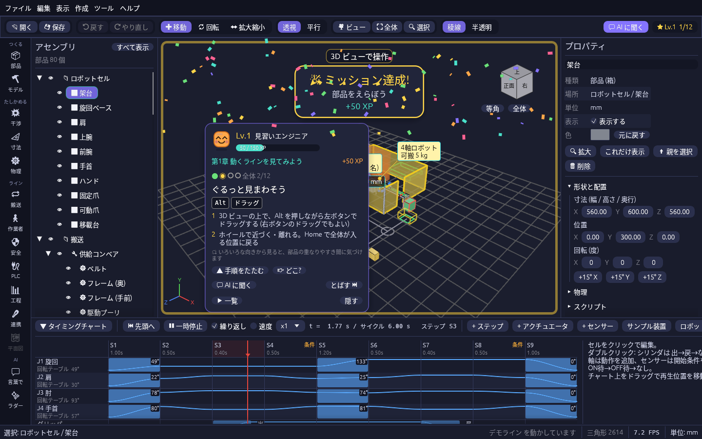

# ミッション

## 起動するとデモラインが動く

ファイルを指定せずに起動すると、ロボットセル・コンベア・安全柵・AGV・作業者を並べた **デモライン** が開き、そのまま動き始めます。
はじめて起動したときは、その上に **ようこそ画面** が出ます。

| ボタン | すること |
| --- | --- |
| ▶ チュートリアルを始める | 左下のミッションカードに手順が出て、第1章から順に進めます |
| 自由にさわる | カードは左下に小さく残ります。いつでも続きから始められます |
| 空のプロジェクトから | デモラインを閉じて、何もない状態から始めます |

- ようこそ画面は「ヘルプ → ようこそ画面」でまた開けます。
- デモラインは「ファイル → サンプルを開く → デモライン」でいつでも開き直せます。無題のプロジェクトとして開くので、保存するときは名前を付けます。

## ミッションで操作を覚える

画面左下の **ミッションカード** に、次にやってみることと、その手順が出ます。言われたとおりに操作するとミッションクリアです。紙吹雪が舞い、経験値(XP)がもらえます。
ミッションは 4 つの章に分かれていて、章を全部クリアすると「第N章 クリア!」のお祝いが出ます。

| 章 | ミッション | やること |
| --- | --- | --- |
| 1 動くラインを見てみよう | 部品をえらぼう | 3D ビューの部品か、左のツリーの行をクリック |
| | ぐるっと見まわそう | Alt を押しながら左ドラッグ(右ドラッグでも見まわせる) |
| | 設備を止めて、また動かそう | タイミングチャートの「⏸ 一時停止」→「▶ 再生」 |
| | 図面モードに切り替えよう | 5 キーか、ツールバーの「平行」 |
| 2 部品にさわってみよう | 部品を動かそう | 「⏮ 先頭へ」で設備を止め、部品を選んで W を押し、矢印をドラッグ |
| | 時間を巻き戻そう | Ctrl+Z で元に戻す |
| | 距離をはかろう | M を押して、部品の表面を2回クリック |
| | ぶつかりを見つけよう | 部品を動かして別の部品に重ねる(赤く光る) |
| 3 ラインを組んでみよう | 標準部品を置こう | ツールレールの「部品」で部品ライブラリを開き、部品をビューへドラッグ |
| | ラインを早回ししよう | ツールレールの「工程」で「サンプル工程」を入れて「▶ 実行」 |
| 4 仕上げて残そう | 寸法を書きこもう | ツールレールの「寸法」で「寸法・注記」パネルを開き、点間距離などを置く |
| | セーブしよう | Ctrl+S でプロジェクトを保存 |

カードの使いかた:

- 番号つきの手順と、使うキーがキーの形で出ます。「▲ 手順をたたむ」で 1 行のヒントだけにできます。
- 使う道具があるミッションでは、「📦 部品ライブラリを開く」のようなボタンが出て、押すとその道具のパネルが開きます。
- 「👉 どこ?」を押すと、操作する場所(3D ビュー・下のタイミングチャート・左端のツールレール)を黄色い矢印で指します。新しいミッションになったときも数秒間出ます。
- 「💬 AI に聞く」を押すと、今のミッションのやり方を聞く文が入った状態で「AI に聞く」画面が開きます。送るのは自分で押してからです(AI の設定が必要です)。
- 設備が動いている間は部品を動かせません。部品を動かすミッションで設備が動いていると、カードに「⏮ 止めて元の位置へ」が出るので押してください。
- 「とばす ⏭」で今のミッションを後回しにできます。とばしたミッションも、あとでやれば経験値がもらえます。「▶ 一覧」の「戻す」で次の候補に戻せます。
- 150 XP ごとにレベルが上がり、称号が変わります(見習いエンジニア → かけだし設計者 → …)。
- 「▶ 一覧」で達成状況を見られます。カードの背景をドラッグすると動かせます。
- 「隠す」で消したカードは、ツールバー右端のレベル表示(★ Lv.)を押すとまた出せます(「表示 → ミッションカードを表示」でも)。
- 「ヘルプ → ミッションを最初からやり直す」で最初に戻せます。進み具合はアプリを閉じても残ります。
