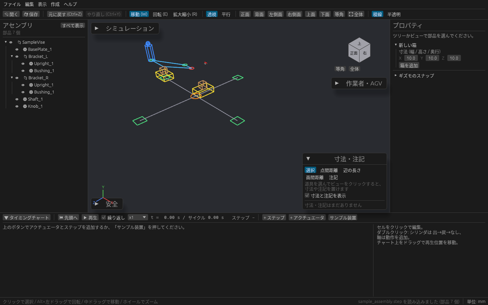
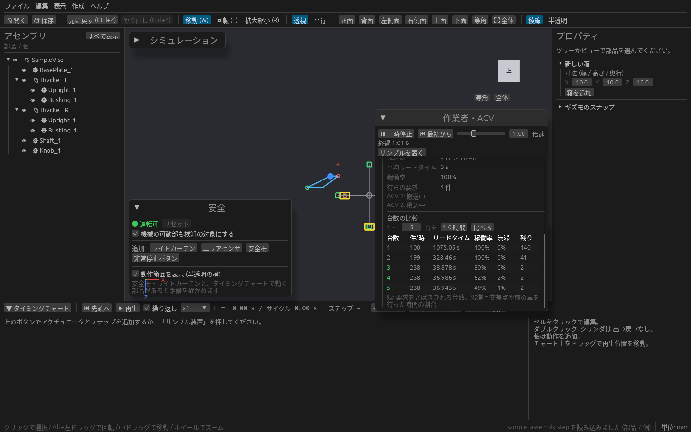

# 作業者と AGV を動かす

床の上で作業者を歩かせて 1 サイクルの作業時間を見たり、AGV(無人搬送車)の経路を引いて何台あれば搬送が回るかを比べたりできます。
作業者と AGV は [安全機器](safety.md) の検知の対象になるので、動線にライトカーテンがかかっていないかも一緒に確かめられます。

## 作業者・AGV パネル

3D ビューの右上に **作業者・AGV** パネルがあります。見出しの ▼ で折りたためます。中は **作業者** と **AGV** の2つに分かれています。

パネルの上の段で、作業者と AGV をまとめて動かします。

| 操作 | 内容 |
| --- | --- |
| ▶ 再生 / ⏸ 一時停止 | 作業者と AGV を動かす / 止める |
| ⏮ 最初から | 時刻 0 に戻す |
| 倍速 | 動かす速さ。スライダーか数値で変えます |
| サンプルを置く | 作業者 1 人と、十字の通路を走る AGV のサンプルを置きます |

まず試すときは **サンプルを置く** を押してから ▶ 再生 を押してください。

## 作業者

### 作業者を置く

**作業者を追加** を押すと作業者が増えます。一覧で作業者を選び、名前・**開始位置 X / Z**・**歩く速さ**(m/s)を決めます。
**全員の歩行経路を表示** にチェックを入れると、選んでいない作業者の経路も出ます。

### 手順を組む

作業者は、手順を上から順にこなしたあと開始位置まで歩いて戻り、また最初から繰り返します。

| 手順 | 足しかた | 内容 |
| --- | --- | --- |
| 歩く | **歩く先を床でクリック** を選んで、3D ビューの床をクリック | クリックした場所まで、まっすぐ歩きます。X / Z は数値でも直せます |
| ピック | **+ ピック** | その場で部品を取る作業。名前(「部品棚」など)と時間を入れます |
| ボタン | **+ ボタン** | その場でボタンを押す作業。名前と時間を入れます |
| 待つ | **+ 待つ** | その場で待つ時間 |

各手順の ↑ ↓ で並べ替え、削除 で消せます。床のクリックを続けて、歩く先を何か所も足せます。

▶ 再生 で歩き出し、歩行経路が青い線で出ます。

### 作業時間を見る

手順の下に、1 サイクルの集計が出ます。

| 項目 | 内容 |
| --- | --- |
| サイクル時間 | 手順をひととおりこなして開始位置に戻るまでの時間 |
| 歩行・作業・待ち | サイクル時間の内訳(秒と割合) |
| 歩行距離 | 1 サイクルで歩く距離(m) |

歩行の割合が大きいときは、部品棚やボタンの置き場所を見直すきっかけになります。
**この作業者を削除** で作業者を消せます。

## AGV

### 経路を引く

**経路 (床をクリックして置く)** の道具を選んで、3D ビューの床をクリックします。

| 道具 | 使い方 |
| --- | --- |
| 点 | クリックした場所に経路の点を置きます。直前に選んだ点と通路でつながります |
| ステーション | 積み降ろしの場所を置きます。いまある点の上をクリックすると、その点をステーションに変えます |
| 通路を結ぶ・外す | 2 つの点を順にクリックすると通路を足します。すでに通路があれば外します |

**配置をやめる** で道具をやめます。点を選ぶと、名前・位置 X / Z・ステーションかどうかを直したり、削除したりできます。

- 3 本以上の通路が集まる点は交差点で、同時に 1 台しか入れません。交差点を予約している AGV がいると交差点が橙になります。
- 通路はどちら向きにも走れ、すれ違いでは止まりません。
- ステーションは、通路の端か、通路が 2 本の点に置いてください。

### 搬送の要求を出す

**+ 要求を追加** で、「どのステーションから → どのステーションへ、何秒 **間隔** で 1 件」を決めます。ステーションが 2 つ以上あると押せます。

その下で AGV の条件を決めます。

| 欄 | 内容 |
| --- | --- |
| 台数 | 走らせる AGV の数 |
| 速度 | 走る速さ |
| 積込・荷降ろし | ステーションで荷を積む・降ろす時間 |
| 車体 長さ・幅 | AGV の大きさ |
| 車間 | 前の車や交差点との間に空ける距離 |

### 走らせる

▶ 再生 で、要求が出るたびに、空いている AGV のうち積み込み場所にいちばん近いものが向かいます。

| 見え方 | 意味 |
| --- | --- |
| 上に箱が乗った AGV | 荷を積んで降ろし場所へ向かっている |
| 赤い AGV | 交差点や前の車を待っている |
| 橙の交差点 | どれかの AGV が予約している |

走らせている間、搬送数・平均リードタイム(要求が出てから降ろし終わるまで)・稼働率・待ちの要求の数が出ます。
安全機器が検知して安全停止になると、AGV はその場で止まります。「安全」パネルでリセットすると動き出します。

### 台数を比べる

**台数の比較** で「1 〜 N 台を ○ 時間」と決めて **比べる** を押すと、同じ経路と要求で台数だけを変えて走らせた結果が表になります。

| 列 | 内容 |
| --- | --- |
| 台数 | 走らせた台数。要求をさばききれる台数は緑になります |
| 件/時 | 1 時間あたりの搬送数 |
| リードタイム | 要求が出てから降ろし終わるまでの平均 |
| 稼働率 | AGV が走ったり積み降ろしたりしていた割合 |
| 渋滞 | 交差点や前の車を待っていた時間の割合 |
| 残り | 最後までさばききれずに残った要求の数 |

台数を増やしても件/時が増えず渋滞だけが増えるときは、交差点を減らす、通路を足すなど経路を見直すと効きます。

## 保存

作業者と AGV の配置・手順・経路・要求はプロジェクト(.plantwright)に保存されます。編集は Ctrl+Z で戻せます(戻すと作業者と AGV の時計は 0 秒に戻ります)。
