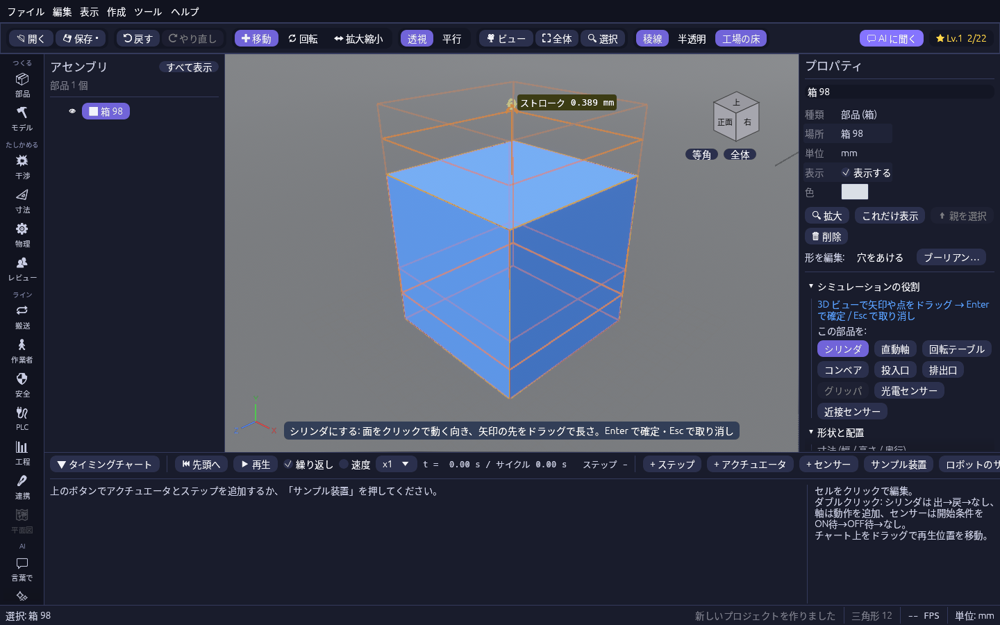

# 部品に役割を付ける

部品を選ぶと、プロパティに **シミュレーションの役割** が出ます。タイミングチャートやワーク搬送のパネルで「+ 追加 → 部品を選ぶ → 数値を打つ」と進まなくても、部品から直接シリンダやコンベアにできます。

## 役割を付ける

1. ツリーかビューで部品を選びます。
2. プロパティの **この部品を:** から役割のボタンを押します(3D ビューで部品を右クリック → **役割を付ける** からでも同じ)。部品の寸法から決めた値の下書きが置かれ、3D ビューに矢印や点が出ます。
3. 矢印の先や点をドラッグ、または部品の面をクリックして決めます。値はつまみの横に、することはビューの下に出ます。
4. **Enter** で確定します。**Esc** で下書きを捨てます(確定するまで設定には入りません)。

ドラッグ中に Ctrl を押すと、「ギズモのスナップ」の寸法の刻みにそろいます。確定した後も Ctrl+Z で戻せます。

| 役割 | 最初の値 | 3D でできること |
| --- | --- | --- |
| シリンダ | 部品のいちばん長い向きに、長さの半分のストローク。チャートに「出 → 戻」の 2 ステップが入る | 面をクリックでその面から出る向き。橙の矢印の先をドラッグでストローク(反対側へ引くと逆向き)。動いた先の箱が行き来して見えます |
| 直動軸 | いちばん長い向きに、部品の長さだけ動ける | シリンダと同じ。矢印の長さが動ける範囲 |
| 回転テーブル | 部品の中心を通る上向きの軸 | 面をクリックでその面の向きを回転軸に |
| コンベア | 水平の長い辺の向きに 0.2 m/s(短い部品なら 1 秒で長さの半分) | 上面の緑の矢印の先をドラッグで流れる向き(X / Z)と速さ(矢印の長さ = 1 秒に進む距離) |
| 投入口 | 3 秒ごとに部品の上へワークを出す | 上の点をコンベアの部品までドラッグして離すと、そのコンベアへ出す |
| 排出口 | 触れたワークを数える | なし(そのまま Enter) |
| グリッパ | 部品の下面の中心で、20 mm 以内を掴む | 青い球をドラッグで掴む位置、外の点で掴める距離。先にその部品をシリンダにしておきます(そのシリンダで開閉します) |
| 光電センサー / 近接センサー | 部品の前(+Z の面)から 300 mm / 20 mm | 面をクリックで取り付け位置と向き。光の先をドラッグで範囲 |

## 付いている役割を直す

役割が付いた部品を選ぶと、プロパティにその役割と値が出ます。

- **3D で調整** … 同じ矢印や点を出して決め直します。Enter で確定、Esc でやめると元のままです。
- **詳しく** … シリンダ・センサーはタイミングチャートのその行を、コンベア・投入口・排出口・グリッパはワーク搬送のパネルを開きます。加減速や載せ先など、細かい設定はそちらで。
- **外す** … 役割を消します。シリンダなら、そのシリンダだけを動かしていたステップも消えます。

## 黄色い「!」

設定が足りない役割の部品には、3D ビューの部品の上に黄色い **!** が出ます。カーソルを乗せると理由が出て、押すとその部品が選ばれます。

- シリンダのストロークが 0
- アクチュエータをタイミングチャートのどのステップでも動かしていない
- センサーの範囲・コンベアの速さ・投入口の間隔が 0
- グリッパの開閉に使うシリンダがない
