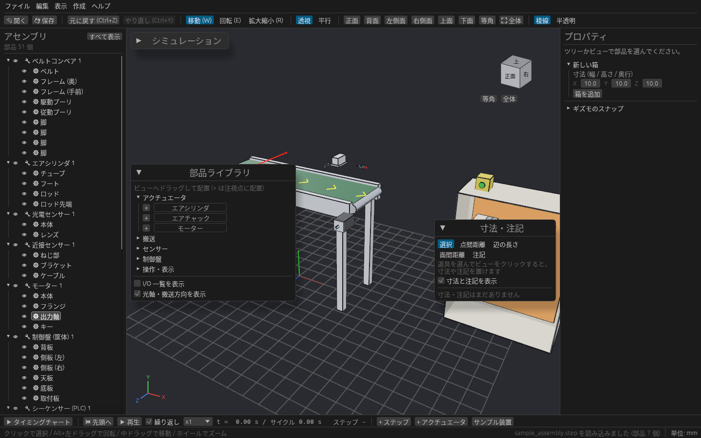
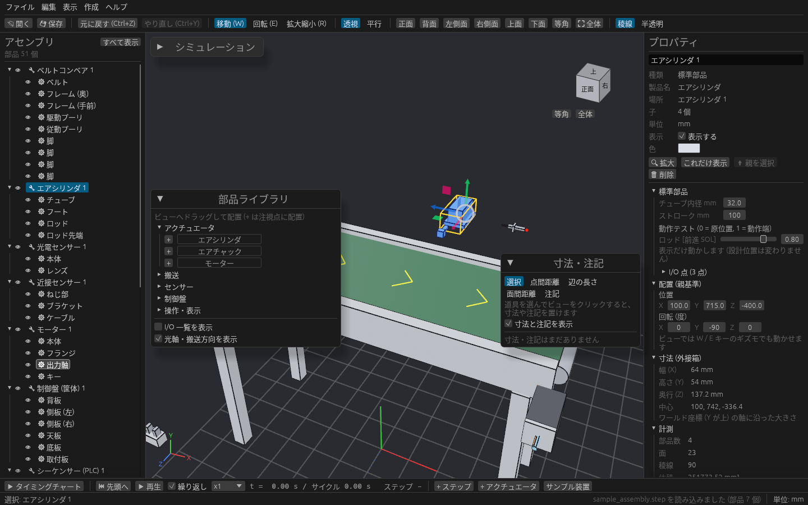
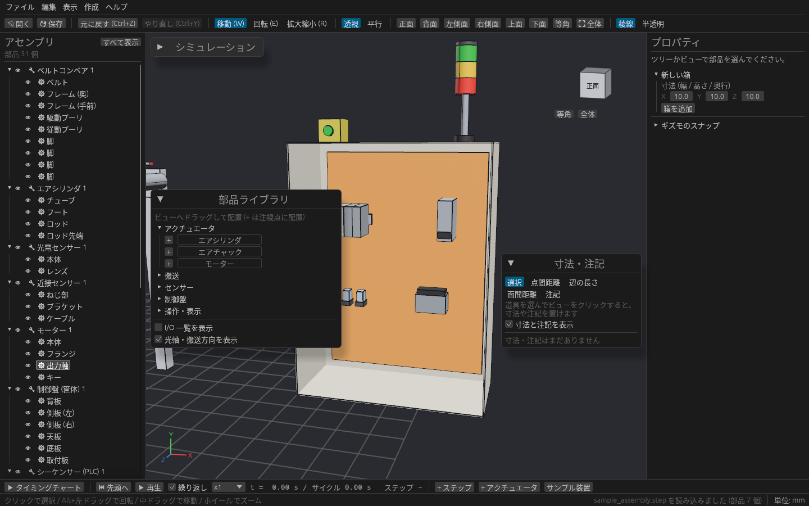
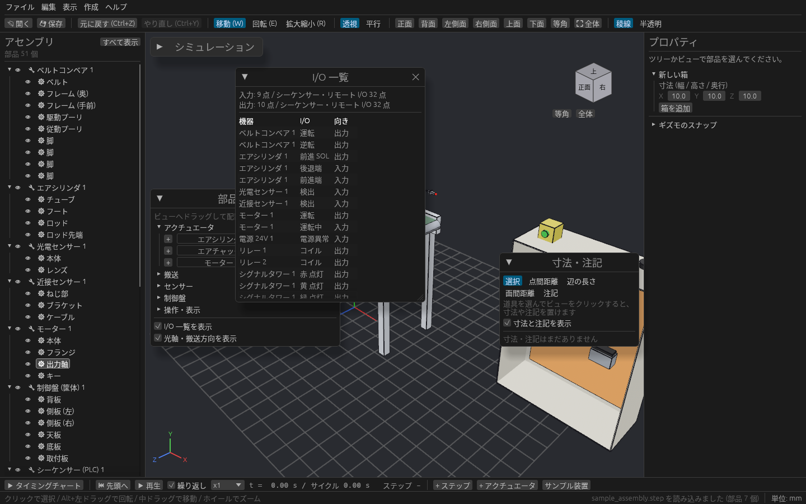

# 標準部品ライブラリ

エアシリンダ・コンベア・センサー・シーケンサーなど、ラインでよく使う部品をライブラリから選んで置けます。
メーカーの CAD データがまだない段階でも、寸法を入れるだけで仮の設備を組んで、配置や干渉、I/O の点数を検討できます。

## 部品を置く

3D ビュー左端の中ほどにある **部品ライブラリ** を ▶ で開くと、分類ごとに部品が並びます。置き方は 3 通りあります。

| 置き方 | 置かれる場所 |
| --- | --- |
| 部品を 3D ビューへドラッグ | カーソルの下の面の上。何もなければ床の上 |
| 部品の横の **+** を押す | 注視点(画面の中心)の床の上 |
| **作成 → 標準部品** から選ぶ | 今あるものの横 |

置いた部品はビューでどこをクリックしても部品全体が選ばれ、ギズモやプロパティの「配置」で部品ごと動きます。ツリーでは 🔧 の下に本体(チューブ・ロッドなど)が並びます。

## 部品の種類

| 分類 | 部品 | 変えられる寸法 | I/O 点(シーケンサーから見て) |
| --- | --- | --- | --- |
| アクチュエータ | エアシリンダ | チューブ内径、ストローク | 出力: 前進 SOL / 入力: 後退端、前進端 |
| | エアチャック | 本体幅、片側ストローク | 出力: 閉 SOL / 入力: 開端、閉端 |
| | モーター | フランジ角、本体長、軸径 | 出力: 運転 / 入力: 運転中 |
| 搬送 | ベルトコンベア | 機長、ベルト幅、搬送面高さ、速度 | 出力: 運転、逆転 |
| センサー | 光電センサー / 近接センサー | 検出距離(近接はねじ径も) | 入力: 検出 |
| 制御盤 | シーケンサー (PLC) | 入力点数、出力点数(8 点単位) | X0..XF, X10.. / Y0..YF, Y10.. |
| | リモート I/O | 入力点数、出力点数 | IN0.. / OUT0.. |
| | 電源 24V / リレー | 容量(電源) | 入力: 電源異常 / 出力: コイル |
| | 制御盤 (筐体) | 幅、高さ、奥行 | 前面が開いた箱。中の取付板に機器を置けます |
| 操作・表示 | 押しボタン / シグナルタワー | 段数(タワー) | 入力: 押下 / 出力: 赤・黄・緑… 点灯 |

## 寸法を変えて、動きを試す

部品を選ぶと、右のプロパティに **標準部品** の欄が出ます。

- 寸法を数値で変えると、形がその場で作り直されます。変更は Ctrl+Z で戻せます。
- **動作テスト** のスライダー(0 = 原位置、1 = 動作端)で、シリンダのロッドやチャックの爪を動かせます。ストロークの端でほかの部品にぶつからないかを確かめるのに使います。動作テストは見た目と干渉チェックの位置だけを動かし、設計位置は変えません。

同じ部品の本体どうし(ロッドとチューブなど)は、干渉チェックの対象から外れます。

## 制御盤を組む

**制御盤 (筐体)** は前面が開いた箱で、中の取付板にシーケンサー・リモート I/O・電源・リレーを置けます。盤の中の機器の並びを、3D で見ながら決められます。

## I/O の点数を確かめる

パレットの **I/O 一覧を表示** で、置いた機器の I/O 点の一覧が出ます。入力・出力それぞれの合計と、シーケンサー・リモート I/O の点数が並ぶので、点数が足りているかをひと目で確かめられます。

## 表示の切り替え

光電センサーの光軸は赤い線、コンベアの搬送方向は黄色の矢印で出ます。パレットの **光軸・搬送方向を表示** で切り替えられます。

## 保存

標準部品は、種類と寸法だけがプロジェクト(.cadsim)に保存され、開くときにその寸法から形を作り直します。
