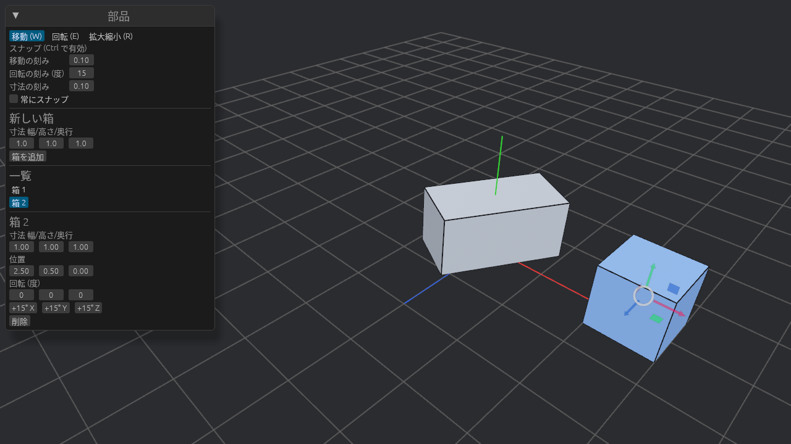
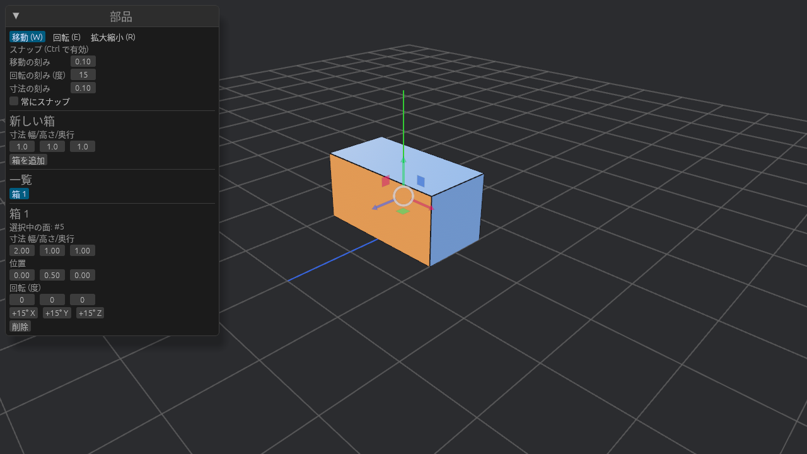

# 箱の作成・選択・編集

## 箱を追加する

1. 「部品」パネルの **新しい箱** に、幅・高さ・奥行を入れます。
2. **箱を追加** を押します。

新しい箱は床の上に、既にある箱と重ならないよう X 方向に並べて置かれ、そのまま選択された状態になります。

## 選択する

3D ビューで箱の面を **左クリック** します。クリックした面がオレンジ、その箱のほかの面が青になります。パネルの **一覧** で名前をクリックしても選べます。

何もないところをクリックすると選択が外れます。

## 数値で編集する

選択すると、パネルの下に編集欄が出ます。

| 欄 | 内容 |
| --- | --- |
| 選択中の面 | クリックした面の番号 |
| 寸法 幅/高さ/奥行 | X / Y / Z 方向の大きさ(0.01 以上) |
| 位置 | 箱の中心の座標 X / Y / Z |
| 回転 (度) | X → Y → Z の順に回す角度 |
| +15° X / Y / Z | その軸まわりに 15° 回す |
| 削除 | 箱を消す |

数値の欄は、**左右にドラッグ** すると連続して変わり、**ダブルクリック** するとキーボードで入力できます。

## 削除する

箱を選んで **Delete** キーを押すか、パネルの **削除** を押します。
