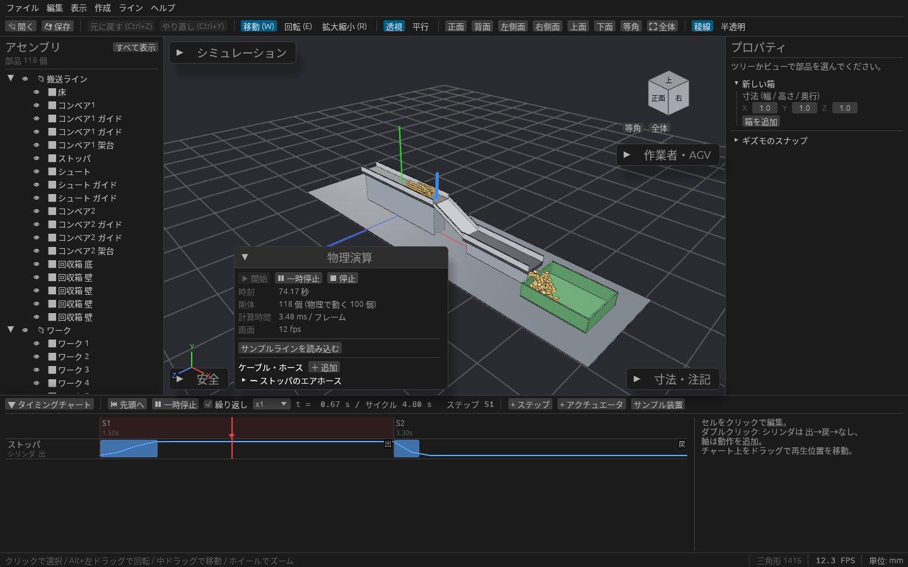

# 物理演算でワークを流す

重力・接触・摩擦でワークを動かして、コンベアで流れる・ストッパで止まる・シュートを滑り落ちる様子を確かめられます。
可動部につないだケーブルやエアホースが、動いたときにどう垂れるか、曲がりすぎないかも見られます。

## まず試す

1. 3D ビュー左下(「安全」パネルの右)の **物理演算** パネルを開きます。
2. **サンプルラインを読み込む** を押します。ベルトコンベア・ストッパ・シュートとワーク 100 個のラインが読み込まれます(いま開いているモデルは置き換わります)。
3. **▶ 開始** を押すと、ワークがコンベアを流れ、ストッパで溜まっては通され、シュートを落ちて回収箱に入ります。

## 部品ごとに振る舞いを決める

部品を選び、右のプロパティの **物理** で振る舞いを選びます。

| 振る舞い | 使いどころ |
| --- | --- |
| 機構で動く(既定) | タイミングチャートのとおりに動き、ワークを押したり支えたりする部品(ストッパ、プッシャ、ロボットなど) |
| 動かない | 架台、ガイド、シュート、床 |
| 物理で動く | ワーク。重力で落ち、ぶつかり、滑ります |
| 当たらない | カバーなど、ワークに関係しない部品 |

同じ欄で次も決められます。

| 欄 | 内容 |
| --- | --- |
| 当たり判定の形 | 「自動」なら、箱は箱、読み込んだ部品は形に合わせて決まります。溝のあるシュートやトレイのようにくぼみのある部品は「凸分解」にすると、くぼみの中にワークが入ります(大きな部品だと開始に時間がかかります) |
| 摩擦係数・反発係数 | 滑りやすさと、はね返りの強さ |
| 密度 | 物理で動く部品の重さを決めます |
| ベルトコンベア | 動かない(か機構で動く)部品でチェックを入れ、向き(部品の X / Y / Z)と速度を決めると、上に載ったものが運ばれます |

設定の変更は Ctrl+Z で戻せます。

## 動かす

物理演算パネルのボタンで動かします。

| 操作 | 内容 |
| --- | --- |
| ▶ 開始 | 物理演算を始めます。タイミングチャートがあれば一緒に再生します |
| ⏸ 一時停止 | その場で止めます |
| ⏹ 停止 | 止めて、部品を設計位置に戻します。タイミングチャートの ⏮ 先頭へ でも戻ります |

パネルには、物理で動く部品の数、1 フレームの計算時間、画面のフレームレートが出ます。

- 物理演算を動かしている間は、ギズモでの編集が止まります。
- ワークはベルトなどに載っているだけでもわずかに食い込むので、干渉チェックでは「干渉」と数えられます。サンプルラインを読み込むと干渉チェックの「自動」は切れます。

## ケーブル・ホース

1. 端を付けたい部品を選び、物理演算パネルの **ケーブル・ホース** で **＋ 追加** を押します。選んだ部品から紐が伸び、もう一方の端はその場の空間に固定されます。
2. 一覧の行を開き、**長さ**・**直径**・**許容曲げ半径** を入れます。端は「選択中の部品に付ける」で付け替え、位置は数値で合わせます。
3. タイミングチャートを再生するか物理演算を始めると、紐が引かれて動きます。止まっていても重力で垂れます。

| 見え方 | 意味 |
| --- | --- |
| 黒い線(ケーブル)/ 青い線(ホース) | 問題なし |
| 一部が赤い | そこで許容曲げ半径より小さく曲がっている |
| 全体が赤い | 長さが足りず、両端に引っ張られている |

一覧には、最小曲げ半径と、当たっている部品の名前も出ます。
当たり判定は部品の外接箱で見ているので、くぼみの中を通す配線は目安として見てください。

## 保存

部品の物理の設定と、ケーブル・ホースはプロジェクト(.cadsim)に保存されます。
