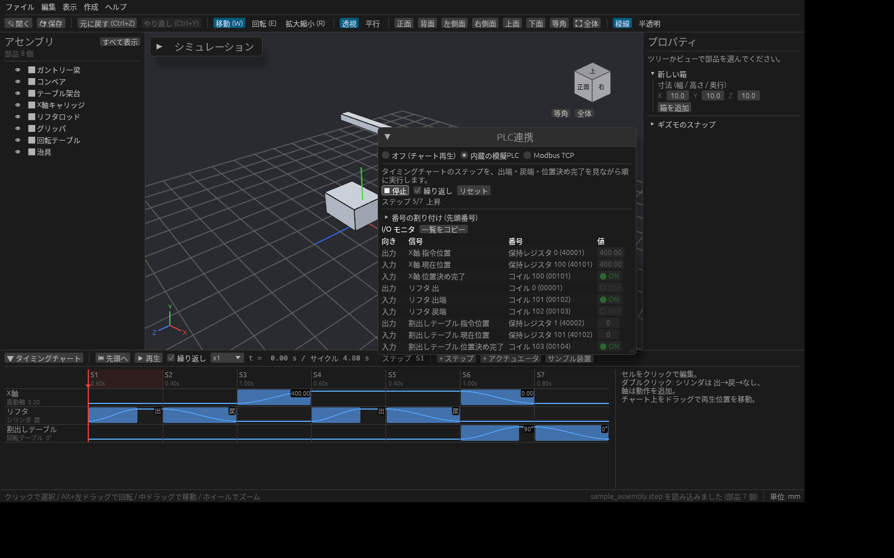

# PLC で設備を動かす(仮想立ち上げ)

タイミングチャートの代わりに **PLC の出力でシリンダや軸を動かし**、出端・戻端・現在位置を PLC の入力に返します。
ラダーを、実機を据え付ける前に 3D モデル相手に確かめられます。実機の PLC がなくても、内蔵の模擬 PLC で動きを試せます。

## PLC連携パネル

3D ビュー右上の **PLC連携** パネルを開きます。いちばん上でモードを選びます。

| モード | 内容 |
| --- | --- |
| オフ (チャート再生) | いつもどおり、タイミングチャートの時刻表どおりに再生します |
| 内蔵の模擬PLC | タイミングチャートのステップを、出端・戻端・位置決め完了を見ながら順に実行します |
| 外部PLC | 実機の PLC と通信して、PLC の出力で動かします。通信のしかたを **Modbus TCP** か **OPC UA** から選びます |
| ログ再生 | 実機で記録した PLC のログ(CSV)のとおりに設備を動かします |

PLC 連携中は、タイミングチャートの再生とギズモでの編集が止まります。「オフ」に戻すとチャートの再生に戻ります。

## 信号を用意する

[タイミングチャート](timing-chart.md) でアクチュエータを作ると、パネルの **I/O モニタ** に信号が並びます。

| アクチュエータ | 出力(PLC → 設備) | 入力(設備 → PLC) |
| --- | --- | --- |
| シリンダ | 出 | 出端、戻端 |
| 直動軸・回転テーブル | 指令位置 | 現在位置、位置決め完了 |

位置のワードは符号付き 16 ビットで、1 = 0.1 mm(回転は 0.1°)です。

## 内蔵の模擬PLCで試す

1. モードで **内蔵の模擬PLC** を選びます。
2. **▶ 運転** で、チャートのステップを先頭から順に実行します。今のステップがパネルに出ます。**繰り返し** にチェックを入れると、最後のステップのあと先頭に戻ります。
3. **■ 停止** で止めます。**リセット** でステップを先頭に戻し、出力をすべて OFF にします。

停止中は、I/O モニタの出力(● ON / ○ OFF)をクリックして、手動で切り替えられます。シリンダを 1 本ずつ出し入れして、出端・戻端が返ってくるかを確かめられます。

## 実機の PLC とつなぐ

### Modbus TCP

1. PLC 側で Modbus TCP のサーバー機能を有効にしておきます。
2. モードで **外部PLC**、通信で **Modbus TCP** を選び、PLC の **IPアドレス**・**ポート**(通常 502)・**ユニットID** を入れて **接続** を押します。
3. つながると「通信中」と通信周期が出ます。PLC のラダーを動かすと、出力に合わせて 3D のシリンダや軸が動き、入力が PLC に返ります。**切断** で通信をやめます。

### OPC UA

1. モードで **外部PLC**、通信で **OPC UA** を選びます。
2. **エンドポイント**(`opc.tcp://192.168.0.10:4840` など)を入れて **接続** を押します。暗号化なし・匿名ログインでつなぎます。
3. やりとりするのは、I/O 表で **OPC UAノード** を決めた信号だけです。下の「PLC 側の割り付けに合わせる」で、信号ごとにノード ID(`ns=2;s=Line1.Lifter.Out` など)を書いてください。パネルに、ノードを決めた信号の数が出ます。

## 記録したログで動かす(ログ再生)

実機の PLC で記録したログを読み込んで、その動きを 3D で再現できます。現場で起きた動きを、あとから机の上で見直すのに使えます。

1. モードで **ログ再生** を選びます。
2. **ログ CSV を読み込み…** で、GX LogViewer などで記録した PLC のログ(CSV)を開きます。Shift_JIS のファイルもそのまま開けます。
3. ▶ / ⏸ で再生・一時停止、⏮ で先頭へ戻します。スライダーで好きな時刻へ移動でき、速度と **繰り返し** も選べます。

ログのどの列をどの信号に使うかは、列の見出しで決まります。I/O 表の **ログ列名**(空欄なら信号名)と同じ見出しの列が使われます。時刻の列(日付・時刻・秒など)は自動で見つけます。
見出しが信号名と違うときは、下の「PLC 側の割り付けに合わせる」でログ列名を書いてください。

## 番号を割り付ける

**番号の割り付け (先頭番号)** で、出力と入力の先頭番号を決めます(初期値は出力 0、入力 100)。そこから順に番号が振られます。

| 信号 | 割り付け先 |
| --- | --- |
| 出力ビット・入力ビット(出、出端、戻端、位置決め完了) | コイル |
| 出力ワード・入力ワード(指令位置、現在位置) | 保持レジスタ |

番号が重なっていると、パネルに「番号が重なっています」と出ます。

**一覧をコピー** を押すと、信号名と番号をタブ区切りでコピーします。Excel や PLC のデバイスコメントにそのまま貼れます。

## PLC 側の割り付けに合わせる(CSV)

PLC のプログラムがすでにあって番号が決まっているときは、信号ごとに番号を合わせられます。

1. **I/O 表を CSV に書き出し…** で対応表を保存します。
2. Excel で、信号ごとの **番号**・**スケール**・**OPC UAノード**・**ログ列名** を書き換えて保存します。空欄にした欄は自動の値に戻ります。
3. **CSV を読み込み…** で読み戻します。行は「信号」列の名前で突き合わせるので、行の順番は変えてかまいません。パネルに、CSV で個別に決めた信号の数が出ます。

## 保存

番号の割り付け(先頭番号と、CSV で個別に合わせた信号の番号・スケール・OPC UA ノード・ログの列)と、外部 PLC の通信方式・接続先(Modbus TCP / OPC UA)はプロジェクト(.cadsim)に保存されます。割り付けの変更は Ctrl+Z で戻せます。

PLC 連携のモードと I/O の値は保存されません。開き直すと **オフ** から始まります。
