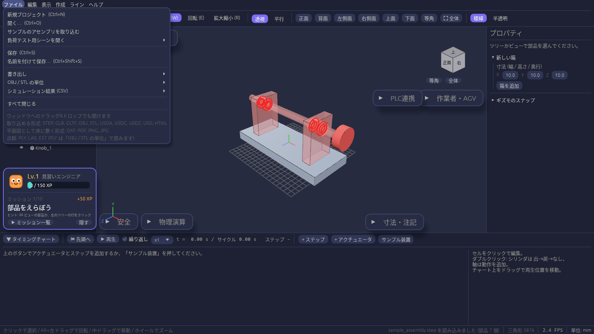

# プロジェクトの保存と読み込み

組み立てた状態は、プロジェクトファイル(`.cadsim`)に保存して、あとで開き直せます。

## 保存する

| 操作 | キー | ほかの方法 |
| --- | --- | --- |
| 保存 | **Ctrl + S** | ツールバーの **保存**、**ファイル → 保存** |
| 名前を付けて保存 | **Ctrl + Shift + S** | **ファイル → 名前を付けて保存…** |

まだ保存したことのないプロジェクトでは、保存先を聞かれます。

保存していない変更があると、ウィンドウのタイトルに `*` が付きます。元に戻して保存したときと同じ状態になれば、`*` は消えます。

## 開く

**ファイル → 開く…**(**Ctrl + O**)で `.cadsim` ファイルを選ぶか、ウィンドウにドラッグ&ドロップします。起動時に `cargo run --release -- line.cadsim` のように指定することもできます。

新しく始めるときは **ファイル → 新規プロジェクト**(**Ctrl + N**)を選びます。

保存していない変更があるときは、開く前・新規作成の前に、変更を捨ててよいか確認が出ます。

## 保存されるもの

| 保存される | 保存されない |
| --- | --- |
| アセンブリツリーの構成と名前 | 選択、カメラの位置 |
| 部品の配置(位置・回転)、表示 / 非表示、色 | 元に戻す履歴 |
| 箱の寸法・位置・回転、寸法と注記 | 取り込んだ形状そのもの |
| モデリングの画面で作った形(形状ごと) | 工程シミュレーションの結果 |
| 工程シミュレーションの工程と設定 | タイミングチャート(いまは保存されません) |
| 部品の物理の設定、ケーブル・ホース | PLC 連携の設定 |
| 安全機器、作業者、AGV の配置 | |
| 取り込んだ STEP などのファイル・平面図・点群の場所と配置 | |

プロジェクトファイルには **取り込んだ形状そのものは入らず**、取り込んだ STEP などのファイルの場所だけを書きます(平面図と点群も同じです)。開くときにそのファイルを読み直して形状を戻します。

- STEP をプロジェクトファイルと同じフォルダ(かその下)に置いておくと、フォルダごと別の PC に移しても開けます。
- 元のファイルが見つからないときは、名前と配置だけの部品としてツリーに残し、ステータスバーに注意を出します。
- OBJ / STL は、開き直すときに既定の単位(mm・Y 軸が上)で読み直します。
- glTF の部品の拡大縮小は保存されません(位置と回転だけ)。
