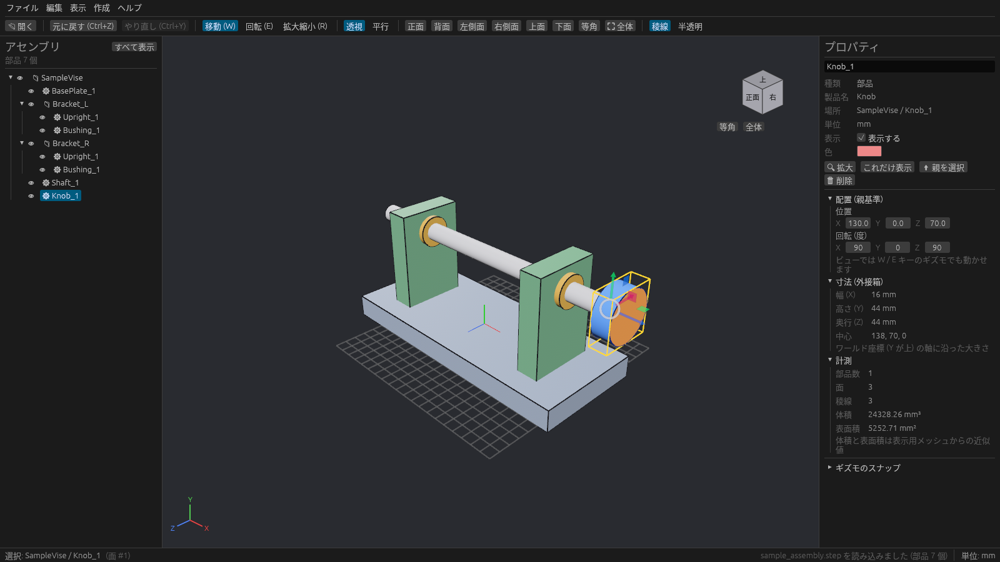

# プロパティ

右の **プロパティ** パネルに、選んだ部品やアセンブリの情報が出ます。

## 基本情報

| 欄 | 内容 |
| --- | --- |
| 名前(一番上) | クリックして書き換えられます |
| 種類 | アセンブリ / 部品 / 部品(箱) |
| 製品名 | STEP に書かれた製品の名前 |
| 場所 | ツリーのどこにあるか(例: `SampleVise / Knob_1`) |
| 子 | アセンブリの場合、直下にある部品の数 |
| 単位 | 長さの単位 |
| 表示 | チェックを外すと隠れる |
| 色 | クリックして色を変えられる。「元に戻す」で STEP の色に戻る |

その下のボタンで **拡大**(F と同じ)、**これだけ表示**、**親を選択**、**削除** ができます。

## 配置(親基準)

親のアセンブリから見た **位置** と **回転(度)** を数値で編集できます。ビューでギズモを使って動かすこともできます([ギズモとスナップ](gizmo.md))。

数値の欄は、**左右にドラッグ** すると連続して変わり、**クリック** するとキーボードで入力できます。

箱の場合は、この欄が **形状と配置** になり、寸法も変えられます([箱の作成と編集](boxes.md))。

## 寸法(外接箱)と計測

| 欄 | 内容 |
| --- | --- |
| 幅 (X) / 高さ (Y) / 奥行 (Z) | 部品を囲む、ワールド座標の軸に沿った箱の大きさ |
| 中心 | その箱の中心の座標 |
| 部品数 / 面 / 稜線 | 含まれる部品・面・稜線の数 |
| 体積 / 表面積 | 表示用のメッシュから計算した近似値 |

## ギズモのスナップ

パネルの一番下の **ギズモのスナップ** を開くと、スナップの刻み幅を変えられます。[ギズモとスナップ](gizmo.md) を見てください。
