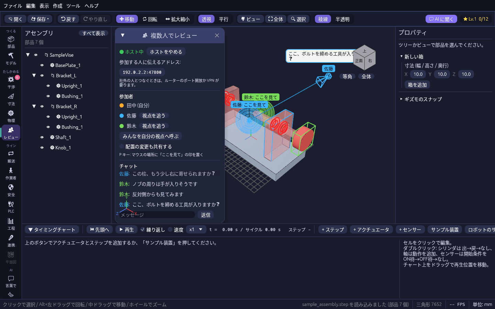

# 離れた人と同じ工場をレビューする

ツールレールの **👥 レビュー**(「たしかめる」の中)を開くと、離れた場所にいる人どうしで同じ工場の 3D に入り、互いの視点と指した場所を見ながら話せます。
全員が同じプロジェクトを開いてから始めてください。

## つなぐ

1. 1人が名前を書いて **ホストになる** を押します。パネルに出る「参加する人に伝えるアドレス」を押すとコピーできるので、ほかの人に伝えます。
2. ほかの人はアドレス欄にそれを貼って **参加する** を押します。合言葉を決めたときは、全員が同じ合言葉を書きます(空なら誰でも入れます)。
3. ほかの人のカメラの位置に、その人の色の **アバター**(球と見ている向きの四角すい)と名前が出ます。マウスで指している場所へ線が伸びます。

## レビュー中の操作

| やりたいこと | 操作 |
| --- | --- |
| 「ここを見て」と知らせる | 3D ビューで見せたい場所にマウスを置いて **P** キー。広がる輪と名前が全員の画面に 4 秒出ます |
| 部品を指す | 部品をクリックして選ぶと、ほかの人の画面でその部品がその人の色の枠で囲まれます |
| 相手と同じ所を見る | 参加者の一覧の **視点を追う**。自分でカメラを動かすと追うのをやめます |
| 全員を自分の視点へ集める | **みんなを自分の視点へ呼ぶ** |
| 話す | パネル下のチャット。書いたことはアバターの横にも吹き出しで出ます |
| 配置を一緒に直す | **配置の変更も共有する** にチェック。チェックした人どうしで、動かした部品が同じ場所へ動きます |

## つながらないとき

同じ社内 LAN ならそのままつながります。社外の人とつなぐときは、ホスト側のルーターのポート開放(既定は 47800 番)か VPN が要ります。
ファイアウォールの確認が出たら、ホストのパソコンでは許可してください。
