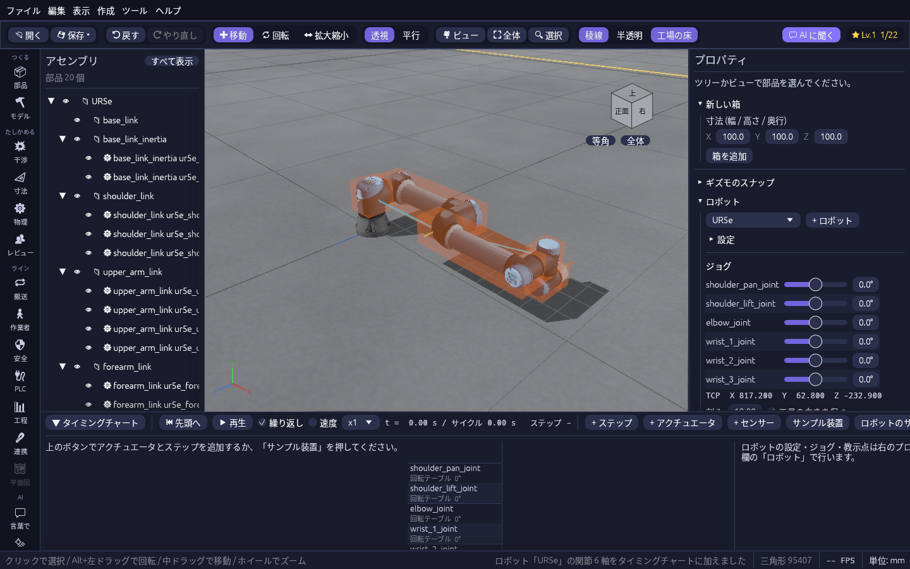
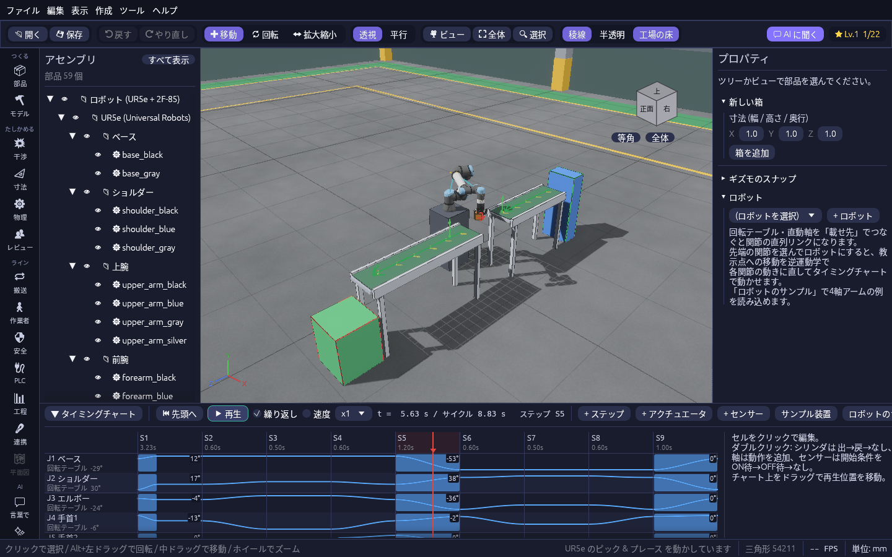
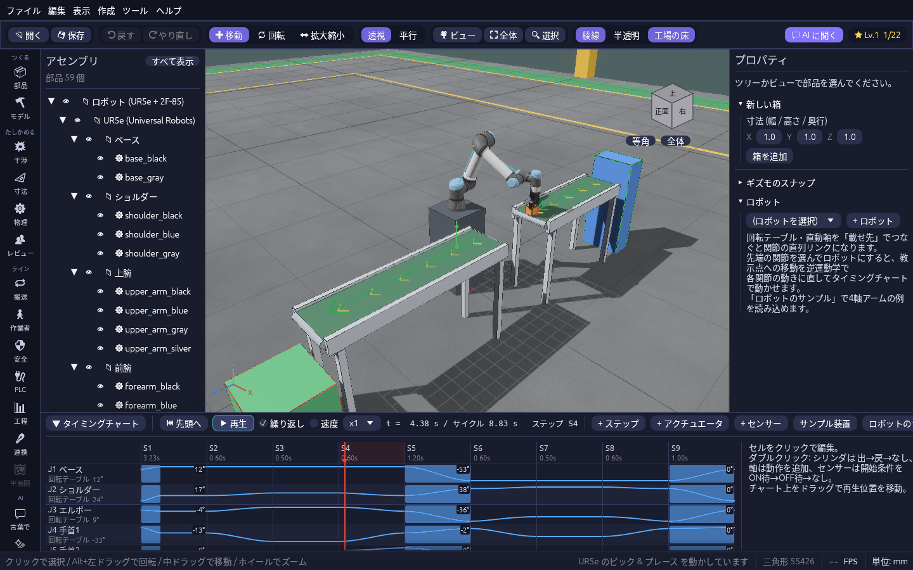

# ロボット機種と本物の装置の CAD

自分で関節を組む代わりに、メーカーが公開しているロボットの形と関節をそのまま使えます。動かし方(教示点・補間・サイクルタイム・MELFA の書き出し・実機とつなぐ)は [関節とロボットの動き](robot.md) と同じです。

## ロボット機種を URDF で読み込む

ROS 向けにメーカーなどが公開しているロボットの記述ファイル **URDF**(`.urdf`)を読み込むと、リンクの形状と関節・可動範囲がそのまま入り、すぐにジョグ・教示点・逆運動学で動かせるロボットになります。

1. **読み込む。** 「ファイル → **ロボット機種 (URDF) を読み込む…**」で `.urdf` を選びます。「ファイル → 開く」(Ctrl+O)やドラッグ & ドロップでも読み込めます。今のプロジェクトに加わります。
2. **試すなら同梱の UR5e。** 「ファイル → サンプルを開く → **ロボット機種 UR5e (URDF)**」で、Universal Robots が公開している UR5e がすぐに置かれます。
3. **動かす。** 右のプロパティ欄の「ロボット」にロボットが選ばれた状態で出ます。関節のスライダで動かし、教示点を置いてステップに並べれば、再生・到達範囲や特異点の確認・移動中の干渉チェック・MELFA の書き出しができます。

- 回転・直動の関節はタイミングチャートのアクチュエータ(URDF の関節名)になり、可動範囲もそのまま入ります。リンクの継ぎ目でメッシュが重なっても干渉にならないよう、ロボットのアセンブリには「干渉: 中の部品どうしは調べない」が付きます。固定の関節でつながったリンクは一緒に動きます。斜めの軸の関節は、プロパティの回転軸に「斜め」と出ます。
- TCP(工具先端)は `tool0` などの手先のリンクに合わせます。2 本指のグリッパのように枝分かれした先の関節は、逆運動学には使わず、関節としてジョグやステップで動かせます。
- 関節の値 0 は URDF の全関節 0 の姿勢です。UR なら **実機 (UR) とつなぐ** で、ずれの設定なしに実機と同じ姿勢になります。
- メッシュは COLLADA (.dae)・STL・OBJ・glTF を読みます。`package://` のメッシュは、URDF をパッケージのフォルダに置いたままにしておけば見つかります。
- xacro(`.xacro`)はそのままでは読めません。ROS の `xacro` コマンドで URDF に直してから読み込んでください。公開されている主な機種とライセンスは開発者向けの [docs/urdf.md](https://github.com/T-T0821/cadsim/blob/main/docs/urdf.md) にまとめています。

## 本物の装置のサンプル(UR5e + Robotiq 2F-85)

「ファイル → サンプルを開く → **本物の装置 (UR5e + Robotiq 2F-85)**」で、メーカーが公開している本物の装置の形状に動きを付けたセルが開き、そのまま動き出します。
協働ロボット **UR5e**(Universal Robots)に電動グリッパ **2F-85**(Robotiq)を付け、供給コンベアで流れてきたワークを掴んで排出コンベアへ移します。

| ピック & プレース | グリッパで掴んだところ |
| --- | --- |
|  |  |

- 2 つの装置は別々のファイル(`ur5e.glb` と `robotiq_2f85.glb`)から読み込んでいます。ツリーには「UR5e (Universal Robots)」「2F-85 (Robotiq)」の下にリンク(ベース・ショルダー・上腕…、本体・ナックル・指先…)が並びます。
- タイミングチャートには UR5e の 6 関節(J1〜J6)と、グリッパの指の 6 関節が入っています。指は平行リンクなので、外側・内側・指先の関節を同じ角度ずつ回して平行に閉じます。
- 大きな移動は関節動作、ワークの真上からの上げ下げは教示点への直線補間(MoveL)です。下降はワーク到着センサーが ON になるまで待ちます。
- 関節の角度は、腕を立てて工具を真下に向けた **ホーム姿勢** からの角度です(UR のペンダントの角度とは [0, −90, 90, −90, −90, 0]° ずれます)。
- ファイル一式は、ソースでは `samples/real_robot` にあります。配布版では、開いたときに設定ファイルと同じ場所の `samples/real_robot` に書き出され、そこから読み込みます。

「ファイル → サンプルを開く → **本物の装置のライン (UR5e + 安全柵・作業者・AGV)**」では、同じセルのまわりに安全柵・ライトカーテン・非常停止・エリアセンサ、制御盤と操作台、部品棚・検査台・出荷パレットを置き、投入と検査の作業者 2 人と AGV が動くラインが開きます。工程シミュレーション・ライン連携・安全停止・動線ヒートマップ・一人称の歩行など、デモラインで試せることを本物の装置の形のまま試せます。

## 自分で用意したメーカーの CAD で同じことをする

SMC・CKD・Festo・ミスミ・THK・IAI などのメーカーのサイトでは、エアシリンダや電動アクチュエータの STEP を無償でダウンロードできます。
ただし多くは利用規約で再配布が禁じられているので、plantwright には入れていません。手元でダウンロードして、次の手順で動きを付けてください。

1. **ダウンロードする。** メーカーのサイトで型式を選び、CAD データを **STEP(AP214 / AP242)** で保存します(会員登録が要るサイトもあります)。
2. **読み込む。** 「ファイル → 開く」(Ctrl+O)かドラッグ & ドロップで STEP を開きます。ツリーにメーカーの部品構成(本体・ロッド・ピストンなど)がそのまま出ます。
3. **動く部品をまとめる。** 動く部品(ロッドと先端金具など)が別々の部品なら、ツリーで選んでアセンブリにまとめます。
4. **アクチュエータにする。** 動く部品を選んでタイミングチャートの「選択中の〜を追加」でシリンダ(出 / 戻)・直動軸・回転テーブルにし、右の設定欄で向き・ストローク(カタログの値)・回転中心を合わせます。
5. **動かす。** ステップに動作を置いて ▶ で再生します。ロボットなら関節を **載せ先** で根元から順につなぎ、[関節とロボットの動き](robot.md) の手順で教示点を置きます。
6. **保存する。** `.plantwright` は STEP の場所を覚えるだけなので、STEP をプロジェクトと同じフォルダ以下に置いたまま保存してください。

メーカーの CAD を取り込んだロボットやシリンダは、組み付いた状態で部品どうしの形状が重なっていることが多く、そのままだと干渉だらけになります。そのアセンブリを選び、右のプロパティの **干渉: 中の部品どうしは調べない** に印を付けてください。
