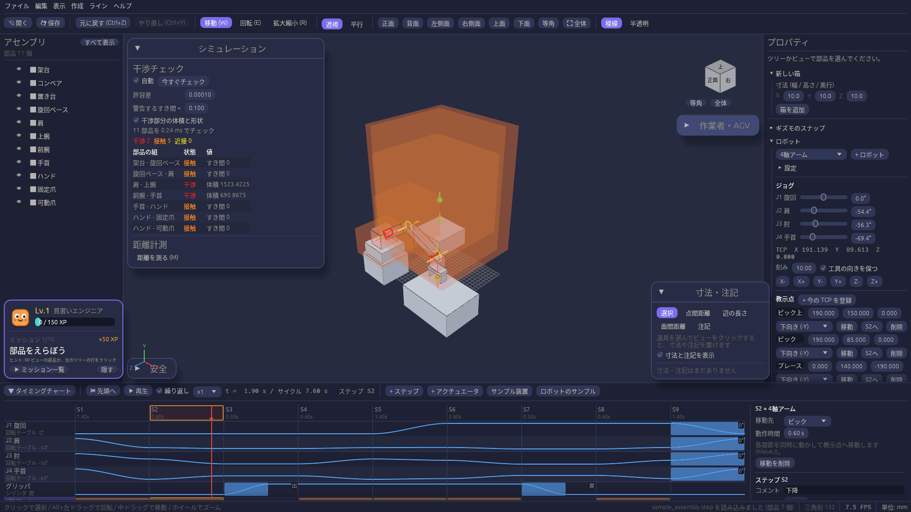
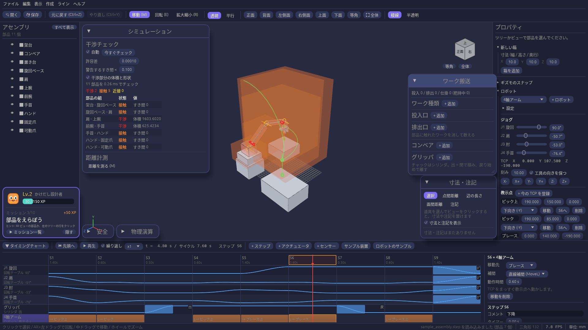
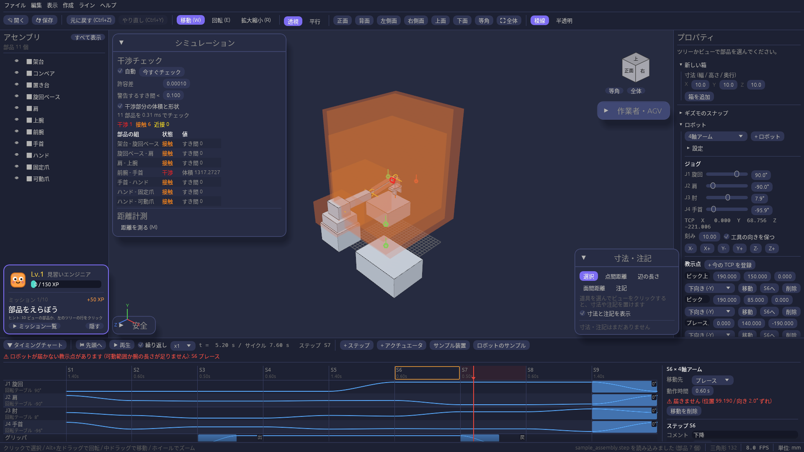

# 関節とロボットの動き

回転テーブルと直動軸を「載せ先」でつなぐと、ロボットアームの関節になります。
教示点(工具の先端 = TCP を持っていきたい位置と、工具の向き)を登録してタイミングチャートのステップに置くと、
各関節をどれだけ動かせばよいかを自動で計算して再生します。

## サンプルで試す

画面下のタイミングチャートの **ロボットのサンプル** を押します(いま開いているモデルは置き換わります)。
旋回・肩・肘・手首の 4 軸アームとグリッパが読み込まれ、▶ 再生でコンベアから置き台へワークを運ぶ動きになります。

## 自分の装置でロボットを作る

1. **関節を作る。** 部品を選んでタイミングチャートの「+ アクチュエータ」から回転テーブル(回転する関節)か直動軸(スライドする関節)にします。
   根元の関節から順に、右側の設定欄の **載せ先** で 1 つ前の関節を選んでつなぎます。
2. **動ける範囲を決める。** 設定欄の **可動範囲** にチェックを入れ、下限と上限を入れます。再生でも自動計算でも、この範囲の外には動きません。
3. **ロボットにする。** 右のプロパティ欄の「ロボット」で **+ ロボット** を押し、先端(手首)の関節を選びます。
   「設定」を開き、TCP(工具の先端)の位置と工具の向きを、全関節が 0 のときの値で入れます。

## 教示点を登録する

1. 「ジョグ」の関節ごとのスライダか、**X- / X+ / Y- / Y+ / Z- / Z+** ボタンで TCP を動かします。
   ボタン 1 回で「刻み」の分だけ動きます。「工具の向きを保つ」にチェックがあると、工具の向きを変えずに動かします。
2. 狙いの位置に来たら **+ 今の TCP を登録** を押します。教示点の名前・座標・工具の向き(下向きなど)はあとから直接直せます。
3. 教示点の **移動** を押すと、その点へ動いて届くかを確かめられます。

### 3D ビューで置く

ワークの上面やコンベアの上など、狙いの面が決まっているときは、3D ビューで直接置けます。

1. 教示点の **+ 3D ビューで置く** を押します。
2. **面から離す** に、面から浮かせたい距離を入れます(0 なら面の上にぴったり)。
3. 3D ビューで部品の面にカーソルを合わせると、置く位置と工具の向きが緑で出ます。クリックすると教示点が 1 つ増えます。

工具は面に向かう向き(上面なら下向き)になります。軸からわずかに傾いた面は、軸の向きにそろえます。置くのをやめるときは Esc か、もう一度ボタンを押します。

スライダやボタンで動かしてもタイミングチャートは変わりません。**チャートの位置に戻す** か、再生・スクラブで元の姿勢に戻ります。

## ステップに置く

1. タイミングチャートでステップを選び、教示点の **S○へ** を押します。チャートの一番下のロボットの行に「→ 教示点の名前」の帯が出ます。
2. ロボットの行のセルをクリックすると、右側で移動先の教示点・**補間**・動作時間を変えられます。セルのダブルクリックでも移動を置けます。
3. 各関節の行に、自動で計算された動きの波形が出ます。原点に戻したいときは、最後のステップで各関節の行に「0」への動作を置きます。

## 関節補間と直線補間

右側の **補間** で、教示点までの動かし方を選びます。

| 補間 | 動き | チャートの表示 |
| --- | --- | --- |
| 関節補間 (MoveJ) | 各関節が同時に動き始めて同時に止まる。TCP の通り道は曲線になる | → 教示点の名前 |
| 直線補間 (MoveL) | TCP が教示点までまっすぐ動く。ワークの真上から下ろすときなどに使う | L→ 教示点の名前 |

大きく動くところは関節補間、ワークに近づく・離れるところは直線補間にするのが基本です。サンプルでは上下の出し入れが直線補間になっています。
3D ビューには TCP の通り道が緑の線で出るので、関節補間と直線補間の違いを見比べられます(下の図では、上下の出し入れがまっすぐな線、旋回が弧になっています)。

## サイクルタイムを見積もる

ロボットの「設定」に、速度の上限を入れます。

| 設定 | 意味 |
| --- | --- |
| 関節の最高速度 | 回転関節が回れる最高の速さ(度/秒) |
| 直線の最高速度 | 直線補間の TCP と直動関節の最高の速さ。チェックを外すと、ロボットの大きさから自動で決めます |
| 加速時間 | 止まった状態から最高速度になるまで(と、止まるまで)の時間 |

プロパティ欄の「ロボット」の **サイクルタイム** に、チャートどおりの時間と、ロボットの移動をすべて最短にしたときの時間が出ます(センサーの条件待ちは含みません)。
ロボットの行のセルを選ぶと、その移動の最短時間が出ます。**最短にする** でその移動だけ、**すべて最短にする** でロボットの移動をすべて最短の動作時間にします。
動作時間が最短より短い(速度の上限を超える)移動は黄色の ⚠ で知らせます。

## MELFA-BASIC VI のプログラムに書き出す

**MELFA-BASIC VI で書き出す…** を押して保存先を選ぶと、三菱電機のロボット言語のプログラム(.prg)ができます。

- 教示点は `P1`, `P2`, … の位置変数になります(名前はコメントに残ります)。位置はロボットの根元(最初の関節の回転中心)を原点、根元の回転軸を +Z とした mm、姿勢 A, B, C は工具の向きから決めた度です。
- 関節補間は `Mov`、直線補間は `Mvs` になります。チャートの動作時間に合わせて、関節補間には `JOvrd`(関節速度の割合)、直線補間には `Spd`(mm/s)を付けます。
- ロボットに載ったシリンダ(グリッパ)は `HClose` / `HOpen`、それ以外のアクチュエータは `M_Out`、センサーの開始条件は `Wait M_In`、待ち時間は `Dly` になります。信号の番号はプログラムの先頭のコメントに書きます。
- 原点復帰のように関節に直接置いた動作は、関節の値の `JS○` 変数への `Mov` になります。

構造フラグ(位置の最後の `(7,0)`)は仮の値です。実機に入れる前に、ロボットの姿勢に合わせて直してください。

## 届かないとき・特異点・干渉

腕の長さや可動範囲が足りない教示点は、チャートのロボットの行とチャート上部に赤い ⚠ が出て、3D ビューの教示点も赤くなります。
右側の設定欄に、どれだけ届かなかったか(距離と向きのずれ)が出ます。
直線補間で、教示点には届いても直線の途中に届かないところがあるときも赤い ⚠ になり、3D ビューの通り道のその部分が赤くなります。

直線補間で、腕が伸び切る姿勢や、TCP が旋回軸の真上に来る姿勢の近く(特異点)を通る移動は、黄色の ⚠ になり、通り道のその部分も黄色になります。
特異点の近くでは、TCP を少し動かすだけで関節が急に大きく回ります。教示点を少しずらすか、そこだけ関節補間にしてください。

プロパティ欄の「ロボット」の **経路の確認** に、問題のある移動の一覧が出ます。クリックするとそのステップを選びます。
**移動中の干渉を調べる** を押すと、ロボットに載った部品(腕やグリッパ)が、ほかの部品に食い込む移動を時刻つきで一覧にします。
腕どうしの重なりは調べません。チャートを変えると結果は消えるので、もう一度押してください。

## 3D ビューの表示

| 色 | 意味 |
| --- | --- |
| 黄 | 回転関節の軸と、直動関節の動く向き |
| 水色 | 関節から TCP までの腕の骨格 |
| オレンジ | TCP と工具の向き |
| 緑 / 赤 | 教示点(赤は届かない点)。線は工具が向かってくる向き |
| 緑の線 | TCP の通り道(黄は特異点の近く、赤は届かないところ) |

## まだできないこと

- つかんだワークを一緒に運ぶこと、4 節リンクのような閉じたリンク機構
