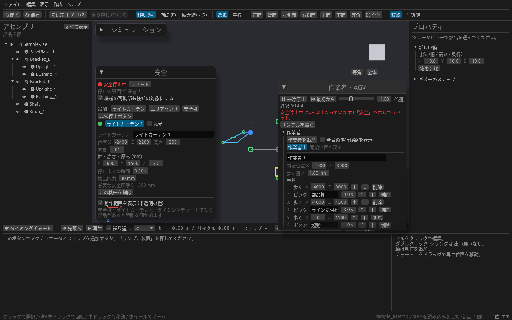
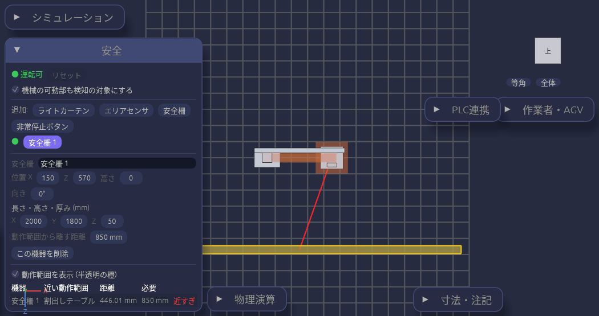

# 安全機器を置いて止まり方を確かめる

ライトカーテン・エリアセンサ・安全柵・非常停止ボタンを置いて、動く部品や作業者、AGV が入ったときにラインが止まるかを確かめられます。
ライトカーテンやエリアセンサには必要な安全距離が出るので、置き場所が危険な部分に近すぎないかも見られます。

## 安全パネル

3D ビューの左下に **安全** パネルがあります。見出しの ▼ で折りたためます。

いちばん上に今の状態が出ます。

| 表示 | 意味 |
| --- | --- |
| ● 運転可(緑) | どの機器も検知していません |
| ● 安全停止中(赤) | どれかの機器が検知したか、非常停止ボタンが押されています。下に停止の原因が出ます |

## 機器を置く

**追加:** の **ライトカーテン**・**エリアセンサ**・**安全柵**・**非常停止ボタン** を押すと、モデルの手前(Z の大きい側)500 mm の床に機器が置かれ、一覧に増えます。
一覧で機器を選ぶと、下の欄で数値を合わせられます。3D ビューでも機器が半透明の箱で表示されます。

| 欄 | 内容 |
| --- | --- |
| 名前 | 一覧や停止の原因に出る名前 |
| 位置 X / Z、高さ | 床の上の位置と、置く高さ(mm) |
| 向き | 上から見た向き(度) |
| 大きさ | ライトカーテンは幅・高さ・厚み、エリアセンサは幅・検知する高さ・奥行き、安全柵は長さ・高さ・厚み |
| 停止までの時間 | ライトカーテンとエリアセンサ。センサの応答時間 + 機械が止まるまでの時間(秒) |
| 検出能力 | ライトカーテン。検知できる最小の物の太さ(指 14 mm、手 30 mm など) |
| 動作範囲から離す距離 | 安全柵。危険な部分から柵までに空けたい距離 |

**この機器を削除** で消せます。

## 必要な安全距離

ライトカーテンとエリアセンサは、**停止までの時間** と検出能力(エリアセンサは検知する高さ)から、検知する面から危険な部分までに必要な距離が **必要な安全距離 S = ○○ mm** と出ます。
人が手を伸ばして検知されてから機械が止まるまでの間に、手が危険な部分へ届かない距離です。止まるまでの時間が長いほど、離して置く必要があります。

## 動作範囲と距離を確かめる

タイミングチャートで動く部品があると、1 サイクルの間に動く範囲が **半透明の橙の箱** で表示されます(**動作範囲を表示** のチェックで切り替え)。

安全柵とライトカーテンは、パネルの表で、いちばん近い動作範囲までの距離と必要な距離を比べられます。

| 列 | 内容 |
| --- | --- |
| 機器 | 安全柵・ライトカーテンの名前 |
| 近い動作範囲 | いちばん近くを動く部品 |
| 距離 | 機器からその動作範囲までの床の上の距離 |
| 必要 | 柵は「動作範囲から離す距離」、ライトカーテンは安全距離 S |

足りないときは「近すぎ」と赤く出て、3D ビューにも赤い線が引かれます。

柵の高さで手が越えて届くかどうかは見ていません。柵の離す距離は、柵の高さと危険な部分の高さに合わせて決めてください。

## 止まり方を試す

タイミングチャートを再生したり、[作業者や AGV](operator-agv.md) を動かしたりして、何かがライトカーテンやエリアセンサの範囲に入ると **安全停止** になります。

- タイミングチャートの再生と AGV がその場で止まり、作業者・AGV パネルにも「安全停止中」と出ます。
- 停止の原因(検知したもの。「作業者 1」「非常停止」など)がパネルに出ます。

止まるかどうかをその場で試すこともできます。

| 機器 | 試し方 |
| --- | --- |
| 非常停止ボタン | 一覧の **押す** で停止、**戻す** で押していない状態に戻します |
| ライトカーテン・エリアセンサ | 一覧の **遮光** にチェックを入れると、検知したことにして止まります |

### 解除する

検知がなくなり、非常停止ボタンを戻してから **リセット** を押すと「運転可」に戻ります。検知が続いているうちはリセットできません。

### 機械の可動部を対象にするか

既定では、タイミングチャートで動く部品も検知の対象です。機械の可動部そのものが検知範囲を通る設計(ワークの出入口にライトカーテンを置く場合など)では、**機械の可動部も検知の対象にする** のチェックを外してください。人(作業者)と AGV だけで止まるようになります。

## 保存

置いた機器はプロジェクト(.cadsim)に保存されます。機器の追加・変更・削除は Ctrl+Z で戻せます(戻すと作業者と AGV の時計は 0 秒に戻ります)。
