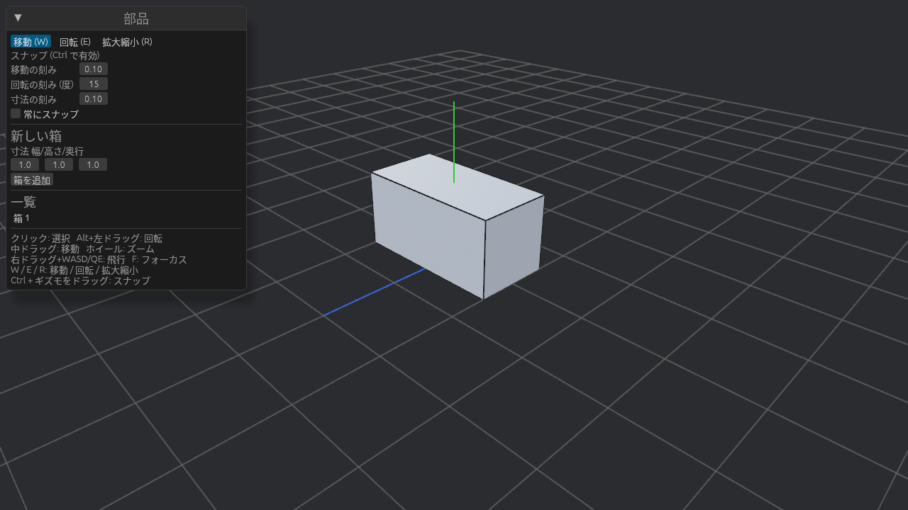

# 画面の見かた

| 場所 | 内容 |
| --- | --- |
| 中央(3D ビュー) | 部品とグリッド(床)が表示されます。部品の輪郭は黒い線で描かれます。 |
| 左上の「部品」パネル | ギズモの切り替え、スナップ設定、箱の追加、部品の一覧、選んだ部品の数値編集をまとめています。 |
| 赤・緑・青の線 | 原点を通る X・Y・Z 軸です(緑の Y が上向き)。 |

## 「部品」パネル

上から順に次の欄があります。

1. **移動 (W) / 回転 (E) / 拡大縮小 (R)**: ギズモの種類を切り替えます([ギズモとスナップ](gizmo.md))。
2. **スナップ**: 移動・回転・寸法の刻み幅と「常にスナップ」。
3. **新しい箱**: 寸法を入れて「箱を追加」。
4. **一覧**: 置いてある部品の名前。クリックで選択します。
5. **選んだ部品の編集欄**: 部品を選んでいるときだけ出ます([箱の作成・選択・編集](parts.md))。

何も選んでいないときは、パネルの下に操作のヒントが表示されます。

パネルの見出し「部品」の左の ▼ を押すと、パネルを折りたためます。3D ビューが狭いときに使ってください。
