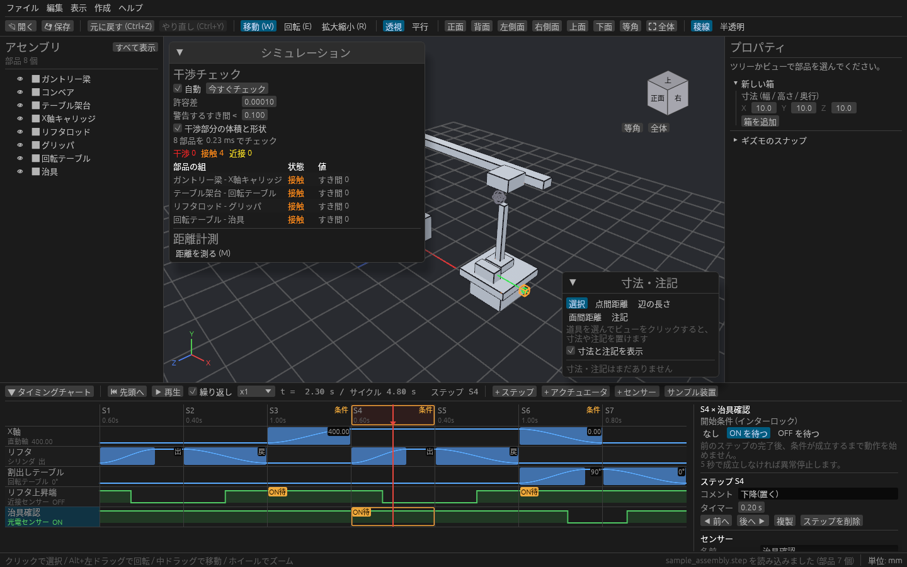
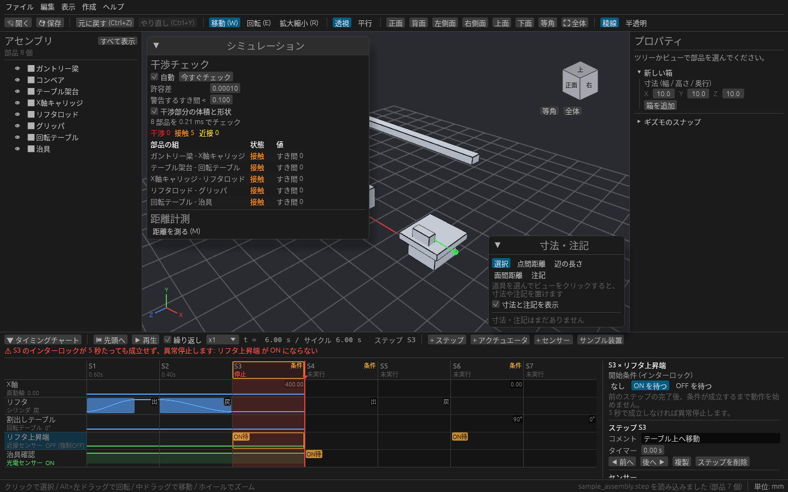

# センサーとインターロック

光電センサーや近接センサーを置き、タイミングチャートのステップに「このセンサーが ON になるまで始めない」という開始条件(インターロック)を付けられます。
センサーが反応しないときに装置が正しく止まるかも、再生して確かめられます。

## まず試す

タイミングチャートの **サンプル装置** には、センサーが 2 つ入っています。

| センサー | 種類 | ON になるとき | 待つステップ |
| --- | --- | --- | --- |
| リフタ上昇端 | 近接 | リフタが上がっている | S5・S9(X 軸の移動) |
| チャック閉確認 | 近接 | チャックの可動爪が閉じている | S4(掴んで上げる)は ON、S8(離して上げる)は OFF を待つ |

▶ で再生すると、チャートの下段にセンサーの ON / OFF が波形で出ます。3D ビューでは、ON のセンサーが緑、OFF の光軸が赤、OFF の検出範囲が灰色で表示されます。

## センサーを置く

1. パネルの **+ センサー** から **光電センサー** か **近接センサー** を選びます。チャートの下段に行が増え、右側に設定欄が出ます。
2. 位置と範囲を決めます。

   | 設定 | 光電センサー | 近接センサー |
   | --- | --- | --- |
   | 位置 X/Y/Z | 投光する位置 | 検出面の中心 |
   | 向き | 光軸を出す方向(X / Y / Z、逆向き) | — |
   | 長さ・距離 | 光軸の長さ。部品が光軸を遮ると ON | 検出距離。この距離以内に部品があると ON |

3. 動く装置に付けるときは **取り付け先** でアクチュエータを選びます。センサーがそのアクチュエータと一緒に動きます。取り付け先が動かす部品自身は検知しません。

## ステップに開始条件を付ける

- センサーの行で、条件を付けたいステップのセルを **ダブルクリック** します。押すたびに **ON待 → OFF待 → なし** と切り替わります。右側の設定欄でも選べます。
- 条件の付いたステップは、見出しに「条件」と出ます。
- 前のステップが終わった時点で条件が成り立っていなければ、成り立つまで待ちます。待っている時間は列の左側に橙色で出て、サイクルタイムに含まれます。

## 止まるかを確かめる

センサーの設定欄の **強制** を **ON** / **OFF** にすると、検知に関係なくセンサーの状態を固定できます。センサーの故障やワークの置き忘れを想定して、装置が止まるかを確かめるときに使います。

条件が **5 秒** たっても成り立たないと異常停止です。チャートの上に赤い警告が出て、止まったステップは「停止」、その後のステップは灰色の「未実行」になり、再生もそこで止まります。

## パネルの操作(センサー)

| 操作 | 内容 |
| --- | --- |
| + センサー | 光電センサー・近接センサーを追加 |
| センサーの行をクリック | センサーを選び、右側で位置・向き・範囲・取り付け先・強制を編集(3D ビューで橙色の枠が付く) |
| センサーのセルをダブルクリック | そのステップの開始条件を ON待 → OFF待 → なし で切り替え |
| ▲ 上へ / ▼ 下へ / センサーを削除 | 行の並べ替え・削除(削除するとそのセンサーの開始条件も外れる) |

センサーと開始条件は、チャートと一緒にプロジェクト(.cadsim)に保存され、Ctrl+Z で戻せます。強制 ON / OFF は動作確認用なので、保存も元に戻す履歴への記録もしません。
