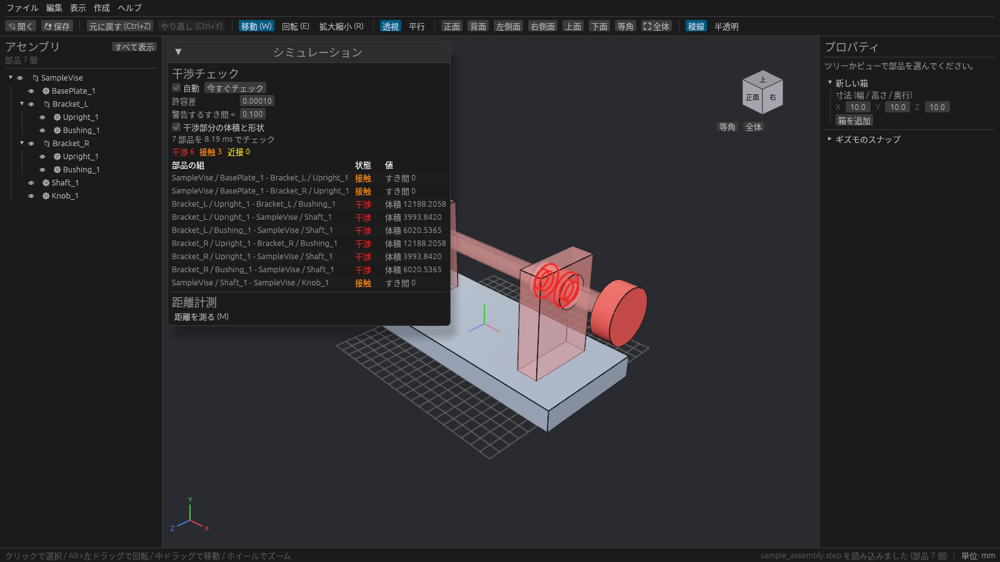
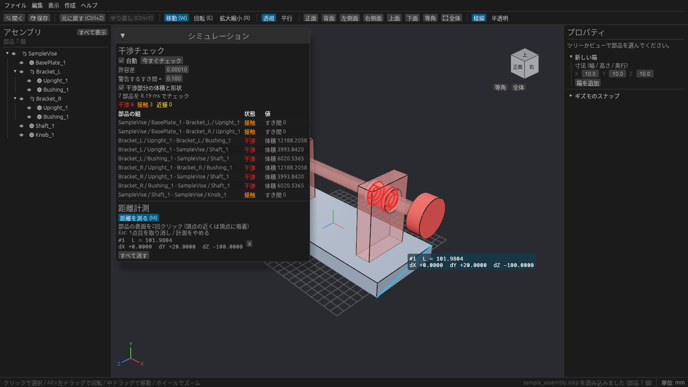

# 干渉チェックと距離計測

ツールレールの **干渉** で開く **干渉チェック・計測** パネルで、部品同士のぶつかりを調べたり、距離を測ったりします。

## 干渉チェック

部品を動かすたびに、表示しているすべての部品の組み合わせを自動で調べ、結果をパネルに一覧します。箱も、STEP などから取り込んだ部品も対象です。

結果は 3 種類です。

| 状態 | 意味 | ビューでの見え方 | パネルの「値」 |
| --- | --- | --- | --- |
| **干渉**(赤) | 部品同士が食い込んでいる | 部品が半透明の赤になり、重なっている部分が濃い赤の立体で出る。食い込んでいる面同士の交線は赤い太線 | 重なっている部分の体積 |
| **接触**(橙) | 面が触れているだけで、食い込んではいない | 橙の線 | すき間 0 |
| **近接**(黄) | すき間が「警告するすき間」より小さい | 黄の線 | すき間の大きさ |

パネル上部の設定:

| 項目 | 内容 |
| --- | --- |
| 自動 | オンのときは部品を動かすたびに調べる。オフにしたら **今すぐチェック** で調べる |
| 許容差 | これより小さい食い込みは「接触」とみなす |
| 警告するすき間 < | この値より近い組を「近接」として出す |
| 干渉部分の体積と形状 | オフにすると、重なり部分の体積と濃い赤の立体を計算しない(部品が多いときに速くなる) |

値の単位は、プロジェクトの長さの単位(mm など)です。部品を動かして食い込みを直すと、一覧からすぐに消えます。

> 調べるのは **表示している部品だけ** です。H キーなどで隠した部品は対象外になります。

## 距離計測

1. パネルの **距離を測る (M)** を押すか、**M** キーを押します。
2. 部品の表面を 2 回クリックします。頂点の近くをクリックすると頂点に吸い付きます。
3. 2 点を結ぶ水色の線と、距離 **L** と各軸方向の差 **dX / dY / dZ** が出ます。パネルにも同じ値が並びます。

続けてクリックすると、次の計測ができます。

| 操作 | 内容 |
| --- | --- |
| Esc | 1 点目を取り消す。もう一度押すと計測をやめる |
| パネルの x | その計測結果を消す |
| すべて消す | 計測結果をすべて消す |
