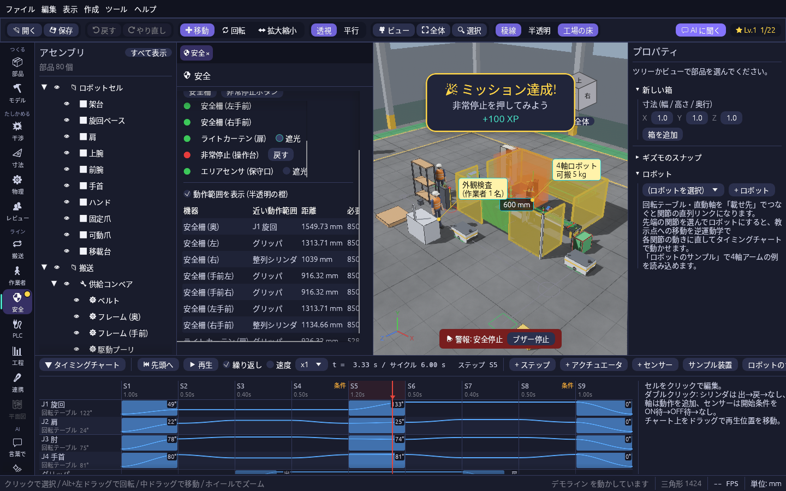
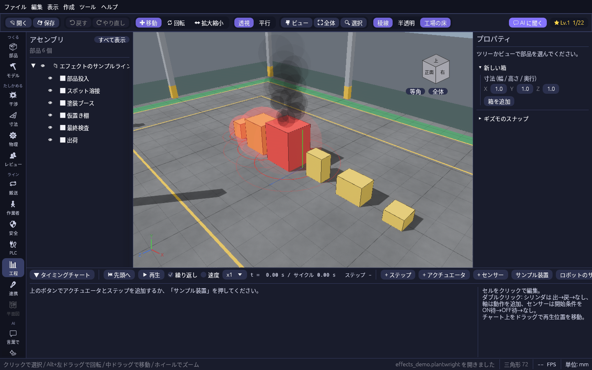

# 設備の音と状態のエフェクト

画面から目を離していても、ライン全体を見渡していても、止まった所や異常に気づけるよう、音と 3D の光・煙・火花で知らせます。

## 設備の音と警報

再生中は設備の音が鳴ります。

- 直動軸はサーボの音、回転テーブルとロボットの関節はモーターの音を、動いている間だけ鳴らします
- エアシリンダは動き始めに「プシュッ」と排気音を鳴らします
- コンベアは、チャートかライン連携を再生している間ベルトの音を鳴らします
- 安全停止とインターロック停止では警報を鳴らし続け、3D ビューの下に赤い帯で理由を出します。帯の **ブザー停止** で音だけ止められ、別の異常が起きるとまた鳴ります
- 再生中に干渉が起きると「ピピッ」と鳴ります

音は 3D ビューで見ている位置から聞こえます。近くの設備ほど大きく、右にある設備は右から聞こえるので、拡大した場所の音を聞き分けられます。一人称で歩いているときは、歩いている人の耳で聞こえます。

「表示 → 音を出す」で音を消せます。「表示 → 音の設定…」で、全体の音量と、稼働音・排気音・警報それぞれの音量を変えられます。設定はアプリを閉じても残ります。

## 状態のエフェクト

工程シミュレーションやライン連携を回している間、設備の状態が 3D ビューの光・煙・火花で出ます。

| 状態 | 見え方 |
| --- | --- |
| 詰まり | 設備が赤く脈打って光り、床に赤い波紋が広がる |
| 故障 | 赤い光と波紋に加えて、黒い煙が昇る |
| 人待ち | 黄色い光がゆっくり点滅する |
| 溶接中 | 名前に「溶接」を含む工程が加工している間、青白い光がちらつき火花が散る |
| 安全停止 | 止めた安全機器の上で赤い光が速く点滅する(リセットするまで) |
| 干渉 | タイミングチャートを再生している間、ぶつかっている所に火花が出る |

試すときは「ファイル → 開く」で `samples/effects_demo.plantwright` を開き、ツールレールの **工程** で ▶ 実行 を押してください。溶接の火花、塗装ブースの故障の煙、その上流の詰まりが順に出ます。

工程に 3D の部品を結び付けておく(「+ 選択中の部品を工程に」)と、その部品のまわりに出ます。
「表示 → 状態のエフェクト」で、まとめてオン・オフしたり、光・煙・火花を別々に切ったりできます。
