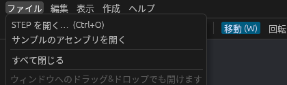

# STEP ファイルを開く

設備メーカーなどからもらった STEP ファイル(`.step` / `.stp`、AP203 / AP214 / AP242)を読み込めます。

## 開きかた

次のどれでも開けます。

- メニューの **ファイル → 開く…** か、ツールバーの **開く**(**Ctrl + O**)
- STEP ファイルをウィンドウに **ドラッグ&ドロップ**
- 起動時に指定: `cargo run --release -- 部品.step`

読み込みは裏で進むので、大きなファイルでも画面は止まりません。読み込み中はステータスバーに「読み込み中: ファイル名」と出て、終わると「○○ を読み込みました(部品 N 個)」に変わります。

STEP は今のプロジェクトに **取り込まれ**(追加され)ます。入れ替えたいときは先に **ファイル → すべて閉じる** か **新規プロジェクト**(**Ctrl + N**)を選んでください。

同じ方法で glTF / GLB・OBJ・STL・OpenUSD も取り込めます([glTF・OBJ・STL・USD の読み書き](interchange.md))。`.cadsim` を開くとプロジェクトそのものが開き直されます([プロジェクトの保存と読み込み](project.md))。

SOLIDWORKS や CATIA などのファイルは直接開けないので、CAD で STEP に書き出してください([各 CAD から STEP を書き出す](step-export.md))。

## 読み込まれるもの

- 製品の構成(アセンブリ → サブアセンブリ → 部品)と、それぞれの配置
- 部品の色
- 長さの単位(mm / cm / m / inch)

同じ部品を何個使っていても、形状は 1 回だけ作るので、部品数の多いアセンブリでも軽く表示できます。

読めなかった形状は飛ばして、その件数をステータスバーに出します。

## サンプル

**ファイル → サンプルのアセンブリを取り込む** で、箱と円柱だけでできた万力風のアセンブリが開きます。操作を試すときに使ってください。
