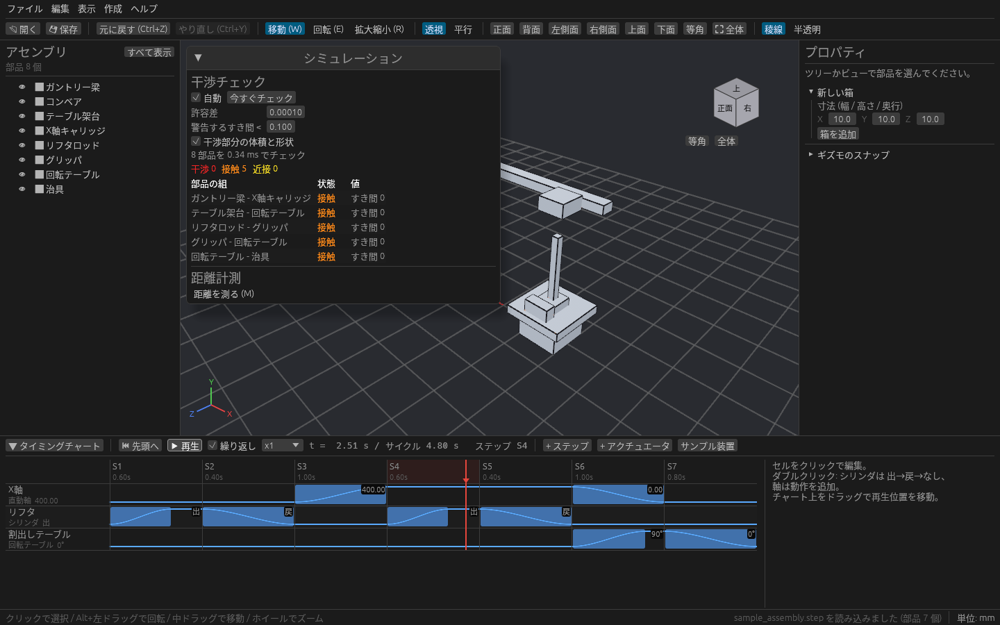
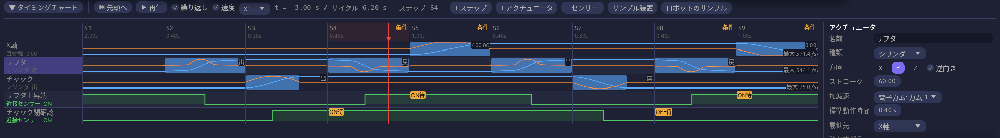

# タイミングチャートと動作シミュレーション

画面下の **タイミングチャート** パネルで装置の動きを組み、3D ビューで再生できます。再生中も干渉チェックは各時刻の位置で動くので、動かしたときにぶつかるところを確かめられます。

## まず試す

パネルの **サンプル装置** を押すと、供給コンベア → ガントリーのピック & プレース → 排出コンベアの装置が読み込まれます。▶ を押すと動き出します。

> サンプル装置を読み込むと、いま開いているモデルは置き換わります。必要なら先に保存してください。

## 動きを組む

1. **アクチュエータを割り当てる。** ツリーかビューで部品やアセンブリを選び、「選択中の〜を追加」で次のどれかにします。アセンブリなら中の部品がまとめて動きます。

   | 種類 | 動き | 主な設定 |
   | --- | --- | --- |
   | シリンダ | 出 / 戻 の 2 位置 | 方向、ストローク |
   | 直動軸 | 指定した移動量だけ動く | 方向、加減速 |
   | 回転テーブル | 指定した角度だけ回る | 回転中心、加減速 |

   **載せ先** で別のアクチュエータに載せると、親と一緒に動きます(例: X 軸に載った上下シリンダ)。

2. **ステップを並べる。** S1, S2, … の列に動作を置きます。同じステップの動作は同時に始まり、すべて終わってタイマーが過ぎると次のステップへ進みます。サイクルタイムは自動で計算されます。

3. **再生する。** ▶ で再生し、チャート上をドラッグすると好きな時刻を表示できます。最後に原点へ戻っていないと、チャート上部に警告が出ます。

## パネルの操作

| 操作 | 内容 |
| --- | --- |
| ▼ タイミングチャート | パネルを畳む / 開く。パネルの上端をドラッグで高さを変える |
| ▶ 再生 / ⏸ 一時停止 / ⏮ 先頭へ | 「繰り返し」でループ、x0.1〜x2 で速度を変える |
| 速度 | 各行に速度のグラフ(オレンジ)を重ね、行の右下に最高速度を出す |
| ステップ見出しをクリック | そのステップを選び、開始時刻へ移動 |
| セルをクリック | ステップ × アクチュエータを選び、右側で目標値・動作時間を編集 |
| セルをダブルクリック | シリンダは 出 → 戻 → なし を切り替え、軸は動作を追加 |
| + ステップ / + アクチュエータ | ステップ(選択中の次)・アクチュエータを追加 |
| 右側の設定欄 | ステップのコメント・タイマー・並べ替え・複製・削除、アクチュエータの方向・ストローク・回転中心・加減速・載せ先 |

センサーを置いてステップに開始条件を付ける方法は [センサーとインターロック](sensors.md)、ワークをコンベアで流してチャックで運ぶ方法は [ワーク搬送](conveyor.md) を見てください。

> 再生位置が先頭以外のときは、ギズモでの編集が止まります。部品を動かすときは ⏮ 先頭へ で戻してください。

## 加減速と電子カム

アクチュエータの行の名前をクリックし、右側の設定欄の **加減速** で動き方を選びます。

| 加減速 | 動き方 |
| --- | --- |
| S字加減速 | なめらかに動き出して止まる(新しいアクチュエータの標準) |
| 台形加減速 | 一定の加速度で加速 → 一定速度 → 一定の減速度で止まる。**加速の割合** で、動作時間のうち加速(と減速)にかける時間を決める |
| サイクロイド | 加速度が 0 から始まり 0 で終わる。動き出しと止まり際の衝撃が小さいカム曲線 |
| 等速 | 最初から最後まで同じ速さ |
| 電子カム | 自分で作ったカム表の曲線で動く |

設定欄の下の **動きのパターン** に、選んだ加減速の位置(青)と速度(オレンジ)のグラフと、最高速度が平均の何倍かが出ます。
チャートの上の **速度** にチェックを入れると、チャートの各行にも速度のグラフが重なり、行の右下に最高速度が出ます。

### 電子カム表を作る

1. 設定欄の **+ 電子カム表を作る** を押すと、新しいカム表ができて、このアクチュエータの加減速になります。
2. 点ごとに **時間**(動作時間に対する %)と **位置**(移動量に対する %)を入れます。始め(0 %, 0 %)と終わり(100 %, 100 %)は書かなくても通ります。
3. **+ 点を追加** で、いちばん間の空いたところに点が増えます。✕ で点を消せます。

点と点の間は、行き過ぎないなめらかな曲線でつながります。同じ位置の点を 2 つ並べると、その間は止まります(停留)。
カム表はほかのアクチュエータの加減速でも選べます。**カム表を削除** すると、使っていたアクチュエータは S字加減速に戻ります。

## 保存と元に戻す

組んだチャート(アクチュエータ・センサー・ステップ・インターロック・電子カム表)はプロジェクト(.cadsim)に保存されます。再生位置とセンサーの強制 ON / OFF は保存されません。

チャートの編集は Ctrl+Z で戻せます。数値欄のドラッグや名前の入力は、マウスを離す・入力欄から抜けるまでを 1 回として扱います。**サンプル装置** の読み込みも戻せます(部品の入れ替えとチャートの入れ替えで 2 回に分かれます)。
