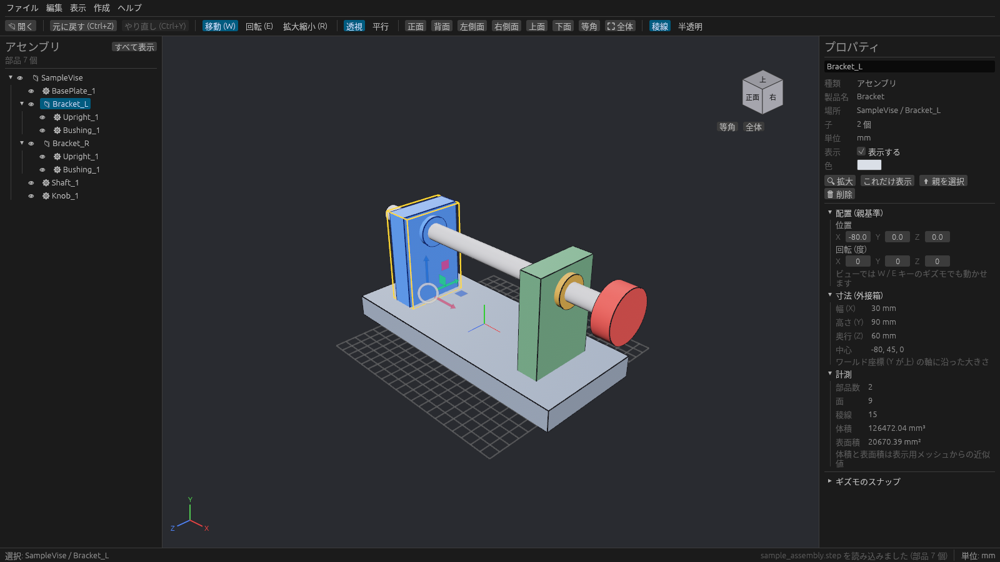
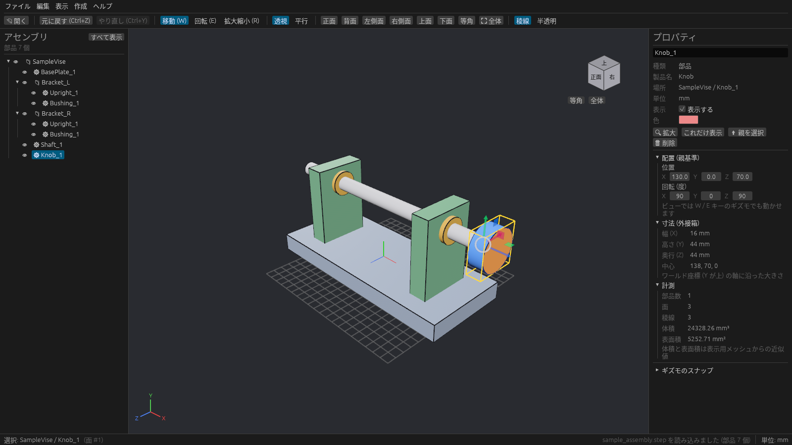
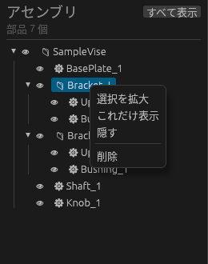

# アセンブリツリーと選択

左の **アセンブリ** パネルに、読み込んだ部品が親子関係のまま並びます。上に全体の部品数が出ます。

| アイコン | 種類 |
| --- | --- |
| 📁 | アセンブリ(部品のまとまり) |
| ⚙ | STEP から読み込んだ部品 |
| ⬛ | plantwright で作った箱 |

## 選択する

- ツリーの行をクリックするか、3D ビューで部品をクリックします。
- アセンブリを選ぶと、その中の部品がすべて青くなり、全体を囲む黄色い枠(外接箱)が出ます。
- ビューで部品をクリックすると、クリックした面がオレンジになり、ツリーがその行まで自動で開きます。
- ツリーの行にカーソルを乗せると、ビューでその部品が水色に光ります。どれがどの部品かを探すときに便利です。
- 何もないところをクリックするか **Esc** で選択を外します。

| アセンブリ(Bracket_L)を選択 | 部品(Knob_1)をクリック |
| --- | --- |
|  |  |

選んだ部品の親を選びたいときは、プロパティの **親を選択** を押します。

## 表示 / 非表示

- 行の左の目のマーク(👁)を押すと、その部品やアセンブリを隠します。もう一度押すと表示します。
- 選んで **H** でも隠せます。**Alt + H** かツリー上の **すべて表示** で全部表示に戻ります。
- 親が隠れている部品は、ツリーで薄く表示されます。

## 右クリックメニュー

ツリーの行を右クリックすると次のメニューが出ます(3D ビューで部品を右クリックしても、同じ項目に「親を選択」「穴をあける」を足したメニューが出ます)。

| 項目 | 内容 |
| --- | --- |
| 選択を拡大 | その部品が画面いっぱいになるようにカメラを寄せる(行をダブルクリックしても同じ) |
| これだけ表示 | その部品だけを残してほかを隠す |
| 隠す / 表示する | 表示を切り替える |
| 削除 | 部品やアセンブリを消す(**Ctrl + Z** で戻せます) |
