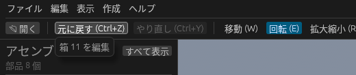

# 元に戻す・やり直し

| 操作 | キー | ほかの方法 |
| --- | --- | --- |
| 元に戻す | **Ctrl + Z** | ツールバーの **元に戻す**、メニューの **編集 → 元に戻す** |
| やり直し | **Ctrl + Y** / **Ctrl + Shift + Z** | ツールバーの **やり直し**、メニューの **編集 → やり直し** |

ツールバーのボタンにカーソルを乗せると、何が戻るか(やり直されるか)が出ます。

## 戻せる操作

- 箱の追加、STEP などの取り込み
- 削除(Delete キー・ツリー・プロパティ)、すべて閉じる
- ギズモでの移動・回転・拡大縮小
- プロパティでの寸法・位置・回転・名前・色の変更
- 寸法・注記の追加・削除・文字の編集
- タイミングチャートの編集(アクチュエータ・ステップ・動作の追加・削除・値の変更)、**サンプル装置** の読み込み
- 工程モデルの編集(工程の追加・削除・つなぎ方・時間などの値)
- 安全機器・作業者・AGV の配置と設定の変更
- 平面図・点群の読み込み・削除・配置の変更(縮尺合わせを含む)
- 部品の物理の設定、ケーブル・ホースの追加・削除・設定の変更、物理演算の **サンプルライン** の読み込み

部品の表示 / 非表示、選択、カメラの動きは見た目だけの操作なので、履歴には入りません。

ギズモや数値欄のドラッグは、マウスを離すまでを 1 回の操作として扱います。数値や名前を打ち込んだときは、入力欄から抜けた時点で 1 回です。

安全機器・作業者・AGV の編集を戻すと、作業者と AGV の時計は最初(0 秒)に戻ります。工程モデルの編集を戻すと、回した結果は消えるので、もう一度 **実行** してください。

元に戻したあとに新しく編集すると、やり直しの履歴は消えます。履歴は最大 200 件までです。

**新規プロジェクト** や **プロジェクトを開く** をすると、履歴は消えます(前のプロジェクトには戻せません)。**すべて閉じる** は元に戻せます。
