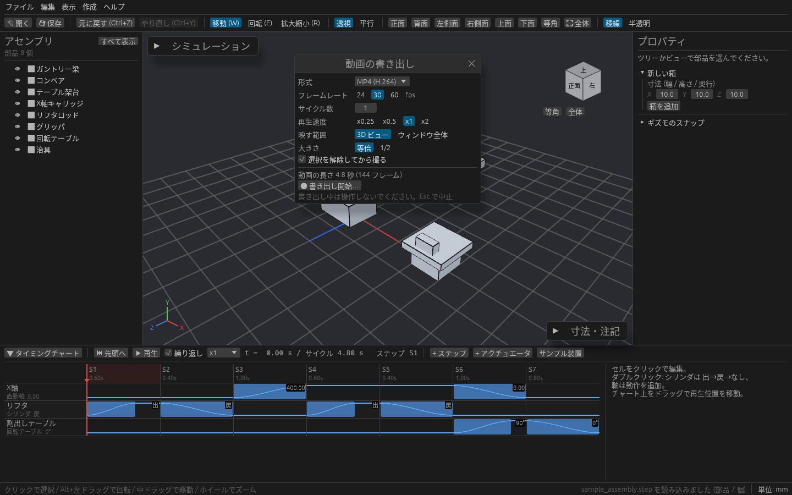
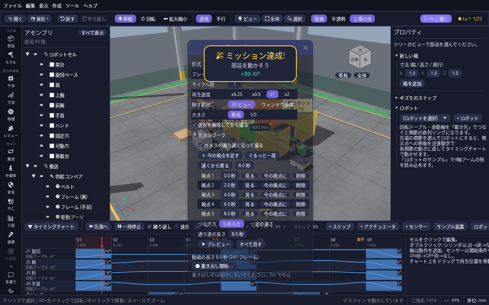

# 動きを動画にする

タイミングチャートの動きを動画ファイルにして、打ち合わせの資料やチャットに貼れます。ffmpeg などを別に入れる必要はありません。

## 書き出す

1. メニューの **ファイル → 書き出し → シミュレーションを動画で書き出し…** を開きます。
2. 下の表の設定を選びます。
3. **書き出し開始…** を押して保存先を選ぶと、1 コマずつ撮っていきます。進み具合はウィンドウのタイトルに出ます。

書き出している間は操作しないでください。**Esc** で中止できます。

| 設定 | 内容 |
| --- | --- |
| 形式 | **MP4**(PowerPoint や Teams でそのまま再生できる)、**GIF**(256 色、どこにでも貼れる)、**PNG 連番**(フォルダに 1 コマ 1 枚) |
| フレームレート | 1 秒あたりのコマ数 |
| サイクル数 / 再生速度 | 何サイクル分を撮るか。x0.25・x0.5 にするとスローモーションになります |
| 映す範囲 | **3D ビュー**(パネルを除く)か **ウィンドウ全体**(タイミングチャートも入る) |
| 大きさ | 等倍か 1/2。GIF は 1/2 にするとファイルが小さくなります |
| 選択を解除してから撮る | 選んでいる部品の強調表示を消してから撮ります |

## カメラワークを付けて紹介動画を撮る

カメラの通り道を決めておくと、カメラが装置のまわりを動きながら撮った紹介動画を自動で作れます。動きのないレイアウトだけのプロジェクトでも撮れます。

1. **動画の書き出し** ウィンドウの **カメラワーク** を押して開きます。
2. 3D ビューで見せたい角度にして **＋ 今の視点を足す** を押します。視点を変えては足す、をくり返すと、3 秒おきに視点が並びます。自動で作るなら **ぐるっと一周**(今の注視点のまわりを一周)か **遠くから寄る**(見下ろしから今の視点まで寄る)を押します。
3. 視点ごとの秒数を変えたり、**見る** でその視点に戻ったり、**今の視点に** で置き換えたり、**削除** で消したりできます。**通り道の長さ** を変えると全体が伸び縮みします。
4. **▶ プレビュー** で、カメラが通り道どおりに動くのを確かめます(**Esc** で止まります)。ウィンドウを開いている間は、通り道が 3D ビューにオレンジの線で出ます。
5. **カメラの通り道に沿って撮る** にチェックを入れて **書き出し開始…** を押します。動画は通り道の終わりまで撮り、タイミングチャートの動きは同じ時間だけくり返します。

| 設定 | 内容 |
| --- | --- |
| つなぎ方 | **なめらか**(曲線でつなぎ、最初と最後はゆっくり動き出して止まる)か **一定の速さ** |
| 秒(自動で作る) | **ぐるっと一周** と **遠くから寄る** で作る通り道の長さ |

カメラワークはプロジェクトに保存され、**Ctrl+Z** で元に戻せます。

## うまく撮るには

- 撮る前に、カメラの向きと拡大を決めておきます。書き出し中もその向きのまま撮ります。
- PC が遅くてもコマ落ちしません。同じ設定なら毎回同じ動画になります。
- 動きを止めずに見せたいときは MP4、メールや資料にそのまま貼りたいときは GIF が向いています。
