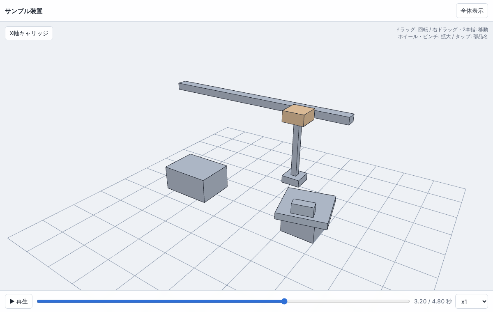
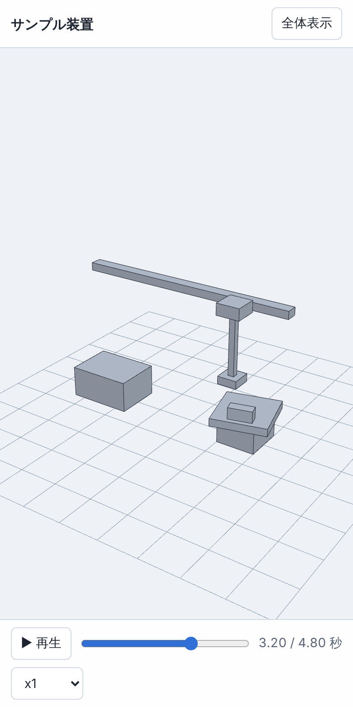

# ブラウザ・スマホ・VR で見る

plantwright を入れていない人にも、設備の形と動きを見てもらえます。モデルとアニメーションを1つの HTML ファイルにまとめて書き出し、ブラウザで開くだけで回したり再生したりできます。VR ヘッドセットなら実寸で設備の間を歩けます。

## HTML に書き出す

1. **ファイル → 書き出し → すべてを書き出し…**(一部だけなら **選択を書き出し…**)を選びます。
2. 保存ダイアログで種類を **Web ビューア (.html)** にするか、ファイル名の拡張子を `.html` にして保存します。

できたファイルは1つだけです。メールやチャットに添付したり、共有フォルダに置いたりして渡してください。インターネットにつながっていなくても開けます。
タイミングチャートを組んであれば、その1サイクルの動きが「動作シミュレーション」として入ります。

## 見かた

| 操作(PC) | 操作(スマホ・タブレット) | 内容 |
| --- | --- | --- |
| 左ドラッグ | 1本指でドラッグ | 回転 |
| 右ドラッグ / Shift + ドラッグ | 2本指でドラッグ | 平行移動 |
| ホイール | ピンチ | 拡大・縮小 |
| クリック | タップ | 部品を選んで、名前とアセンブリの経路を左上に表示 |
| ダブルクリック / **全体表示** | **全体表示** | 全体が見える向きに戻す |

アニメーションがあると下に再生バーが出ます。▶ / ⏸ で再生と停止、つまみで好きな時刻へ移動、x0.25〜x2 で速度を変えられます。アニメーションが複数あるときは一覧から選びます。

## VR で実寸で見る

VR に対応したブラウザ(Meta Quest のブラウザや、PC につないだヘッドセットで使う Chrome / Edge)で開くと、右上に **VR で見る** が出ます。

- 押すとモデルが実寸(1 m = 1 m)で床の上に置かれ、手前の端が 1 m 先に来ます。
- **左スティック**: 見ている方向を前にして歩く
- **右スティック**: 左右に倒すと 30° ずつ向きを変える
- 再生中のアニメーションは VR の中でも動き続けます。

AR に対応した端末では **AR で置く** も出て、カメラの映像の上に実寸で置けます。

### plantwright から直接 VR で見る

**ファイル → 書き出し → ブラウザ / VR で見る** を押すと、いまのモデル全体を書き出して既定のブラウザで開きます。PC VR のヘッドセットで見るときは、開いたページの **VR で見る** を押してください。

### VR のボタンが出ないとき

- ブラウザが WebXR に対応しているか確かめてください(Quest のブラウザ、Windows の Chrome / Edge は対応しています)。
- `http://` のサイトに置いたファイルでは使えません。ファイルを直接開くか、`https://` のサイトに置いてください。
